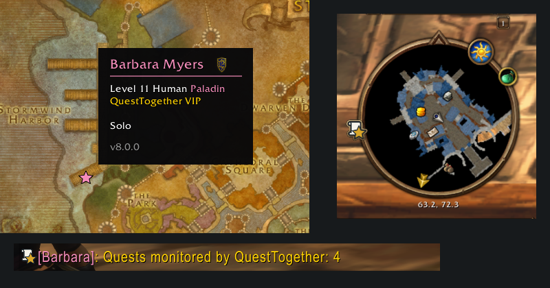
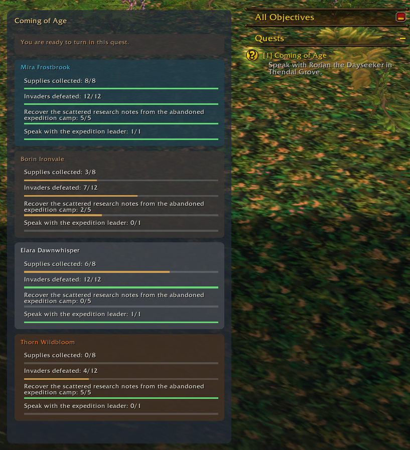
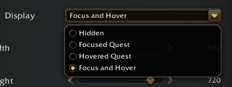
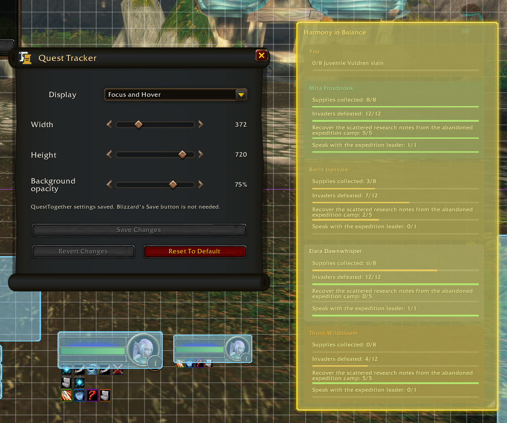
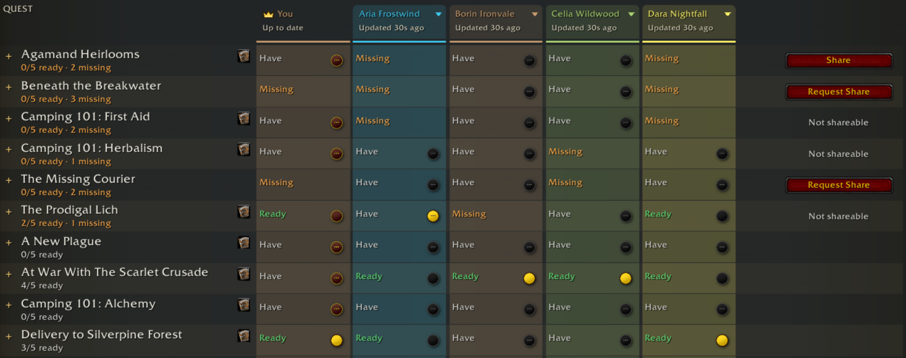
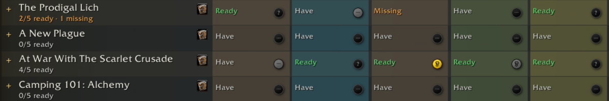
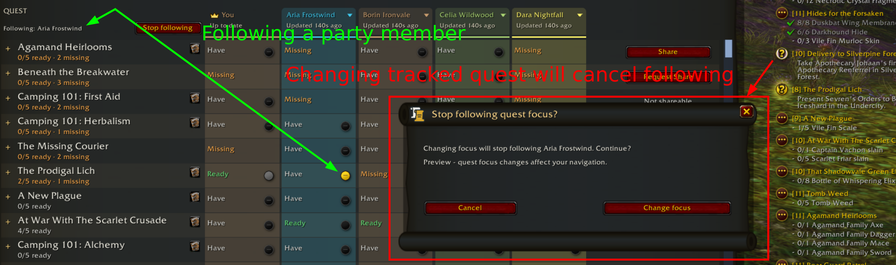
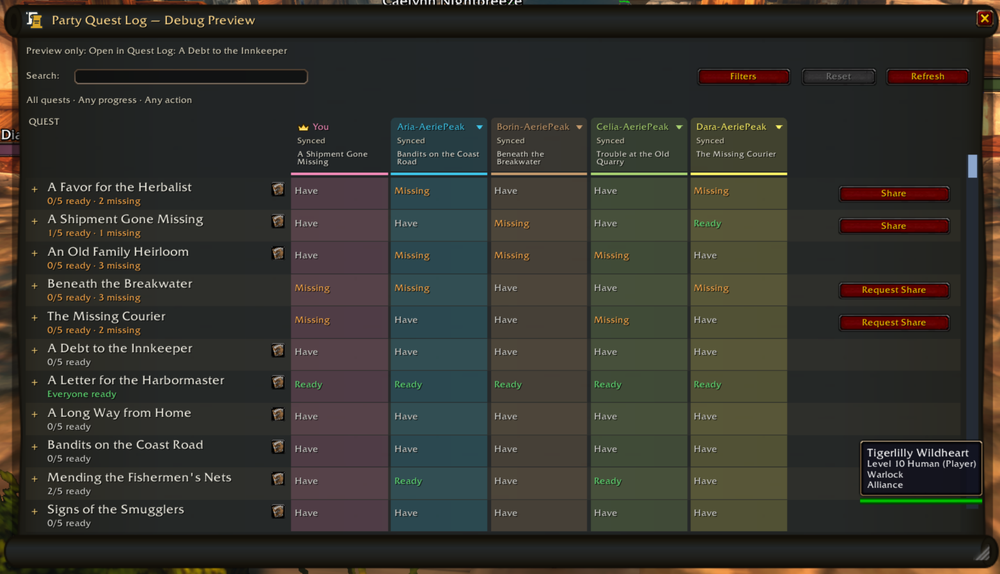
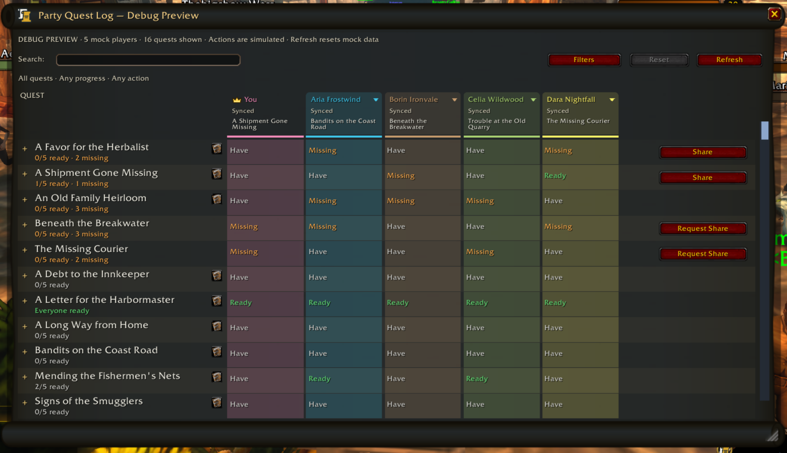
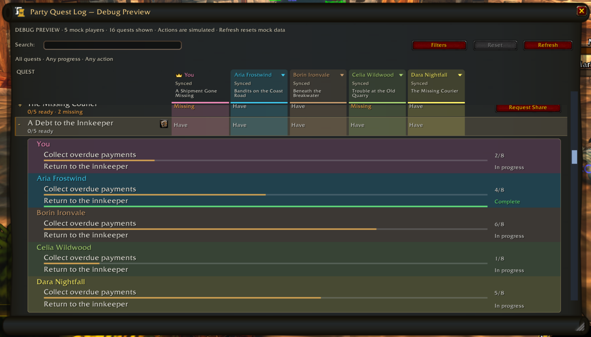

# QuestTogether — Registro de alterações

<!-- Generated from canonical release notes; do not edit by hand. -->

## 9.0.9

Este patch corrige avisos indevidos no bate-papo e melhora a busca por outros jogadores.

### Busca de jogadores e avisos no bate-papo

- Corrigimos mais uma situação em que erros de sussurros enviados pelo QT em segundo plano apareciam no bate-papo. Os avisos de falha dos sussurros que você envia continuam visíveis.
- O tempo de espera antes de tentar falar novamente com um jogador inacessível agora é mantido ao mudar de zona ou recarregar a interface. Informações antigas não provocam mais tentativas sem parar, e conexões que funcionam são mantidas até que uma substituta responda.
- O QT pausa as solicitações em segundo plano quando não consegue ocultar seus erros com segurança. O diagnóstico agora diferencia os avisos realmente ocultos daqueles que podem ser de sussurros enviados por você.

## 9.0.8

Este patch corrige um erro no carregamento dos dados do grupo.

### Correções

- Corrigido um problema introduzido na versão 9.0.7 que podia causar um erro e impedir o carregamento dos dados de missões ao formar grupo com outro usuário do QuestTogether. Os dados do grupo voltam a carregar sem esse erro.

## 9.0.7

Mais correções na comunicação em segundo plano, na indicação de fases e no comportamento do minimapa e dos perfis.

### Comunicação

- Corrigidos mais casos de avisos de jogador não encontrado causados pelos sussurros internos do QT, inclusive avisos atrasados após trocar de área ou desativar e reativar o addon. Os avisos de erro dos seus sussurros normais continuam aparecendo.
- Quando WoW informa que um jogador está offline, o QT interrompe os envios pendentes e espera antes de tentar novamente. Diferenças de maiúsculas no mesmo nome completo não provocam mais novas tentativas antes da hora.
- /qt diagnostics traz mais informações para investigar esses avisos. Os novos contadores não incluem nomes de jogadores nem conteúdo de mensagens.

### Mapas e perfis

- Com Detectar camadas diferentes ativado, o QT prioriza as informações de fase do WoW. A dica diferencia Fase diferente da estimativa Provavelmente em outra camada (experimental). Não ver ou não conseguir selecionar um jogador, por si só, não indica outra fase.
- A área de seleção de jogadores no minimapa acompanha o marcador ou menu, deixando de interceptar cliques destinados às janelas que estão por cima.
- Ao trocar de perfil, comparações de missões pendentes e anúncios traduzidos ainda em espera do perfil anterior são descartados, sem aparecer nem alterar o novo perfil.

## 9.0.6

Os ícones de VIP e do desenvolvedor agora estão na legenda do mapa.

### Legenda do mapa

- Passe o cursor sobre o botão do QT no mapa-múndi para ver a estrela de VIP e a engrenagem do desenvolvedor na legenda, acompanhadas dos respectivos logotipos do QT.

## 9.0.5

Escolha quando ver as informações do QT nas dicas de jogadores e tenha menos avisos de erro dos sussurros internos.

### Visibilidade das dicas de jogadores

- Em Placas de Nome dos Jogadores > Dicas de jogadores > Dica do QuestTogether, a opção padrão é Ocultar para amigos. Você também pode escolher Mostrar para todos, Ocultar para membros do grupo, Ocultar para amigos e membros do grupo ou Ocultar para todos.
- A opção controla toda a seção do QT abaixo da dica do WoW: logotipo e identificação, status Procurando parceiros de missão e notas privadas. Essa seção fica sempre oculta no seu próprio personagem. As notas salvas e as preferências de compartilhamento permanecem como estão.

### Avisos de sussurros

- Corrigidos vários casos de avisos de jogador não encontrado causados pelos sussurros internos do QT, inclusive avisos atrasados ou recebidos após uma resposta. Quando a origem é incerta, o aviso continua visível para não esconder erros dos seus sussurros normais.

## 9.0.4

Esta atualização agiliza a descoberta de jogadores e melhora a exibição de versões no mapa.

### Descoberta de jogadores e comunicação

- A busca por outros jogadores fica mais rápida quando há poucas conexões e capacidade disponível. Também foram corrigidas falhas no estabelecimento das primeiras conexões.
- Versões compatíveis evitam enviar a mesma informação pública várias vezes e podem fornecer dados verificados ainda válidos a quem começa a recebê-los. Envios pendentes e retransmissões também se recuperam com mais confiabilidade.
- Os dados do grupo e as comunicações privadas mantêm a prioridade, sem aumentar os limites totais de envio. Suas preferências de compartilhamento, a verificação da origem dos dados e os pedidos para deixar de compartilhá-los continuam sendo respeitados.
- A compatibilidade com versões anteriores da série 9.0 foi mantida. Os benefícios aumentam conforme os jogadores atualizam. A descoberta continua sendo gradual, sem garantir que todos os jogadores apareçam.

### Versões nas dicas do mapa

- As atualizações públicas de localização e as conexões confirmadas agora informam a versão do QuestTogether. Isso reduz os casos em que a dica de um jogador no mapa fica sem versão enquanto os demais dados ainda não chegaram.
- Ao recarregar a interface, as localizações salvas mantêm a informação de versão enquanto ela ainda estiver válida. Dados recebidos com atraso não fazem uma versão antiga parecer recente novamente.

## 9.0.3

Esta atualização melhora as conexões entre jogadores, salva a escolha do lembrete do grupo com mais segurança e ajusta a abertura do mapa.

### Encontrar e conectar jogadores

- O QT agora também usa a lista de amigos do personagem, personagens de WoW compatíveis de amigos do Battle.net, remetentes do chat e jogadores aliados visíveis para encontrar conexões. Só amigos online são considerados, e suas opções de localização continuam valendo.
- As novas descobertas não deixam mais os contatos anteriores esperando indefinidamente por outra tentativa. A falta de espaço nas suas conexões também não atrasa a próxima tentativa como se o outro jogador estivesse inacessível.
- Pedidos a jogadores com conexões lotadas podem aguardar e tentar novamente quando houver espaço ou uma troca de conexões. Ambos devem atualizar o addon; os limites continuam valendo e a conexão pode demorar.
- Os diagnósticos diferenciam conexões lotadas, falta de espaço local, falhas de envio, jogadores indisponíveis e tempo esgotado.

### Lembrete do chat do grupo

- Marcar “Não me lembrar novamente” e clicar em “Manter ativado” agora salva a preferência mesmo que o QT reconheça um membro durante o clique, evitando que a entrada de outro membro reabra o lembrete.
- A caixa “Não me lembrar novamente” permanece marcada quando a lista de membros é atualizada no mesmo lembrete aberto.

### Abertura do mapa

- Ajustamos a navegação no mapa e no registro de missões para reduzir erros de ação bloqueada que podem aparecer ao abrir o mapa em combate mais tarde.

## 9.0.2

Esta atualização corrige as respostas às consultas gerais de /qt ping e mantém suas escolhas sobre o compartilhamento de diagnósticos.

### Diagnóstico por ping

- Corrigido um problema que impedia jogadores com o compartilhamento de diagnósticos ativado de responder às consultas gerais de /qt ping.
- Mesmo com o compartilhamento desativado, os jogadores podem encaminhar essas consultas verificadas sem responder. Se você desativar o compartilhamento durante a verificação de uma consulta, sua resposta será cancelada, mesmo que você o reative depois.
- Os jogadores que respondem também precisam atualizar para a versão 9.0.2. Não basta atualizar o QT apenas no cliente do desenvolvedor que executa o comando.

## 9.0.1

Esta atualização reduz erros de bate-papo em segundo plano e corrige dicas de missão e avisos de compartilhamento.

### Comunicação em segundo plano

- QuestTogether oculta avisos de jogador não encontrado quando consegue associá-los aos próprios sussurros em segundo plano. Os envios pendentes para esse jogador são cancelados e novas tentativas ficam pausadas por um breve período. As últimas informações de missão conhecidas são mantidas, e as falhas continuam registradas nos diagnósticos.
- Avisos que também possam ter sido causados por um sussurro seu continuam visíveis.

### Dicas de missão

- “Ocultar a dica de missão da Blizzard” agora fica ativado por padrão em perfis novos e ao redefinir a posição e os ajustes do rastreador. Suas escolhas anteriores são preservadas.
- A dica da Blizzard só é ocultada enquanto o rastreador de objetivos do grupo está visível e mostra a mesma missão sob o cursor. Isso não ocorre com o rastreador oculto, no modo de edição ou com outras dicas.

### Compartilhamento de missões

- Corrigido o recebimento, pelo QuestTogether, dos avisos da Blizzard sobre compartilhamento de missões.

## 9.0.0

O QuestTogether passa a usar uma nova forma de comunicação. Para continuar trocando informações, todos os jogadores precisam atualizar o addon.

### Atualização necessária

- Esta versão substitui o protocolo de comunicação anterior. Clientes antigos não conseguem trocar dados com os atualizados.
- Suas configurações, perfis, ativação VIP e preferências para seguir a missão de outro jogador são mantidos.

### Comunicação entre jogadores

- Os canais personalizados passam a servir apenas para encontrar outros usuários do QT. Os dados são enviados por mensagens de addon via sussurro ou pelos canais nativos do grupo.
- Outros clientes do QT podem retransmitir atualizações públicas, com verificação da origem. A descoberta dá prioridade à sua área atual e à área que você está vendo no mapa.
- A descoberta acontece aos poucos. Jogadores isolados podem não ser encontrados, e não há garantia de que uma atualização chegue a todos os usuários.

### Compartilhamento e confiabilidade

- Os registros de missões, detalhes dos objetivos, missão em foco, pontos de referência do grupo, respostas privadas e diagnósticos para o desenvolvedor continuam sendo enviados diretamente. As opções de compartilhamento e a autorização do desenvolvedor continuam valendo.
- Limites de tráfego e memória preservam capacidade para o grupo. As tentativas de recuperação são limitadas, e a rede verifica com mais rigor as conexões entre jogadores, as áreas solicitadas e a validade das atualizações.

### Rastreador de objetivos do grupo

- As janelas de Personagem e Bolsas e as dicas de itens agora aparecem por cima do rastreador. A opção de posicioná-lo junto à dica de missão continua disponível.

## 8.4.0

Escolha quando ver seu próprio balão, personalize os sons do QT e acompanhe melhor as missões do grupo com novas opções de posição e indicadores.

### Seu balão de bate-papo

- Em Onde Anunciar, Meu balão de bate-papo substitui a opção anterior de ocultar seus próprios balões. Escolha Sempre mostrar, Mostrar apenas ao jogar solo ou Sempre ocultar. Solo significa estar fora de grupos, raides e grupos de instância. A opção continua visível, mas fica desabilitada quando Mostrar Balões de Fala está desativado.
- A preferência anterior de mostrar ou ocultar é preservada. No modo solo, seu balão atual some assim que você entra em um grupo; ao sair, novos balões próprios podem aparecer. Só a sua exibição muda: balões dos outros jogadores, registros de chat e anúncios enviados continuam iguais.

### Sons do QuestTogether

- O QT traz seis sons originais. Por padrão, apenas solicitações, caixas de confirmação e mudanças automáticas de missão em foco ao seguir outro jogador têm avisos discretos ativados.
- Em Áudio, ajuste a ativação e o volume gerais e escolha quais eventos emitem avisos, com som e volume próprios e uma opção para ouvir uma amostra. Há opções para silenciar em combate, definir o intervalo mínimo entre sons e restaurar os padrões. Os avisos respeitam também o volume e o silenciamento dos efeitos sonoros do WoW.
- Os avisos opcionais começam desativados: pontos de rota do grupo, missões do grupo prontas para entrega, entregas de missões do grupo, progresso de objetivos do grupo, mensagens recebidas no chat do QT e resultados do compartilhamento de missões.

### Rastreador junto às dicas de missão

- Com Encaixar no rastreador de objetivos da Blizzard ativado, o Rastreador de objetivos do grupo se encaixa na dica nativa da missão sob o cursor, quando a dica correspondente está visível. Essa posição é independente do encaixe da visualização da missão em foco.
- Em Grupos e compartilhamento ou no modo de edição do rastreador, Posição junto à dica oferece Topo, Embaixo e Ao lado. Topo é o padrão. Se não houver espaço na tela, o QT usa outro lado; ao tirar o cursor da missão, o rastreador volta à posição habitual.
- Ocultar a dica de missão da Blizzard vem desativado. Essa opção só oculta a dica correspondente à missão sob o cursor enquanto o rastreador do grupo está visível; as demais dicas continuam aparecendo.

### Indicadores de acompanhamento de missões

- Um anel verde-limão marca o integrante cuja missão em foco você está seguindo. Um distintivo de elos marca quem está seguindo sua seleção de missão, com uma explicação ao passar o cursor.
- O Registro de missões do grupo e outras janelas agora cobrem os pontos, anéis e distintivos de missão que ficam atrás delas.

### Atalho opcional em barras Data Broker

- Barras compatíveis, como Bazooka, podem exibir um atalho do QT quando outro addon fornece LibDataBroker. O QT não inclui nem exige uma biblioteca nova. O atalho é independente da exibição do botão do minimapa.
- Em Geral, escolha as ações dos cliques esquerdo e direito do Data Broker. Por padrão, eles abrem o Registro de missões do grupo e o menu do QT, respectivamente. Também é possível ativar ou desativar a busca por parceiros de missão, abrir Configurações ou escolher Nenhum.

### Intervalos entre tentativas de envio

- Quando o WoW recusa envios em um canal personalizado usado pelo QT, o addon aumenta gradualmente a espera antes de tentar novamente nesse canal, de cerca de 5 segundos até 120 segundos. Envios para o grupo, sussurros e canais sem problemas continuam disponíveis.
- O QT evita acumular mensagens antigas para reenviá-las todas de uma vez e volta a tentar enviar mensagens atuais após o intervalo. Isso reduz recusas repetidas, mas não remove restrições do servidor nem garante a entrega.

## 8.3.1

Atualização mais confiável das missões do grupo, inclusive após compartilhar uma missão.

### Atualização das missões do grupo

- Atualizar agora solicita uma nova lista de missões sem ficar preso a uma solicitação antiga ou aguardar consultas em segundo plano.
- Quando o jogo informa que um integrante aceitou a missão compartilhada ou já a possui, o addon solicita automaticamente uma nova lista de missões desse integrante.
- Respostas atrasadas não fazem uma missão voltar a aparecer como Ausente após a chegada de uma lista mais recente. O progresso dos objetivos já recebido é mantido quando a missão não mudou.

## 8.3.0

Acompanhe a missão em foco dos seus companheiros com novos controles e confira os ajustes nas janelas de missões e nos ícones das placas de nome.

### Controle da missão em foco

- Em grupos de até cinco jogadores, os pontos com a cor da classe dos outros integrantes ficaram maiores e podem ser clicados, à esquerda do botão de foco de missão do rastreador da Blizzard. Passe o cursor para identificar o jogador e clique com o botão esquerdo para seguir a missão em foco dele.
- Quando vários integrantes escolhem a mesma missão, seus pontos aparecem lado a lado. O integrante que você está seguindo recebe um contorno branco, mantendo a cor da classe.
- Clicar em um ponto pede confirmação por padrão. Marque “Não perguntar novamente” para dispensar essas perguntas no perfil atual do QT.
- Ao escolher outra missão enquanto segue alguém, sua escolha permanece ativa durante a confirmação para parar de seguir. Confirmar encerra o acompanhamento e mantém a missão escolhida; cancelar, fechar a janela ou pressionar Escape retoma a missão que o jogador seguido tem em foco, desde que ela esteja no seu registro.

### Janelas de missões e placas de nome

- O Registro de missões do grupo deixa de reorganizar as linhas repetidamente durante a rolagem. Novas informações de missão ainda podem alterar a ordem.
- O Rastreador de objetivos do grupo agora aparece por cima da dica exibida ao passar o cursor sobre uma missão da Blizzard.
- Nas placas de nome, os ícones à direita não se sobrepõem mais à caixa de nível no Forever, e os ícones superiores ganham espaço em relação ao nome. Os ícones antes do nome acompanham o texto visível, inclusive com alinhamento central ou à direita. Os ajustes valem tanto para ícones de missão quanto para ícones de jogador do QT.

## 8.2.1

Os dados das missões do grupo passam a ser atualizados em segundo plano, com novos indicadores de foco e status.

### Dados do grupo

- Em grupos de até cinco jogadores, o QT atualiza listas e objetivos de missões mesmo com o Registro de missões do grupo fechado e o Rastreador de objetivos do grupo oculto. As informações aparecem conforme são recebidas; atrasos na comunicação do jogo ainda podem afetar as atualizações.
- Tirar o cursor de uma missão não interrompe mais a busca pelos dados do grupo. O progresso já recebido continua disponível quando você volta a consultar a missão.

### Foco e status das missões

- Pontos nas cores das classes, ao lado dos títulos no rastreador de objetivos da Blizzard, mostram quais missões seus companheiros têm em foco. Eles aparecem mesmo que você não esteja seguindo o foco de ninguém.
- Cada jogador agora tem ícones de status no Rastreador de objetivos do grupo: missão em andamento, pronta para entregar ou já concluída, além de indicadores de carregamento e estado desconhecido. A indicação de pronta para entregar permanece enquanto os detalhes dos objetivos são carregados.
- Corrigido um caso em que o modo “Foco e cursor” deixava de mostrar a missão em foco quando não era possível ler informações independentes de um ponto de rota.

## 8.2.0

Continue acompanhando a missão em foco dos amigos, mesmo quando vocês ainda não têm uma missão em comum.

### Acompanhamento que espera por uma missão em comum

- Você pode começar a seguir a missão em foco de um integrante do grupo mesmo sem terem missões em comum.
- Se a missão em foco dele não estiver no seu registro, o acompanhamento permanece ativo. O Registro de missões do grupo mostra Aguardando uma missão em comum, mantém sua navegação atual e não abre mais o aviso de missão ausente.
- A sincronização volta automaticamente quando seu amigo escolhe uma missão que você tem ou quando você aceita a missão que ele já está acompanhando. Não é preciso seguir de novo.
- Enquanto você aguarda, mudanças automáticas de foco do WoW ao aceitar ou entregar missões não encerram o acompanhamento. Como antes, o QT lembra por personagem quem você segue após recarregar a interface e aguarda informações atualizadas do grupo para retomar.

>  Dica: Abra /qt pql, abra o menu do seu amigo no Registro de missões do grupo e escolha Seguir missão em foco. Use Parar de seguir para encerrar o acompanhamento.

## 8.1.2

As falhas de comunicação agora ficam registradas apenas no QuestTogether.

### Menos alertas de erro

- Recusas do servidor nos canais e falhas no envio de mensagens de addon deixam de acionar o BugSack ou o tratamento global de erros do WoW.
- Essas falhas continuam disponíveis no registro de depuração do QT e em /qt diagnostics. Os contadores e os limites para registros repetidos foram mantidos.

## 8.1.1

Agora fica mais fácil identificar falhas na comunicação pelos canais.

### Registro de erros de comunicação

- Quando o servidor recusa uma operação em um canal do QuestTogether, a recusa passa a aparecer no registro de depuração do QT e em addons de erros como BugSack, mesmo que o envio tenha indicado sucesso inicialmente.
- A repetição dos avisos é limitada para evitar excesso de mensagens. O relatório de /qt diagnostics mantém a contagem de todas as recusas detectadas.
- Este patch melhora o registro das falhas, mas não restabelece comunicações que estejam bloqueadas pelo servidor.

## 8.1.0

Melhorias na comunicação do grupo e um aviso sobre os problemas atuais de mensagens no WoW Forever.

### WoW Forever: mensagens atrasadas ou que não chegam

- Sabemos dos atrasos e das mensagens de addons que não chegam durante o lançamento do Forever. Entre os sintomas estão jogadores ausentes no mapa, anúncios que não aparecem e dados do grupo parados em “Carregando”.
- Suspeitamos que a alta carga nos servidores da Blizzard contribua para isso, mas os diagnósticos não confirmam essa causa em todos os casos.
- Esta versão corrige falhas comprovadas do QuestTogether. As correções não garantem a entrega de mensagens pelo serviço da Blizzard.

### Sincronização de missões do grupo

- As solicitações e respostas do Registro de missões do grupo e do Rastreador de objetivos do grupo passam a usar o canal de grupo, raide ou instância, conforme o grupo atual. Comparações com jogadores de fora do grupo continuam por sussurro.
- Todos os participantes precisam atualizar o addon para que a comunicação use esses canais nos dois sentidos. As versões anteriores continuam compatíveis, mas podem responder por sussurro.
- Quando o envio de uma solicitação é rejeitado de forma definitiva, o QT encerra a espera em vez de deixar os dados em “Carregando” até o fim do prazo.
- Ao tirar o cursor de uma missão ou passar para outra, as transferências de resposta incompletas são liberadas. Dados antigos retidos deixam de ocupar todas as vagas de resposta e bloquear solicitações seguintes.

### Diagnóstico da comunicação

- Falhas definitivas no envio pelo jogo são encaminhadas ao gerenciador de erros Lua do WoW, para que addons de captura de erros possam registrá-las, e ficam no diagnóstico e no registro de depuração do QT. Avisos idênticos têm repetição limitada. A limitação normal de envios e os resultados de envio incertos não entram nesses relatos de erros definitivos.
- Se os dados continuarem travados, /qt diagnostics oferece ao desenvolvedor mais informações sobre os canais, os resultados dos envios e as solicitações pendentes.

## 8.0.6

O rastreador de objetivos do grupo agora usa “Missão sob o cursor” por padrão.

### Rastreador de objetivos do grupo

- Se nenhum modo de exibição estiver salvo, aparece apenas a missão sob o cursor no rastreador de objetivos da Blizzard. A opção de ocultar ao jogar sozinho continua valendo.
- Restaurar os padrões também seleciona “Missão sob o cursor”.
- Seu modo de exibição salvo é mantido, e os quatro modos continuam disponíveis.

## 8.0.5

Este patch deixa os pontos do minimapa mais suaves e facilita a leitura das dicas de jogadores.

### Marcadores do mapa e dicas de jogadores

- Os pontos de jogadores no minimapa acompanham seus passos e giros a cada quadro, reduzindo o vaivém dos pontos de quem está parado.
- No mapa-múndi e no minimapa, a dica fica no lugar enquanto você mantém o cursor parado, mesmo que o marcador se mova. Os resumos de pontos agrupados mantêm os jogadores que você começou a consultar. A dica fecha ao afastar o cursor, fechar ou mudar o mapa, desativar as localizações ou deixar de ter dados válidos.
- As dicas individuais usam o mesmo contorno branco, ícone de grupo e total de membros dos resumos de pontos agrupados. Quem está sem grupo aparece sem a caixa de grupo e sem a indicação de que está sozinho.
- Em grupos com mais de cinco pessoas, a dica individual mostra primeiro o líder e depois o jogador sob o cursor, sem repetir o nome quando ele é o líder. O total continua incluindo todo o grupo, mesmo quando só há informações de parte dos membros.

## 8.0.4

Os marcadores acompanham os movimentos do mapa-múndi com mais fluidez.

### Marcadores do mapa-múndi

- Os pontos dos jogadores e os pontos de referência compartilhados do grupo acompanham o mapa com fluidez ao arrastá-lo ou ajustar o zoom com a roda do mouse.
- Os marcadores são atualizados imediatamente ao mudar de nível do mapa, inclusive ao voltar com o botão direito. Os pontos da área anterior não ficam mais na tela.

## 8.0.3

As notas de atualização estão mais claras e naturais, e o histórico de lançamentos voltou a incluir uma entrada que estava faltando.

### Notas de atualização e histórico

- Revisamos as notas de atualização atuais e antigas nos dez idiomas disponíveis além do inglês para deixar os textos mais claros e naturais.
- Restauramos a entrada 7.4.4, que estava faltando no histórico de lançamentos disponível para consulta e nos registros de alterações.

## 8.0.2

Marcadores e identificação VIP mais confiáveis.

### Correções de estabilidade

- Estrelas VIP continuam visíveis após suas telas de carregamento, e atualizações VIP simultâneas deixam de bloquear umas às outras.
- Foi corrigido o desaparecimento de marcadores quando uma atualização vinha temporariamente sem coordenadas. Atualizações compartilhadas também ficam mais confiáveis sob limitação de envio do canal.

## 8.0.1

Navegue pelo teclado sem um botão extra.

### Registro de missões do grupo

- Abrir o registro ou clicar numa missão dá foco à lista automaticamente. O botão Teclado foi removido; setas navegam e Enter expande ou recolhe objetivos.
- Tab alterna entre lista e busca. Escape fecha a janela a partir da lista; clicar fora libera o teclado. Atualizações de missões não recuperam o foco sozinhas.

## 8.0.0

Conheça o QuestTogether VIP.

### Visuais VIP

- Jogadores VIP têm uma estrela na cor da classe no mapa, estrela dourada QT no prefixo do chat e no botão do minimapa, além de identificação QuestTogether VIP no tooltip individual. São recompensas visuais, sem acesso de desenvolvedor.

**Forever**

### Como se tornar VIP

- Compartilhe o link de download do QT com amigos, sua guilda, um Discord relacionado ou nas redes sociais. Tire uma captura da mensagem enviada ou publicação, mostrando o link QT e onde você divulgou. Envie por mensagem privada a @chevcast para análise. Antes, entre no Discord QT ou envie uma solicitação de amizade para a mensagem chegar. A janela VIP tem o link para copiar e as instruções após a aprovação.

### Ative a recompensa

- Abra a janela pelo minimapa, Configurações ou /qt vip. Aguarde @chevcast confirmar que concedeu VIP à sua conta do Discord. O comando /qt claim no Discord só funciona depois dessa concessão.
- Então copie seu código de solicitação com Ctrl+C e envie a @chevcast, ou use /qt claim no servidor QT. Cole o código privado de ativação recebido na janela VIP e escolha Ativar VIP. Repita no Retail ou Forever para usar a mesma recompensa lá.

### Permanente e opcional

- A recompensa está ligada ao Discord e vale para os personagens de cada instalação. Resgate separadamente no Retail e no Forever. Desativar «Mostrar meus cosméticos VIP» oculta os visuais sem perder a recompensa. Botões normais, VIP e de desenvolvedor usam bordas douradas que seguem o ícone; a aparência de desenvolvedor tem prioridade sobre VIP.

## 7.4.4

Leia cada atualização de recursos junto das correções seguintes.

### Histórico agrupado

- Cada versão secundária e seus patches ficam na mesma página, começando pela versão inicial e seguindo as correções em ordem, com data e versão nos títulos. A navegação percorre essas páginas agrupadas.
- Notas antigas de patches mantêm apenas suas mudanças, sem repetir guias, dicas e capturas. Atualizações só de correção continuam sem abrir a janela automaticamente; use /qt notes a qualquer momento.

## 7.4.3

Nomes e controles mais claros para missões em grupo.

### Ferramentas do grupo

- Quest Tracker passa a Party Objective Tracker (POT), chamado Rastreador de objetivos do grupo na interface. Modo de exibição e posição existentes são preservados.
- Use /qt pql para abrir o Registro de missões do grupo. /qt compare permanece como alias; ajuda e dicas usam /qt pql.
- Ocultar fora de um grupo aparece no modo de edição do HUD e em Configurações > Grupos e compartilhamento > Rastreador de objetivos do grupo. As duas caixas controlam a mesma opção, ligada em perfis novos e ao restaurar o padrão. Escolhas salvas continuam valendo.

## 7.4.2

Correção de caracteres nas notas.

### Texto legível

- Separadores incompatíveis foram substituídos por texto simples para não aparecerem como quadrados vazios.

## 7.4.1

Correções de progresso e opções de posição para o Rastreador de objetivos do grupo.

### Contagem correta

- Objetivos de uma etapa ainda pendentes deixam de aparecer como 1/1 no Forever, incluindo Use Walk on Air. A correção vale para o rastreador e o Registro de missões do grupo.

### Ocultar quando estiver sozinho

- modo de edição do HUD oferece Ocultar fora de um grupo, desligado por padrão. A prévia de posicionamento continua disponível no modo de edição.

### Encaixe e tamanho

- Encaixar no rastreador de objetivos da Blizzard vem ativado e coloca QT junto à borda externa, sem espaço extra. Arrastar solta o encaixe e libera redimensionamento pelos cantos. Reativar redefine a posição; controles de largura e altura máxima funcionam nos dois modos.
- A janela encolhe para o conteúdo até a altura máxima e então permite rolagem. O máximo padrão passa a 600, preservando tamanhos já salvos.
- O preenchimento na cor da classe mantém 25% de opacidade, independente do fundo da janela.

## 7.4.0

Mantenha o progresso do grupo à vista com o novo Rastreador de objetivos do grupo.

### Objetivos de todos

- Uma janela compacta na cor das classes mostra contagens e barras de progresso. Integrantes precisam do QT para compartilhar seus dados.
- O progresso atualiza conforme chegam anúncios do grupo, independente da exibição de chat e bolhas. Missões sem contadores mostram o estado, como prontas para entregar.

**Forever**

### Escolha a missão

- Selecione Oculto, Missão em foco, Missão sob o cursor ou Foco e cursor. O último é o padrão: exibe temporariamente a missão apontada no rastreador Blizzard e depois retorna à selecionada.
- Sem uma missão válida, a janela fica oculta. Mude o modo em modo de edição do HUD ou Configurações > Grupos e compartilhamento > Rastreador de objetivos do grupo.

**Forever**

### Ajuste à sua interface

- Selecione o painel em modo de edição do HUD para mover, redimensionar e ajustar opacidade. Salvar, Reverter e Restaurar padrão incluem modo e layout.
- As seções usam a largura disponível e permitem rolagem quando necessário. Temas claro e escuro mantêm texto legível e fundos leves por jogador mesmo com opacidade zero.

**Forever**

## 7.3.5

Marcadores mais claros, navegação mais fácil e dados de grupo atualizados.

### Mapas e jogadores

- O botão QT mostra uma legenda visual ao passar o cursor. Clique esquerdo num ponto mundial o destaca e abre o mapa mais detalhado disponível; no último nível abre o menu. O direito sempre abre o menu.
- Encontrar no mapa também usa o nível mais detalhado. O brilho verde acompanha mudanças de mapa e termina após um minuto, ao fechar ou ao selecionar outra pessoa.
- Apontar um jogador, agrupamento ou destino compartilhado escurece o mapa e os demais marcadores, mantendo os relevantes claros. O botão QT deixa de escurecer o mapa.
- Brilhos usam um efeito consistente. Tooltips e agrupamentos compartilham integrantes mais recentes e recuperam melhor pedidos atrasados. Diagnósticos melhoram sem alterar preferências nem a privacidade da localização pública.

## 7.3.4

Tooltips mais claros e indicadores QT mais consistentes.

### Jogadores e chat

- Listas do grupo mostram o logo QT assim que há localização válida, inclusive após recarregar.
- Listas de grupos e agrupamentos mantêm estados compactos. Explicações de desenvolvedor e localização oculta só aparecem ao apontar diretamente o jogador; indicadores de localização oculta continuam exclusivos do desenvolvedor.
- Anúncios do desenvolvedor verificado usam pergaminho e engrenagem, com brilho dourado enquanto procura parceiros.

## 7.3.3

Tooltips de agrupamentos mais limpos.

### Identificação do desenvolvedor

- O agrupamento identifica o desenvolvedor pela engrenagem da classe, sem texto extra. A explicação permanece no tooltip individual.

## 7.3.2

Dados de grupo mais consistentes e navegação mais precisa.

### Grupos no mapa

- Tooltips individuais, agrupamentos e destaques compartilham informações conhecidas do grupo, reduzindo carregamentos repetidos e divergências. O ícone branco também mostra o tamanho total do grupo.
- Clicar num agrupamento na visão completa do mundo abre o mapa mais detalhado que contém todos e expande o agrupamento se necessário.

## 7.3.1

Informações de grupo e controles de mapa mais claros.

### Mapas de jogadores

- Tooltips de agrupamentos reúnem membros do mesmo grupo conhecido numa borda branca arredondada com ícone de grupo. Quem tem colegas fora do agrupamento ainda mostra o indicador.
- O botão QT permanece visível com um X vermelho quando os marcadores estão ocultos. Nesse estado, passar o cursor não escurece o mapa.

## 7.3.0

Encontre jogadores em mapas cheios, reencontre colegas recentes e acompanhe progresso com menos anúncios repetidos.

### Jogadores no mapa

- Pontos sobrepostos no mapa mundial se agrupam por padrão; desative em Localização de jogadores se preferir. Clicar abre o mapa mais detalhado que contém todos. Se ainda houver agrupamento, ele se expande em pontos individuais com tooltips e menus; use a roda para percorrer agrupamentos grandes.
- O botão QT no canto superior direito alterna jogadores e destinos compartilhados. Passar o cursor escurece o mapa atrás deles. O minimapa e o compartilhamento de localização não mudam. Encontrar no mapa abre a posição recente compartilhada e destaca o jogador.

### Companheiros recentes

- Abra /qt companions ou use o minimapa para um histórico privado de pessoas com quem formou grupo, com menus para sussurros, convites e notas. Ele vale para personagens do mesmo cliente e reino, guarda até 100 colegas por 90 dias e permite remover entradas ou limpar tudo.

### Progresso e identificação

- Atualizações rápidas de um objetivo viram um anúncio com o progresso mais recente; conclusões continuam sendo anunciadas prontamente.
- Desenvolvedores QT verificados por assinatura têm engrenagens na cor da classe e identificação no tooltip. Listas de agrupamentos mostram cores, logos QT e procura de parceiros como as listas de grupo.

## 7.2.1

Correções nas notas privadas e colunas recolhidas.

### Edição e ícones

- O cursor de texto das notas volta a aparecer, com borda de foco mais discreta e melhor rolagem em textos longos.
- Colunas recolhidas usam ícones confiáveis para missões prontas e concluídas, substituindo caracteres que podiam aparecer como quadrados vazios.

## 7.2.0

Notas privadas de jogadores e um Registro de missões do grupo mais útil.

### Anotações só suas

- Adicione, edite ou apague uma nota pelo menu QT do jogador e leia-a ao passar o cursor sobre ele. As notas valem para seus personagens e ficam no computador: nunca são enviadas a jogadores nem incluídas em diagnósticos.

### Registro aprimorado

- Recolha colunas individuais para ganhar espaço e abra quando precisar. O botão Teclado permite navegar com setas, expandir objetivos com Enter e abrir ações com Espaço; Escape retorna aos controles normais.
- Missões concluídas são diferenciadas das ausentes quando o colega atualizado confirma seu histórico. Sem confirmação, ficam indicadas como fora do diário.
- Explicações de compartilhamento esclarecem pedidos que não puderam prosseguir. Tooltips também mostram resultados recentes informados pelo WoW.

### Dicas e informações ao apontar

- Muitas dicas têm atalhos clicáveis para a janela ou configuração correspondente. Manter o cursor num jogador distante solicita metadados novos e a lista completa do grupo pequeno, com novas tentativas enquanto você consulta.

>  Dica: Use /qt tip ou /qt hint para ver uma dica e seus atalhos clicáveis para explorar o QuestTogether.

## 7.1.3

Textos de missão no seu idioma ficam mais confiáveis.

### Nomes e detalhes

- Anúncios, registro do grupo e avisos de acompanhamento aproveitam melhor títulos locais. Atualizações mantêm a ordem enquanto os nomes carregam.
- Detalhes da missão se recupera quando o texto do tooltip demora, e títulos recebidos de outros jogadores são tratados melhor.

## 7.1.2

Controle as dicas iniciais e use configurações mais simples.

### Dicas e aparência

- Desative dicas automáticas em Geral na página principal. /qt tip e /qt hint continuam disponíveis.
- A página foi simplificada e a escolha entre tema claro e escuro passa a ser um menu suspenso.

## 7.1.1

Ícone e cores das dicas mais legíveis.

### Dicas QT

- O emoji incompatível dá lugar a um ícone QT com lâmpada, com rótulo dourado e texto creme.

## 7.1.0

Descubra mais recursos do QuestTogether com dicas úteis.

### Dicas do QT

- Ao entrar ou recarregar, aparece uma dica de uma lista embaralhada, sem repetição até todas serem exibidas.

> 💡 Dica: Digite /qt tip ou /qt hint quando quiser ver outra dica do QuestTogether.

## 7.0.2

Melhorias nas informações de missão e no diagnóstico opcional.

### Ajustes

- Detalhes da missão abre uma janela com o texto disponível.
- A comunicação e os diagnósticos opcionais do desenvolvedor ficam mais confiáveis, respeitando sua opção de compartilhamento.

## 7.0.1

Os controles QT ficam mais próximos da interface atual da Blizzard.

### Controles no estilo do jogo

- Controles deslizantes têm setas para ajustes finos e valor ao lado. Caixas de seleção, amostras de cor, barras de rolagem e botões seguem o visual atual da Blizzard.
- Buscas do registro e da depuração incluem lupa e botão de limpar.

### Rolagem aprimorada

- Ajustes de rolagem abrangem configurações, registro, notas e depuração, inclusive tamanho e alinhamento de missões. Setas e arrastes das barras nativas param corretamente ao fechar a janela.

## 7.0.0

A comunicação do QT foi reconstruída para o lançamento do WoW Forever. O novo protocolo exige que os parceiros atualizem juntos.

### Versões antigas não conseguem se comunicar

- QuestTogether 7.x não troca localização, progresso, dados do registro do grupo ou outras mensagens com 6.x e anteriores. Peça aos parceiros para atualizar também.

### Preparação para o Forever

- Estamos fazendo essas mudanças incompatíveis antes do lançamento para fortalecer a base de comunicação. Depois, teremos mais cuidado com a compatibilidade entre versões e evitaremos exigências de atualização que atrapalhem o uso. Se outra ruptura de protocolo for necessária, ela será comunicada claramente.

### Prioridade ao que você está vendo

- Sua zona atual e a zona mantida aberta no mapa recebem prioridade; locais distantes atualizam em segundo plano. Movimento próximo usa mensagens breves, e pedidos de descoberta são compartilhados e espaçados em áreas cheias.

### Compartilhamento mais confiável

- Missões, registro do grupo, detalhes e diagnósticos dividem o envio regulado, deixando espaço para outras atividades durante respostas grandes. Partes perdidas podem ser recuperadas sem reiniciar tudo.
- Locais atrasados mantêm a idade original e não substituem posições novas ou retiradas. Desativar o compartilhamento de localização cancela as coordenadas públicas que ainda aguardam envio. Ao sair ou passar por uma tela de carregamento, QT tenta avisar a saída; a expiração continua sendo a alternativa.

## 6.5.11

Novas teclas facilitam abrir ferramentas e procurar parceiros.

### Atalhos de teclado

- QuestTogether aparece corretamente nas teclas das configurações, substituindo HEADER_QUESTTOGETHER. Atribua abrir menu, alternar registro ou procura de parceiros, parar de seguir, abrir chat QT ou configurações.
- Seu atalho existente do registro é preservado. Novas ações começam sem tecla, e o menu pode ser aberto mesmo com o ícone do minimapa oculto.

## 6.5.10

Atualizações mais suaves no registro e correções de pedidos, mapas, perfis e bolhas.

### Registro do grupo

- A atualização automática usa menos tráfego para listas sem mudanças; Atualizar manualmente ainda pede dados completos. Listas se recuperam após mudanças de objetivos ou ignorar e deixar de ignorar alguém, sem progresso antigo ou carregamento preso.

### Perfis e janelas

- Trocar, copiar ou redefinir perfil restaura seus layouts ou os padrões. Mudanças de tela mantêm janelas visíveis sem descartar tamanho e posição preferidos.
- Fechar uma confirmação de entrada ou missão mostra o próximo pedido. Abrir configurações no modo de edição não impede Reverter de recuperar a bolha original. Janelas de suporte abertas acompanham tema e tela mesmo com QT desativado.

### Pedidos e rastreamento

- Pedidos vencidos ou desnecessários são cancelados antes do envio. Objetivos de bônus e missões mundiais mantêm o tipo correto de anúncio mesmo saindo do diário antes do evento de conclusão.
- Atualizações manuais de localização aproveitam respostas públicas de versões antigas para os pontos normais, preservando posições mais novas e escolhas de compartilhamento.

## 6.5.9

Atualizações de grupo mais confiáveis, mapas mais limpos e correções ao ocultar a interface com Alt+Z.

### Registro e janelas

- Ocultar e restaurar a interface preserva confirmações de foco pendentes e fundos de classe nos nomes. Pedidos do registro se recuperam melhor de recargas, telas de carregamento e páginas perdidas.
- Janelas e bolhas pessoais se ajustam melhor a telas pequenas. Redefinir layouts mantém decisões pendentes dos diálogos.

### Dados atuais no mapa

- Localização, grupo e foco rejeitam mensagens antigas para não restaurar jogadores que saíram nem substituir dados novos. Ao sair do mundo, QT tenta enviar uma despedida para retirar o ponto antes; a expiração normal cobre avisos perdidos. A disponibilidade para entrar no grupo se recupera após carregar.
- Seu grupo usa marcadores nativos da Blizzard sem pontos QT duplicados. O filtro oferece Todos, Procurando parceiros ou Nenhum, independente de compartilhar sua posição.

### Rastreamento e envios

- O acompanhamento se recupera quando o diário chega incompleto no início, e eventos frequentes não adiam continuamente atualizações pendentes.
- Mensagens compartilham uma fila espaçada; a verificação de pedidos do desenvolvedor ocorre em pequenos passos. Desligar diagnósticos cancela tarefas na fila.
- Respostas grandes têm mais tempo para terminar. Solicitantes antigos recebem um erro explícito de tamanho se o relatório não couber, em vez de aguardar sem resposta.

## 6.5.8

Menus nativos do WoW, controles de mapa mais simples e diagnóstico para o desenvolvedor.

### Configurações e mapas

- Os nove menus suspensos usam controles nativos, seleção dourada, fundo preto e botões anterior/próximo.
- Jogadores mostrados nos mapas substitui opções separadas de visibilidade e exceção do grupo. Escolha todos os QT, parceiros com ou sem seu grupo, apenas grupo ou nenhum. Preferências são preservadas e compartilhar sua localização continua separado.
- A categoria Desenvolvedor reúne Abrir depuração, Reler diário e a opção de compartilhar diagnóstico.

### Respostas privadas de diagnóstico

- Compartilhar dados de diagnóstico com o desenvolvedor vem ativado. Permite pedidos autenticados de diagnóstico QT, configurações e dados de personagem, grupo e localização no jogo, mesmo com localização pública desligada. Desative em Desenvolvedor para parar de compartilhar.
- Respostas usam sussurros privados de addon em páginas espaçadas, preservando os campos de relatórios grandes. Os dois precisam de 6.5.8 ou posterior; clientes publicados 6.5.7 não respondem a esses pedidos.

## 6.5.7

Seleção pelo minimapa e ícones do grupo mais claros.

### Pontos e ícones

- Fora de combate, clique esquerdo num ponto seleciona o jogador quando o jogo permite. O direito abre o menu com Selecionar primeiro; os menus do mapa mundial não mudam.
- Ícones de procura de parceiros têm contorno dourado mais forte. Listas do grupo mostram o logo brilhante de quem procura parceiros. Símbolos de missão do registro usam uma camada à frente do fundo dos botões.

## 6.5.6

Veja quem procura parceiros também nos registros.

### Indicadores de parceiros

- O ícone LFQP recebe contorno dourado mais forte e brilho mais visível em tamanhos pequenos. O prefixo QT nas linhas do jogador brilha enquanto ele procura parceiros; ícones específicos de missão e fala não mudam.

## 6.5.5

Correção de ícones ausentes no registro do grupo.

### Ícones de missão

- Botões reutilizados restauram sua imagem ao rolar ou atualizar, evitando círculos vazios. Se a arte pedida não puder ser aplicada, usam um ícone alternativo.

## 6.5.3

O guia recebe três imagens do registro com colegas simulados do Forever. O funcionamento no jogo não muda.

### Seu grupo de relance

- Foi adicionada uma visão geral do Registro de missões do grupo.

**Forever**

### Escolha ou siga uma missão

- Uma captura mostra os controles de acompanhamento.

**Forever**

### Confirme a mudança

- A confirmação de alteração do foco também ganha uma captura.

**Forever**

## 6.5.2

Correção da prévia de acompanhamento.

### Retorno ao grupo real

- Fechar a prévia do registro retoma o acompanhamento que já existia no seu grupo real.

## 6.5.1

Botões mais claros, confirmação ao mudar de acompanhamento e ícones coerentes com o rastreador nativo.

### Cores dos botões

- Enquanto segue alguém, apenas a missão ativa dessa pessoa fica colorida. Sem acompanhamento, seus botões e as missões ativas dos colegas têm cor; os demais ficam cinza, sem desvanecimento. Os botões ativos dos colegas continuam clicáveis para iniciar ou trocar o acompanhamento.

### Confirme antes de mudar

- Escolher sua missão ou outro colega pede confirmação para encerrar o acompanhamento atual. Alterar ou limpar o foco no rastreador Blizzard também pede: QT restaura o foco seguido enquanto você decide. Cancelar mantém; Alterar foco aplica sua escolha. Veja /qt preview unfollow.

### Ícones como os do jogo

- A verificação de conclusão coincide com a Blizzard, corrigindo missões de entrega que exibiam progresso em vez de interrogação. O estado Pronto corrigido também entra nos dados compartilhados do registro.

### Prévia com suas missões

- A comparação de prévia usa seu diário real com quatro colegas simulados e missões extras ausentes. Controles de foco alteram sua navegação real; compartilhar continua simulado. O menu do colega avança sua missão escolhida. Missões que não podem ser compartilhadas mostram uma indicação centralizada de Não compartilhável ou Possibilidade desconhecida, em vez de ação vazia.

## 6.5.0

Escolha missões pelo Registro de missões do grupo e continue seguindo parceiros após recarregar.

### Botões de foco

- Botões de missão no estilo Blizzard substituem títulos nos cabeçalhos. Na sua coluna, mudam a missão de navegação; nos colegas, os botões ativos indicam sua escolha e permitem segui-los.

### Acompanhamento persistente

- A escolha fica salva por personagem após recargas e aguarda lacunas temporárias de dados. Atualizações do grupo mantêm a missão correspondente se você a possui. Navegar por conta própria, a saída do colega, dissolver o grupo ou transformá-lo em raide encerra o acompanhamento.

### Missão ausente

- Se o colega escolhe uma missão que você não tem, o acompanhamento para sem alterar a navegação. Um diálogo explica e abre o registro para pedir a missão e seguir novamente. /qt preview focus mostra o aviso; /qt preview compare permite testar botões e mudanças simuladas.

## 6.4.3

Correções no foco de missão e nos tooltips do grupo, com exibição de mapa simplificada.

### Sua missão selecionada

- O cabeçalho do registro consulta sua seleção diretamente, mesmo sozinho ou com o compartilhamento desligado. Mudar a missão de navegação atualiza o cabeçalho sem precisar de Atualizar.

### Integrantes no tooltip

- Grupos pequenos mostram imediatamente o jogador apontado e o líder enquanto a lista carrega. O aviso de carregamento aparece só se faltarem outros membros; acima de cinco, continua apenas o líder.

### Uma opção para os mapas

- Mostrar outros jogadores no mapa e minimapa controla as duas exibições, independente de compartilhar sua posição. Na atualização, permanece ligado se qualquer mapa estava ligado e desligado se ambos estavam desligados.

## 6.4.2

Mais controle sobre dados de missões, pontos no mapa e acessibilidade das janelas. O Discord continua sendo o lugar para comentários e suporte.

### Atualizações do registro

- Cabeçalhos mostram a idade dos dados e permitem atualizar só um jogador. O menu Filtros oferece atualização automática opcional, aproximadamente a cada 30 segundos com a janela real aberta.
- Atualizar preserva busca, missões abertas e posição horizontal e da missão visível quando possível. Rótulos de foco indicam espera, expiração ou incompatibilidade; sem poder distinguir, mostram «não compartilhado ou indisponível». O menu alerta se seguir criaria um ciclo.

### Acessibilidade e disposição

- Acessibilidade oferece escala de 80% a 150% para texto e controles juntos e movimento reduzido, tornando rolagem e expansão instantâneas. A escala pode ser limitada para manter a janela na tela.
- Registro e boas-vindas guardam tamanho e posição relativa por perfil. Janelas se ajustam após mudanças de tela ou escala da interface. Redefinir disposição ou /qt resetlayout limpa os layouts QT salvos e centraliza as janelas.

### Controles de localização

- Você pode mostrar ou ocultar os pontos do mapa e do minimapa separadamente, sem alterar o compartilhamento da sua localização. O filtro oferece todos os usuários QT, parceiros ou apenas grupo.
- Sempre mostrar meu grupo vem ligado: integrantes aparecem mesmo com filtro de parceiros, se suas permissões de localização permitirem.

### Outros ajustes

- A detecção experimental mantém interface e opções, com melhor gestão dos pedidos quando as evidências mudam ou ainda é preciso aguardar para consultar jogadores próximos. Escape usa o fechamento normal dos diálogos. O registro pode receber uma tecla nas opções nativas, sem tecla inicial.
- Passe o cursor nas linhas de missão e objetivo para ler o texto completo. Controles de escala e alcance próximo ficam mais brilhantes, com contornos escuros.

## 6.4.1

Detecção experimental de camadas para jogadores QT próximos.

### Estimativa de camadas

- Detectar camadas diferentes vem ligado em Configurações > QuestTogether > Experimental. Desligar interrompe comparações e oculta os indicadores inferidos.
- No mundo aberto do Forever, clientes compatíveis próximos com localização compartilhada comparam PNJs observados e jogadores visíveis. Um ícone de fase indica provável diferença de camada; passe o cursor para detalhes.
- A estimativa pode errar. Não ver alguém, por si só, não conclui nada; enxergar um ao outro ou um jogador em comum prevalece sobre a estimativa por PNJs. Evidências antigas expiram, e clientes anteriores não participam.

### Capturas das notas

- Imagens das notas passam a ser anexadas diretamente ao Discord para continuar visíveis nos anúncios.

## 6.4.0

Janelas QT mais cuidadas e acesso rápido às missões do grupo.

### Registro de missões do grupo

- O registro introduzido na 6.3 compara até cinco jogadores em colunas de classe: quem possui a missão, quem não tem e se todos estão prontos para entregar. Combine busca e filtros de posse, progresso e ação; Compartilhar e Pedir compartilhamento aparecem quando disponíveis.
- Cada cabeçalho mostra a missão selecionada. Clique no nome para optar por seguir um colega; se não tiver a missão, sua navegação permanece intacta. Atualizar pede dados remotos recentes. As capturas usam dados fictícios de demonstração.
- Um livro nas missões que você possui abre os detalhes no Registro de Missões da Blizzard. Clicar na linha continua expandindo objetivos. A coroa acompanha mudanças de líder e sua coluna fica primeiro.

**Retail**

**Forever**

### Expanda os objetivos

- Veja contagens, barras e etapas concluídas de todos, mantendo várias missões abertas. Os painéis ficam mais compactos, com cabeçalho e corpo na cor da classe. Uma missão típica com cinco jogadores e dois objetivos por pessoa cabe no tamanho padrão; missões longas ainda podem exigir rolagem.

**Forever**

### Janelas e minimapa

- Clique esquerdo no minimapa abre ou fecha o registro; direito abre o menu. Configurações volta ao menu, com atalhos explicados no tooltip.
- Lembretes de chat, pedidos de missão e grupo, opções de bolha e convite do Discord usam a moldura QT e temas claro e escuro, com mais espaço e valores de controles bem acomodados.
- Arrastar mantém o deslocamento do cursor, inclusive na prévia. Menus e tooltips usam de forma consistente Registro de Missões para a janela da Blizzard.

### Comandos de prévia

- /qt preview lista prévias de janelas e anúncios. Comandos antigos continuam disponíveis; ações simuladas não convidam, compartilham missões ou enviam mensagens.
- A comparação de prévia mostra cinco jogadores, incluindo Caçador e Ladino, com objetivos variados, missões selecionadas e coroa de líder.

## 6.3.1

Os objetivos ganham mais espaço no Registro de missões do grupo.

### Espaçamento dos painéis

- Painéis expandidos recebem margem inferior para as barras não encostarem na borda. Rolagem e animação incluem esse espaço.
- Avisos como «Sem detalhes de objetivos» ficam centralizados verticalmente junto ao nome, em vez de colados no topo.

## 6.3.0

O novo Registro de missões do grupo reúne objetivos de todos, destinos compartilhados e acompanhamento opcional da missão escolhida por um parceiro.

### Registro de missões do grupo

- Comparar missões do grupo passa a ser Registro de missões do grupo. Expanda várias missões de uma vez para ver objetivos, progresso e um resumo de prontidão do grupo.
- Combine busca e filtros de posse, progresso e compartilhamento. Atualizar renova os dados remotos; clientes antigos ainda comparam listas, mas não fornecem objetivos detalhados.
- A janela de pergaminho tem tamanho ajustável e rolagem suave, colunas por classe, cabeçalhos clicáveis com espaço e painéis arredondados.

### Missão escolhida e destinos

- A missão ativa aparece abaixo de cada nome. Siga a missão pelo cabeçalho ou menu QT para acompanhar aquelas que você também possui. Missões ausentes ou removidas preservam sua navegação. Navegar manualmente, sair do grupo ou recarregar encerra o acompanhamento.
- Pontos da Blizzard dos colegas aparecem na cor da classe no mapa e no minimapa próximo. Sobreposições listam todos os donos; Navegar aqui usa TomTom ou navegação nativa. Receber um ponto não muda seu destino nem garante a mesma fase.
- Compartilhar minha missão selecionada, Compartilhar meu ponto e Mostrar pontos do grupo vêm ligados em Grupos e compartilhamento, independentemente da localização pública e busca de parceiros. Seguir é opcional. É preciso QT atualizado em grupos de até cinco, incluindo masmorras; raides ficam fora.

### Janelas e menus

- As notas usam pergaminho escuro com modo Claro opcional. Arraste e redimensione, percorra um histórico mais limpo e use setas entre versões ou até as extremidades. Discord e Configurações ficam no rodapé.
- Tooltips se ajustam melhor ao conteúdo. O minimapa separa ferramentas de missão das notas, destino do registro e ícone. Configurações e Enviar mensagem QT saem desse menu; /qt options continua abrindo as opções.

## 6.2.3

Menos anúncios repetidos de missão pronta para entregar.

### Conclusão sem repetições

- Missões já prontas ou concluídas quando o acompanhamento começa são registradas em silêncio. Dados ausentes e atualizações posteriores não repetem um aviso já observado.
- Conclusões novas continuam sendo anunciadas, e aceitar a missão novamente reinicia o histórico de avisos. Quem envia precisa atualizar; versões antigas ainda podem produzir rajadas.

## 6.2.2

Progresso legível, sem perder a descrição do objetivo.

### Detalhes preservados

- Missões comuns, mundiais e objetivos de bônus mantêm texto e números do remetente no chat e nas bolhas, em vez de descrições genéricas como «Objetivo 1: 5/5».
- Anúncios de aceitação e conclusão continuam com rótulos localizados e títulos locais disponíveis.

## 6.2.1

Fica mais claro quando o QT envia anúncios ao chat do grupo.

### Escolha antes dos envios

- Onde anunciar explica que o QT também escreve quando alguém não foi reconhecido como usuário do addon. A opção continua ligada por padrão.
- Após uma breve espera pela descoberta, um diálogo com logo QT oferece Manter ativado ou Desativar anúncios antes dos envios. Não lembrar novamente salva a confirmação no perfil.
- O lembrete localizado informa os integrantes afetados e pode voltar com novos membros desconhecidos. Some quando eles são reconhecidos como usuários QT. Eventos retidos durante a espera não são reenviados depois.

## 6.2.0

Movimento próximo mais suave, detalhes mais rápidos e comunicação mais confiável.

### Movimento no minimapa

- Posições podem ser trocadas por sussurros de addon espaçados, favorecendo até quatro usuários elegíveis mais próximos. Permissões, filtros, ignorados e limites de tráfego são respeitados.
- Os dois precisam desta versão para os fluxos próximos e respostas diretas ao cursor. Clientes antigos mantêm os envios normais; atrasos do servidor e restrições ainda podem afetar a entrega.

### Descoberta e detalhes do grupo

- Passar o cursor por nomes ou pontos pode solicitar dados novos diretamente, com frequência limitada. Listas de grupo sem mudanças deixam de expirar após dois minutos.
- Locais recentes, procura de parceiros e detalhes conhecidos de grupo sobrevivem a /reload por até três minutos desde a coleta original. Entrar numa zona solicita uma renovação de descoberta espaçada.
- Enquanto falta o tamanho exato, o tooltip usa o estado conhecido de sozinho ou em grupo. Um logo pequeno identifica usuários QT nas linhas do grupo, mantendo os nomes alinhados.

### Textos e apresentação

- Raças, pings, dados de missão e mais textos usam versões locais disponíveis. Sem tradução, vale o texto legível enviado; progresso não aproveita descrições de objetivos sem relação.
- Anúncios genéricos usam o logo QT, e Procurando parceiros aparece primeiro no menu do minimapa.

### Comunicação e correções

- Comparações, listas de grupo, pedidos de entrada e missões e respostas a ping preferem sussurros diretos entre clientes compatíveis. Avisos consolidados e menos posições repetidas reduzem o tráfego público.
- Foram corrigidos exames repetidos de missões, excesso de tentativas de placas, diálogos que não fechavam sob restrições e /qt set aceitando ajustes que não são liga/desliga. Desativar a localização não descarta pedidos pendentes sem relação.

## 6.1.2

Pontos próximos respondem mais rápido, e anúncios ficam mais claros no seu idioma.

### Pontos do minimapa

- Quando o minimapa não fornece um ID, QT usa seu mapa atual para evitar pontos ausentes.

### Posições renovadas mais vezes

- A meta é uma atualização por segundo com menos de 10 usuários conhecidos na zona; a cada 5–10 segundos com 10–19 e a cada 15–20 com 100. Os intervalos crescem aos poucos entre esses níveis; a partir de 500 permanecem iguais.
- O envio rápido leva apenas posições compactas recém-coletadas. Os demais dados mantêm os avisos mais lentos. Limites de tráfego podem atrasar a entrega, e quem envia precisa desta atualização.

### Localização dos anúncios

- Rótulos como Missão aceita usam seu idioma mesmo sem título local ou metadados opcionais. Sem nome fornecido pelo WoW, fica o título legível do remetente. Progresso que não pode ser reconstruído com segurança preserva o texto original.

## 6.1.1

Menus de jogadores e missões mais enxutos.

### Menus de contexto

- O atalho para mover o registro sai dos menus de nomes. Use o minimapa ou as configurações para alternar entre o chat principal e uma janela separada.

## 6.1.0

Veja quem joga junto no mapa e peça uma vaga por qualquer integrante do grupo.

### Grupos visíveis

- Pontos de jogadores em grupo recebem um pequeno símbolo de duas pessoas nos dois mapas. Ao passar o cursor, companheiros ganham contorno branco, o líder recebe coroa e os outros pontos escurecem. Brilhos dourados de parceiros permanecem visíveis.
- Tooltips de pontos e nomes do registro listam integrantes com pontos e nomes na cor da classe, começando pelo líder. Até cinco, todos aparecem; grupos maiores mostram apenas o líder.
- Seu grupo usa a lista do jogo. Detalhes remotos vêm de clientes atualizados, com dados guardados e pedidos espaçados. Versões antigas mantêm pontos e tamanho básico, mas a lista completa exige atualização.

### O pedido pode chegar ao líder

- Você pode pedir entrada por alguém sem permissão para convidar. Se o líder usa QT e pode convidar, o pedido segue para ele com as confirmações e aprovações automáticas habituais.
- Sem confirmação de que o líder usa QT, o integrante pode avisar no chat do grupo, se esses anúncios estiverem ativados. Alguém com permissão precisa então convidar manualmente.
- Solicitante e intermediário precisam desta versão. Continuam as verificações de grupo cheio, restrições, ignorados, validade e frequência dos pedidos.

### Tooltips reorganizados

- O grupo fica logo abaixo de nível, raça e classe, com linhas compactas e espaço entre seções. Símbolos de Aliança e Horda dobram de tamanho.
- A versão encerra o tooltip como vX.Y.Z; a idade da localização aparece logo acima, quando aplicável. Contagens de missões saem dos tooltips de jogadores e minimapa, mas a missão ativa de quem procura parceiros continua.

## 6.0.2

Navegue pelas atualizações anteriores no seu idioma e veja uma recuperação melhor dos títulos de missões concluídas.

### Consulte o histórico

- A janela oferece Anteriores, Próximas, Mais recente e Histórico com versões e datas. Ao abrir, começa na última versão. Todo lançamento anterior, inclusive betas, está disponível nos idiomas do WoW e nos respectivos arquivos do repositório.
- Botões sem destino ficam desativados. Ler notas antigas não muda qual atualização você reconheceu; abertura automática continua apenas para versões principais e secundárias. Use /qt notes quando quiser.

### Títulos de missões concluídas

- Se uma missão sai do diário antes de ter um título utilizável, QT tenta consultá-lo no jogo antes de recorrer ao ID. Um nome recuperado é preservado independentemente da ordem dos eventos de entrega e remoção.
- Sem título local, vale o texto do remetente; se nenhum cliente tiver nome, fica o ID. A recuperação aprimorada depende da atualização de quem envia o anúncio.

## 6.0.1

Comemorações de outros jogadores ficam limitadas a quem você realmente vê por perto.

### Reações próximas

- Reagir a uma missão concluída ou subida de nível exige uma unidade visível correspondente ao jogador. Coordenadas ou nome sozinhos não acionam gestos, nem com devlogall ativo.
- Gestos recebidos precisam estar na lista de comemorações QT. mountspecial, gritos de facção e outros não listados são ignorados sem substituição. Suas comemorações próprias mantêm comportamento e configurações.

## 6.0.0

O QuestTogether 6.0 prepara a comunicação para o lançamento do Forever, reduzindo o tráfego de fundo conforme a comunidade cresce.

### Atividade local, descoberta global

- Anúncios de missões e atualizações frequentes usam canais de zona. Avisos ao grupo continuam atravessando zonas. Pontos permanecem disponíveis no mundo todo com renovações mais lentas; abrir outra zona no mapa ativa temporariamente suas atualizações.
- O chat digitado continua no canal global QuestTogether. Global e Apenas zona ainda definem quais mensagens você vê.

### Menos tráfego em segundo plano

- Presença, versão, número de missões, procura de parceiros e localização são reunidos em mensagens compactas. Zonas cheias atualizam menos frequentemente.
- Anúncios têm prioridade e envios espaçados; respostas a ping são distribuídas para evitar rajadas. O WoW ainda pode atrasar a entrega, portanto mensagens instantâneas não são garantidas.
- Tooltips mostram a idade de locais antigos. Diagnósticos incluem contagem de mensagens, limitação de envio e atrasos informados pelos remetentes.

### Mudança de base durante a beta

- A beta permite preparar essa estrutura para o lançamento do Forever antes que mais jogadores dependam do funcionamento antigo.
- A versão 6.0 sai de QuestTogetherAnnounce1 e não envia nem recebe por ele. QuestTogether atende chat e descoberta globais; canais de zona atendem a atividade local.
- Os canais QT ficam depois dos demais, com o principal antes dos regionais. Preferências de localização, ignorados e anúncios são mantidas.

### Atualizem em conjunto

- Versões antigas não leem as atualizações agrupadas nem escutam os novos canais de zona. Misturá-las pode fazer pontos, procura de parceiros e anúncios próximos deixarem de aparecer.
- Jogadores que usam apenas o canal antigo não são descobertos por ele. Algumas trocas com versões 5.x recentes podem funcionar no global compartilhado ou no grupo, mas a compatibilidade é parcial.
- /qt ping continua global e pode ouvir clientes antigos compatíveis nesse canal. É uma tentativa de descoberta, não uma contagem completa de usuários QT.

## 5.17.2

Fica mais fácil separar conversas e anúncios de missão.

### Chat QT em branco

- Mensagens de jogadores usam texto branco nos registros e bolhas. Nomes mantêm a cor da classe, e anúncios de missões continuam amarelos.

## 5.17.1

Consulte mais informações dos parceiros e veja o estado de uma missão diretamente no tooltip do chat.

### Informações dos jogadores

- Tooltips de nomes e pontos mostram quantas missões o QT acompanha e se o jogador está sozinho ou em Grupo de N. Seu tooltip usa o estado local atual. O minimapa conta as missões acompanhadas pelo QT, como no anúncio inicial, em vez de apenas as rastreadas pelo WoW.
- Contagens e tamanhos de grupos remotos exigem um usuário atualizado. Eles se renovam aproximadamente a cada 80 segundos nos avisos existentes, sem mensagens extras. Dados ausentes ou vencidos aparecem como desconhecidos. Versões antigas continuam recebendo anúncios de versão compatíveis.

### Estado da missão no tooltip

- Passe o cursor pelo nome no registro QT para ver seu estado, possibilidade de compartilhar, ID e objetivos locais ao lado do cursor. Os rótulos estão localizados, e os detalhes são do seu progresso, não da etapa do remetente.
- Estado saiu do menu. Clicar ainda oferece Compartilhar, Abrir no diário, Comparar missões do grupo e escolher a janela de registro.

## 5.17.0

Converse pelo chat QT, anuncie sua procura por parceiros na zona e consulte detalhes e configurações com mais clareza.

### Converse com outros usuários

- Digite /qt <text> ou escolha Enviar mensagem de chat QT no minimapa. A conversa aparece nos registros e nas bolhas próximas com um ícone de fala; os comandos existentes continuam funcionando.
- Global é o padrão. Também é possível escolher Apenas zona ou ocultar o chat QT. Apenas zona exige uma localização recente compartilhada pelo remetente; Global não.
- Na transição, QuestTogether funciona junto de QuestTogetherAnnounce1. Quando permitido, ficam depois dos outros canais, com QuestTogether primeiro. O chat digitado usa somente o novo canal.

### Divulgue que procura parceiros

- Ativar a procura anuncia sua disponibilidade na zona com um ícone QT dourado e um sorriso. O envio exige localização compartilhada e respeita as preferências de anúncio; desligar fica silencioso.
- Controle os avisos em O que anunciar. Há 30 segundos entre anúncios repetidos, sem atrasar mudanças de estado ou brilho. Parar de procurar ao entrar em grupo é uma opção inicialmente desligada.
- Shift-clique no botão do minimapa alterna a procura. Um anel dourado pulsante mais forte destaca o estado sem cortar o logo.

### Alcance e informações dos jogadores

- Alcance próximo vai de 5% a Zona inteira, com 25% por padrão. A distância acompanha o tamanho da zona atual; integrantes do grupo e jogadores diretamente visíveis mantêm suas regras.
- Nomes no registro mostram o mesmo tooltip dos pontos, junto ao cursor: nome na cor da classe, nível, raça, classe, facção, procura por parceiros, missão acompanhada disponível e versão QT.
- Seu próprio tooltip mostra a missão selecionada para navegação enquanto procura parceiros. Clientes atualizados informam a versão aproximadamente a cada 40 segundos nos avisos periódicos existentes; os antigos mantêm a frequência anterior.

### Controles e anúncios

- O tooltip do minimapa resume versão, procura, alcance do chat, quantidade de missões acompanhadas, alcance próximo e compartilhamento de localização. Menus, controles deslizantes, ações de perfil e cores ganham explicações localizadas ao passar o cursor.
- Se faltar um título local, registros e bolhas preservam o texto do remetente em vez de um número genérico de missão. Anúncios posteriores voltam ao idioma local quando o título fica disponível.

## 5.16.7

Leia as mesmas novidades no jogo, no Discord e nos arquivos do seu idioma.

### Histórico multilíngue consistente

- O arquivo inglês compartilha resumos e tópicos com as boas-vindas e o Discord. Todos os idiomas compatíveis têm arquivos com o histórico já traduzido, e as notas inglesas antigas escritas à mão ficam preservadas.
- Verificações de publicação mantêm os arquivos sincronizados com as notas canônicas e os textos localizados.

## 5.16.6

Veja de relance se está procurando parceiros.

### Lembrete no minimapa

- O botão QT pulsa com o mesmo brilho dourado das placas enquanto a procura está ativa. O brilho acompanha seu estado e para ao desativar QT ou ocultar o botão. Botão e logo mantêm o tamanho.

## 5.16.5

Um prefixo menor deixa os anúncios mais compactos.

### Chat do grupo

- O progresso enviado a integrantes sem QuestTogether passa a usar [QT] em vez de [QuestTogether]. O limite do chat é respeitado sem cortar caracteres de nenhum idioma.

## 5.16.4

A bolha preserva os ajustes ao sair do modo de edição, e mapas cheios dão preferência a jogadores próximos.

### Ajustes da bolha preservados

- Fechar modo de edição do HUD mantém tamanho de fonte, duração e posição da bolha QT. O painel tem Salvar alterações e uma indicação de estado salvo. Mudanças são aplicadas automaticamente; Salvar define o ponto restaurado por Reverter alterações, inclusive após novos ajustes.

### Quem está perto tem prioridade

- Quando mais de 128 pontos disputam a exibição, os dois mapas priorizam a distância ao personagem. Ao atingir 512 locais guardados, os próximos são preservados antes de novas entradas distantes. Arrastar ou ampliar o mapa não muda essa prioridade.
- Os limites continuam iguais, sem mensagens de comunicação adicionais.

## 5.16.3

As configurações ficam organizadas por atividade, com um resumo mais fácil de consultar.

### Encontre a opção certa

- Grupos e compartilhamento substitui Diversos e reúne disponibilidade para parceiros, pedidos de entrada e aprovação de missões. Comemorações passam para Onde anunciar.
- A visibilidade do minimapa fica em Geral na página inicial; depuração e nova leitura do diário ficam em Solução de problemas. Comparar missões e Encontrar parceiros lideram as ações rápidas. Preferências existentes são mantidas.

### Estado rápido mais completo

- Seções com links mostram busca de parceiros, compartilhamento e exibição de localização, aprovações, saídas dos anúncios e placas. O resumo inclui perfil ativo, versão instalada e versão mais nova detectada. Com QT desligado, informa que são preferências salvas.
- Clique no título de uma seção para abrir suas opções. O resumo cresce conforme o texto e permanece atualizado enquanto a página estiver aberta.

## 5.16.2

Tooltips ajudam a reconhecer usuários QT, e o brilho fica mais fácil de perceber.

### Identificação no tooltip

- Passe o cursor sobre um personagem QT, sua placa ou seu quadro de unidade para ver que ele usa QuestTogether. Quem procura parceiros também mostra esse estado e um logo brilhante.
- A seção QT acompanha largura e escala do tooltip, fica fora da barra de vida e vai para cima quando falta espaço embaixo.

### Brilho ampliado

- O brilho dourado nas placas alcança o dobro da distância ao redor do logo, sem mudar seu tamanho. Ícones e brilhos correspondem a usuários QT reais e ao estado atual de procura de parceiros.

## 5.16.1

Identifique parceiros com mais facilidade e veja qual missão escolheram para acompanhar.

### Brilho dourado reforçado

- O logo QT na placa de quem procura parceiros ganha um brilho dourado mais forte, com pulsação suave. O logo permanece estável.

### Veja a missão selecionada

- Passe o cursor pelo ponto no mapa ou minimapa de alguém que procura parceiros para ver a missão escolhida para navegação. Os dois jogadores precisam desta atualização.
- Os dados se renovam aproximadamente a cada 20 segundos e só são enviados com a busca de parceiros e o compartilhamento de localização ativados.
- O título usa seu idioma quando disponível; caso contrário, vale o título enviado ou o ID. Clientes antigos mantêm seus pontos e indicadores de parceiros.

## 5.16.0

Todos os idiomas do WoW passam a ter suporte no QT, e atualizações de missões de outros jogadores podem aparecer no idioma do seu cliente.

### Mais idiomas

- Menus, configurações e notas atendem inglês, alemão, francês, espanhol europeu e latino-americano, português brasileiro, russo, italiano, coreano e chinês simplificado e tradicional. O espanhol latino-americano tem textos próprios.

### Progresso no seu idioma

- Eventos compatíveis enviados por QT atualizado podem aparecer em português nos registros e bolhas, com títulos locais disponíveis e os números reais do remetente.
- Se não for seguro escolher a descrição traduzida de um objetivo, o QT mostra seu número localizado com quantidades, porcentagem ou estado de conclusão e progresso.
- Versões antigas e o chat público do grupo preservam a redação de quem enviou. Sem título local fornecido pelo WoW, fica o título de origem ou o ID da missão. Eventos no mesmo idioma mantêm o texto detalhado.

### Títulos mais consistentes

- A comparação prefere o título local quando disponível, e links de nomes com pontuação fora de ASCII ficam mais confiáveis.

## 5.15.0

Peça para entrar em um grupo de missões pelo menu de um jogador QuestTogether.

### Solicite uma vaga

- Se houver informações recentes de que a pessoa está em grupo, Pedir para entrar substitui Convidar. Você precisa estar sem grupo, e ambos devem ter esta atualização.
- O destinatário pode recusar ou enviar um convite normal do WoW, desde que tenha permissão e espaço em um grupo comum. Você ainda precisa aceitar esse convite.

### Aprovação automática opcional

- Duas opções aprovam pedidos de amigos de personagem ou de outros jogadores enquanto você procura parceiros. Ambas vêm desligadas e aparecem no pedido e em Diversos. Amigos de conta Battle.net não estão incluídos.
- Pedidos expiram e respeitam ignorados, mudanças de grupo e restrições. QT nunca abandona seu grupo nem aceita convites por você.

## 5.14.1

Os anúncios no grupo passam a mostrar o nome completo.

### Chat do grupo

- O prefixo [QT] foi ampliado para [QuestTogether], facilitando encontrar o addon pelo nome.

## 5.14.0

Cinco novos idiomas chegam ao QT, junto com uma forma de avisar integrantes do grupo que não usam o addon.

### Jogue no seu idioma

- A interface passa a oferecer alemão, francês, espanhol, português brasileiro e russo. O QT acompanha o idioma do jogo e usa inglês como alternativa.
- Configurações, menus, tooltips, comparações e notas são localizados; nomes de missões e textos de progresso recebidos de outros jogadores permanecem no idioma original.
- Há cinco canais de alterações por idioma no Discord para acompanhar os anúncios.

### Avisos para quem não usa QT

- Uma opção em Onde anunciar envia seus eventos ativados ao chat do grupo quando algum integrante ainda não foi reconhecido como usuário QT. Ela vem ligada e pode ser desligada nas configurações.
- Também funciona em grupos de instância formados automaticamente. Não se aplica sozinho nem em raides e nunca retransmite anúncios de outros jogadores.

## 5.13.1

As placas se recuperam melhor após restrições, bolhas e logos antigos são limpos, e configurações e janela de depuração ficam mais consistentes.

### Placas e presença

- Ícones de missão e cores de vida voltam ao fechar visualizações restritas. Varreduras adiadas mantêm o tempo de estabilização, e dados de tooltip temporariamente ausentes preservam suas tentativas restantes.
- Bolhas são retiradas quando uma placa desaparece ou é reutilizada em combate. Janelas protegidas ou proibidas aguardam uma limpeza segura.
- Locais e presença se recuperam ao desativar QT, mudar de zona e reativar. Avisos atrasados de retirada de localização ou de busca de parceiros não fazem o logo de quem saiu reaparecer.

### Configurações e janelas

- A opção de procurar parceiros acompanha mudanças feitas por comandos, menus ou perfis.
- Ao terminar uma restrição, a janela de depuração conclui com segurança arrastes e redimensionamentos interrompidos, mesmo se tiver sido ocultada.

### Verificações mais rigorosas

- Os testes detectam acesso a janelas proibidas mesmo quando o erro é capturado internamente.
- A publicação é recusada enquanto houver alterações de implementação sem commit, para evitar que uma correção fique fora do pacote distribuído.

## 5.13.0

Encontre parceiros pelos pontos e logos destacados, ajuste a localização com menos opções e saiba quando outro jogador estiver usando uma versão estável mais nova.

### Destaque para parceiros

- Quem procura parceiros ganha um brilho dourado suave ao redor do ponto da classe nos dois mapas e do logo QT na placa. O brilho some quando o estado é desligado ou expira.
- Localização de jogadores oferece «Mostrar apenas jogadores procurando parceiros». Ela vem desligada e, quando ativada, filtra os dois mapas.
- A janela de novidades mostra pontos e logos normais ao lado das versões brilhantes. O dourado identifica quem procura parceiros.

### Configuração simplificada

- Compartilhar minha localização e Mostrar outros jogadores passam a valer para mapa e minimapa. Ambas vêm ligadas em perfis novos; escolhas anteriores de não compartilhar são preservadas na atualização.

### Lembretes de nova versão

- Se outro jogador informar uma versão estável mais recente, o QT avisa na janela escolhida para seus registros. O lembrete é compartilhado entre personagens e aparece uma vez por recarga até instalar a versão detectada ou uma superior. Alfa e beta não geram avisos.
- Os anúncios de versão são pequenos e pouco frequentes. Informações já presentes nas respostas a ping também são aproveitadas.

## 5.12.0

O novo estado Procurando parceiros de missão ajuda a encontrar companhia. Pontos e tooltip do minimapa também melhoram, com tratamento próprio para reinos e Modo de Guerra no Retail e no Forever.

### Mostre que procura parceiros

- Seu estado aparece no menu do jogador e nos tooltips dos pontos, sem ativar localização ou enviar convites. Alterne pelo minimapa, Configurações > Diversos ou /qt lfg. Use /qt lfg on, off ou status para definir ou consultar. Ele vem desligado e é salvo por perfil.
- O aviso expira sem atualizações, exclui ignorados e fica pausado quando QuestTogether é desativado.

### Retail e Forever

- Forever não mostra mais Modo de Guerra nos pontos, locais de missões ou respostas a ping. Os pings também omitem reinos, preservando nomes completos. Atualizações próximas deixam de depender do Modo de Guerra do Retail; pontos continuam visíveis entre fases para facilitar a formação de grupo.
- No Retail, vale o estado ativo do Modo de Guerra quando disponível. Um estado desconhecido ou incompatível deixa de ser apresentado como desligado.

### Pontos mais estáveis

- Uma ausência breve de coordenadas mantém a última posição por até dois minutos; o tooltip informa há quanto tempo ela foi recebida. Desativar o compartilhamento ainda retira a posição imediatamente quando a comunicação permite.
- Movimento é enviado no máximo a cada dez segundos. Parado, o aviso continua a cada vinte segundos para manter a compatibilidade com versões antigas.
- A memória guarda até 512 jogadores, e cada mapa desenha até 128 pontos visíveis. Jogadores fora do mapa exibido não ocupam esse limite de desenho.

### Logos nas placas

- O QT consulta a opção atual de placas amistosas para corrigir logos ausentes nos clientes atuais Retail e Forever. Logos à esquerda se afastam dos benefícios visíveis e retornam quando eles somem.
- Mensagens QT compatíveis identificam o remetente. Uma memória limitada por sessão da interface mantém o logo mesmo quando faltam avisos periódicos, sem mensagens extras. Saídas explícitas e ignorados continuam sendo removidos.

### Tooltip do minimapa

- Uma camada independente permite que o tooltip QT apareça por cima das barras de ação. Ele some ao começar uma restrição ou quando o botão fica indisponível.

## 5.11.0

Esta versão traz localização de jogadores, logos nas placas, comparações individuais e acesso ao suporte pelo Discord. Nas configurações, você escolhe o que compartilha e o que quer ver ao acompanhar missões com outros usuários QT.

### Encontre outros usuários QT

- Com as placas amistosas do WoW ativadas, jogadores QT mostram o pergaminho. Placas de Nome dos Jogadores vem ativado, à esquerda com espaçamento. Também é possível escolher direita, acima ou prefixo sem alterar as cores das barras de vida.
- Pontos com a cor da classe aparecem no mapa e minimapa para quem compartilha localização. Passe o cursor para ver nome, facção, raça, classe e nível; clique para abrir o menu do jogador.
- Localização de jogadores separa compartilhar e visualizar em cada mapa, com as quatro opções ativadas por padrão. A presença usada pelos logos pode continuar mesmo com as duas opções de compartilhar localização desligadas.
- As posições são renovadas periodicamente e desaparecem ao expirar. Os dois jogadores precisam do addon atualizado; um ponto não garante a mesma fase ou camada.

### Compare uma pessoa ou todo o grupo

- Comparar missões no menu de um jogador passa a comparar apenas você e ele, inclusive fora do grupo se o QT dele puder responder. A comparação completa continua no minimapa, nos menus de missão e em /qt compare.
- Compartilhar e pedir missões continuam restritos ao grupo. A comparação individual explica quando é preciso formar grupo para compartilhar ou quando o outro jogador precisa instalar QT para responder.
- Ao trocar o jogador selecionado, pedidos de compartilhamento pendentes mostram de quem se aguarda resposta.

### Fale pelo Discord

- As boas-vindas e a página principal de configurações incluem Discord: comentários e suporte. A opção abre um convite copiável ou mostra o convite no chat se a janela estiver indisponível.

### Correções

- Ignorados deixam de gerar registros, bolhas, pontos, comparações e pedidos de compartilhamento. Bolhas e posições existentes também são limpas quando a lista muda.
- Foram corrigidas placas falsas causadas por limites ilegíveis de tooltip que permitiam confundir o texto de outra missão.
- Desligar o compartilhamento no mapa ou minimapa tenta avisar novamente após falhas temporárias de comunicação. Desligar ambos também retira a localização dos outros dados enviados pelo addon.
- Logos são retirados quando a presença expira pouco antes da saída. Sussurrar por um ponto abre o chat; alterar o destino do registro nas configurações fica indisponível durante restrições.

## 5.10.0

O QuestTogether compartilha o progresso das missões com seu grupo e jogadores próximos. O botão do minimapa dá acesso às configurações, comparações, diário e notas da versão.

### Compare missões com o grupo

- Abra Comparar missões do grupo pelo minimapa, pelos menus de missões e jogadores ou com /qt compare. Confira quem tem cada missão e o progresso de todos. Todas aparecem por padrão; «Ocultar missões que não tenho» restringe a lista ao seu diário.
- Peça missões compartilháveis a integrantes com o addon atualizado. Por padrão, o envio depende da permissão de quem recebe o pedido; o compartilhamento automático é opcional.
- Comparações se recuperam após restrições do mapa ou de combate. Atualizar substitui respostas antigas, e avisos de espera e falha explicam quando tentar novamente.

### Atalhos nos menus

- Arraste o pergaminho do minimapa para reposicioná-lo. O menu abre configurações, comparações, diário, notas e a escolha da janela de registro. O botão pode ser ocultado ali e restaurado em Diversos.
- O menu da missão oferece Estado, Compartilhar, Abrir no diário e Comparar missões do grupo. Compartilhar e abrir o diário conferem novamente a missão e as restrições no momento do clique.
- Links de estado mantêm o título depois que uma missão sai do diário. A opção de compartilhamento automático acompanha as preferências salvas e as trocas de perfil.

### Ajuda e novidades

- As boas-vindas e notas ficam em uma janela própria, sem mensagens repetidas no chat. Abra pelo minimapa, pela página principal de configurações ou por /qt notes, /qt changelog ou /qt patchnotes.
- A janela abre automaticamente em versões principais e secundárias. Correções também têm notas novas, mas não abrem a janela por conta própria.
- /qt help lista os comandos comuns; /qt help debug mostra prévias, diagnósticos e comandos de desenvolvimento.

## 5.9.2

Clique com o botão esquerdo ou direito no nome de uma missão no registro QT para abrir o menu. Estado vem primeiro, Compartilhar depois; a opção final, separada das demais, alterna os registros entre a janela principal e uma janela própria, como no menu de jogadores.

### Mudanças nesta versão

- Compartilhar usa a entrada atual do diário sem alterar a missão selecionada pela Blizzard. A ação fica indisponível sem grupo, sob restrições ou quando a missão não pode ser compartilhada.
- Os nomes das missões nos avisos de estado também são clicáveis, inclusive títulos obtidos do registro de outro jogador. Comparações concluídas preservam os links existentes para que o texto do estado não forme um segundo link quebrado.
- Passaram 521 testes nas duas ordens em Lua 5.1 e 5.2, seis perfis de API, sintaxe Lua e shell, revisão exata da libchev e diferenças. Menus no cliente, entrega de missões compartilhadas e taint do motor continuam exigindo verificação separada.

## 5.9.1

A auditoria geral resultou em correções no acompanhamento de missões, nas placas, nos anúncios de áreas de tarefas, na comunicação e nas ações do usuário.

### Mudanças nesta versão

- Blocos de missões sem relação no tooltip deixam de aproveitar texto de objetivos compartilhados. O progresso válido do grupo é preservado, e placas se recuperam após mudanças de mapa, instância, integrantes ou missões.
- Missões recém-aceitas e varreduras iniciais aguardam dados legíveis. Marcos de objetivos, classificação de tarefas e locais desconhecidos são mantidos sem saídas falsas ou entradas duplicadas.
- Anúncios localizados e comparações melhoram no limite das mensagens, ritmo de envio, novas tentativas, cancelamento e indicação de compartilhamento disponível.
- Se um ponto de destino nativo falha, o QT não continua seguindo um marcador antigo. Cliques restritos com o addon desativado são recusados sem perder tarefas pendentes. Testes de bolha viram prévias locais e aceitam nomes completos do Forever ou entre aspas, mantendo a identidade exata.
- Foram corrigidos ativação e desativação, perfis, abertura de modo de edição do HUD, gestos de comemoração permitidos e diagnósticos. O isolamento dos testes no jogo e a cobertura de regressões melhoraram, premissas erradas foram corrigidas e o CI passou a propagar falhas de sintaxe Lua.
- Passaram 516 testes nas duas ordens em Lua 5.1 e 5.2, seis perfis de API, sintaxe, verificação exata da libchev e diferenças. Aparência no cliente, entrega entre dois clientes e taint do motor continuam como validações separadas.

## 5.9.0

Subidas de nível suas e de jogadores QT próximos ganham comemorações com gestos sincronizados. As opções independentes ficam em Diversos, junto às comemorações de missão, e vêm ativadas. As reações respeitam o alcance de jogadores e a proximidade já configurados.

### Mudanças nesta versão

- Objetivos concluídos são lembrados por criatura individual e por tipo. Um inimigo que apareça em combate não recebe marca baseada num registro antigo de objetivo pendente se o tooltip estiver indisponível. Dados novos de objetivos ainda incompletos podem restaurar o destaque; mudanças no estado das missões limpam essa memória. Dados parciais ou inacessíveis nunca são prova de que todos terminaram.
- Quando um inimigo deixa de conceder crédito, o ícone de missão e a cor da barra somem imediatamente, inclusive em combate. O QT acompanha mudanças de propriedade e confere novamente nas atualizações de vida e ameaça.
- Em combate comum no mundo aberto, criaturas de missão novas são detectadas por tooltips legíveis. As placas atualizam ao voltar ao campo da câmera, selecionar a unidade ou passar o cursor. Há um limite por unidade para novas tentativas de obter janela, GUID ou linhas atrasadas; a remoção cancela o trabalho antigo. Cor e ícone voltam juntos. Permanecem as proteções de mapa, instância, dados inacessíveis e janelas protegidas, sem chamar Questie ou tooltips ocultos nessa descoberta.
- Passaram 374 testes nas duas ordens em Lua 5.1 e 5.2, seis perfis de API, sintaxe, revisão exata da biblioteca e diferenças. As regressões da memória de conclusão reproduziam o erro antes da correção. Jogabilidade real e taint do motor ainda exigem verificação separada.

## 5.8.6

Valores inacessíveis ou malformados deixam de comprometer nomes de personagens e classes, títulos de missões e cores de classe personalizadas. Dados opcionais do TomTom e do Questie são validados antes do uso; a leitura do tooltip do Questie para ao encontrar informações inacessíveis.

### Mudanças nesta versão

- Os estados de visibilidade das bolhas e de modo de edição são normalizados para booleanos antes de chegar aos controles. O tratamento da tela de carregamento foi unificado; argumentos privados e uma ramificação de restrições sem uso foram retirados, e o tratamento de callbacks e retornos ficou mais claro. Alternativas para clientes modernos e antigos e a revisão exata da biblioteca privada foram preservadas.
- Passaram 336 testes nas duas ordens em Lua 5.1 e 5.2, além das verificações ampliadas de adaptadores nos seis perfis de cliente. As novas regressões reproduzem os erros no código anterior. Sintaxe, biblioteca e diferenças também passaram. Os avisos restantes de Ketho WoW API/LuaLS foram revisados, inclusive sem clientes simulados; cada aviso mantido tem motivo específico de compatibilidade, proteção, callback, biblioteca ou dados de teste. A validação no Retail e no Forever continua separada dos testes fora do jogo.

## 5.8.5

A descoberta de tarefas e missões mundiais no mapa foi corrigida nos clientes atuais: o QT lê questID de C_TaskQuest.GetQuestsOnMap e mantém a API antiga com questId nos clientes anteriores. As comemorações priorizam C_ChatInfo.PerformEmote, inclusive quando as funções globais obsoletas estão desativadas.

### Mudanças nesta versão

- APIs de gestos ausentes ou com erro são tratadas com segurança. Também foram removidos um cálculo sem uso da composição do grupo e variáveis locais desnecessárias.
- Os testes cobrem APIs modernas e antigas de tarefas e gestos, precedência, dados inacessíveis e funções ausentes ou com falha. Passaram 334 casos nas duas ordens em Lua 5.1 e 5.2, verificações ampliadas de seis perfis de cliente, sintaxe e revisão exata da biblioteca. O funcionamento em partidas no Retail e no Forever ainda é uma validação separada.

## 5.8.4

Organização do repositório, sem mudanças na experiência de jogo.

### Mudanças nesta versão

- As anotações locais de desenvolvimento ficam fora dos arquivos versionados e dos pacotes distribuídos.

## 5.8.3

Ao entrar no jogo ou recarregar a interface, o QT informa uma vez a versão instalada, os clientes compatíveis e o comando das configurações. Os links próprios do CurseForge e do GitHub abrem uma janela com visual nativo para copiar o endereço.

### Mudanças nesta versão

- A libchev 1.2.0 compartilha o comportamento da mensagem e a janela segura de cópia. Se o registro dos links ou a janela estiver indisponível, o chat exibe a URL completa. Uma falha na mensagem de boas-vindas não interrompe a inicialização normal.
- Passaram 334 testes nas duas ordens em Lua 5.1 e 5.2, as verificações de API, sintaxe e revisão exata da biblioteca. Simulações básicas do NoPoizen cobrem os dois links nos sete perfis de cliente ou regras. A aparência dentro do jogo precisa de verificação separada.

## 5.8.2

Dois falsos erros de /qt test eram causados por uma unidade real ocupando o identificador de placa usado nos testes de tooltip e ícone em cache. As consultas de GUID dos testes agora ficam isoladas dos jogadores próximos; as placas durante o jogo não mudam.

### Mudanças nesta versão

- A simulação fora do jogo inclui essa colisão e reproduz os dois erros sem o ajuste. Com a correção, passam os 333 testes nas duas ordens em Lua 5.1 e 5.2, além dos seis perfis de API. A confirmação no cliente continua sendo uma etapa separada.

## 5.8.1

Fica mais fácil reconhecer o QuestTogether na lista de addons.

### Mudanças nesta versão

- O marcador de missão da Blizzard aparece ao lado do QuestTogether no lugar do ponto de interrogação padrão.

## 5.8.0

Esta versão atende aos clientes Classic atuais com dados corretos ao aceitar missões, alternativas seguras para consultar objetivos e metadados de cada variante. Quando não é possível determinar se uma missão pode ser compartilhada, o estado fica desconhecido. Retail, Forever e as ferramentas compartilhadas de depuração mantêm o comportamento anterior.

### Mudanças nesta versão

- Foram verificados seis perfis de cliente. Passaram 333 testes nas duas ordens em Lua 5.1 e 5.2, análise de sintaxe e conferência exata da biblioteca privada, além dos testes básicos de cliente do NoPoizen e da verificação do pacote. Os novos adaptadores ainda aguardam testes no jogo.
- As fontes, o alcance e os limites da validação estão em CLIENT_COMPATIBILITY.md.

## 5.7.7

A libchev 1.1.3 mantém consoles sobrepostos e seus controles no mesmo grupo de janelas nativo. O menu de categorias acompanha o console ao qual pertence.

### Mudanças nesta versão

- O padrão para novos ícones de objetivos é à esquerda da placa de nome. Posições já salvas são preservadas.
- No Forever, seu nome segue a opção «My Last Name», sem esconder os sobrenomes dos outros jogadores. Nomes completos são usados de modo consistente na comunicação, no grupo, na identificação de placas e nas ações sociais; as chaves dos perfis e da posição da bolha pessoal não mudam.
- Anúncios locais deixam de se repetir quando a cópia recebida pelo canal usa outra forma do nome completo. Os testes cobrem o anúncio original, os retornos pelo canal e pelo grupo e outro personagem com o mesmo primeiro nome.
- Passaram 331 testes nas duas ordens em Lua 5.1/5.2. A posição inicial dos ícones e o uso de várias janelas ainda precisam de confirmação no cliente.

## 5.7.6

A libchev 1.1.2 unifica o console privado dos três addons: filtros de categoria e busca, cópia, resultados de testes, diagnósticos, horários quando disponíveis e um único resumo final. Limites explícitos das texturas corrigem o desenho esticado da janela nativa.

### Mudanças nesta versão

- Use /qt test, /qt debug ou /qt diagnostics. O QuestTogether fornece seus diagnósticos de missões e testes isolados; a biblioteca cuida da janela e das ferramentas gerais de depuração.
- Os 324 testes passaram nas duas ordens com Lua 5.1/5.2. O usuário confirmou a correção visual dentro do jogo. As demais verificações de restrições e comportamento durante o jogo continuam separadas.

## 5.7.6-beta.3

A atualização para libchev 1.1.1 restaura no console compartilhado o visual das janelas nativas do WoW.

### Mudanças nesta versão

- O resultado dos testes deixa de aparecer duas vezes. O resumo final continua no histórico limitado, e busca, categorias, cópia, rolagem, testes, diagnósticos e proteções contra restrições seguem como antes.
- O relato de 324 testes aprovados no Forever 1.60.1, build 70009, era da beta.2 e não confirma esta alteração visual. Os sete arquivos de testes carregados pelo QT no jogo também foram auditados: não há casos que produzam NaN nem divisão por zero.
- Após /reload, abra /qtd e execute /qt test para conferir o visual e a exibição de um único resumo. A renderização e o comportamento de restrições e taint desta revisão ainda precisam ser verificados no cliente.
- Os 324 casos passaram em ordem normal e inversa nos intérpretes Lua 5.1.5 e 5.2.4. Cada execução pela linha de comando emite um resumo, e o ZIP extraído com 26 arquivos passou em ambos. Foram verificados os 23 arquivos Lua, as 22 entradas do TOC, o manifesto de dependências, a formatação e as diferenças. Revisão da biblioteca: 2feea04bab60ba1c1b91bd01ab8a58ce02e091a9. O QT ainda não tem CI configurado no GitHub; o CI da biblioteca de origem passou.

## 5.7.6-beta.2

O console da libchev v1.1 assume o lugar da janela de depuração separada do QT. É o mesmo console compartilhado pelos addons, e a biblioteca já vem incluída no pacote.

### Mudanças nesta versão

- O console reúne filtros de categoria, busca aproximada ou por frase entre aspas, seleção, cópia, limpeza, recarregamento, testes e diagnósticos, além do acompanhamento de novas linhas na rolagem.
- Ao executar /qt test novamente, os resultados atuais substituem o histórico TEST antigo e limpam filtros que poderiam escondê-los. /qt diagnostics [questID] e /qt diag [questID] refazem o relatório com os dados em cache na mesma janela, preservando eventos recentes dentro do limite de exportação.
- As verificações compartilhadas de restrições e de janelas pertencentes ao addon substituem os antigos controles do console e do menu suspenso. Missões, anúncios, placas, comunicação e isolamento dos testes específicos continuam no QuestTogether.
- Por ser uma beta, a aparência e os bloqueios por taint ainda precisam ser conferidos no Retail e no Forever. Após /reload, rode /qt test e /qt diagnostics; confira categorias e busca, cópia, limpeza, tamanho, rolagem, testes repetidos e alternância entre relatórios e registro. Inclua combate e outras restrições com seus addons habituais.
- Passaram 324/324 casos nas duas ordens em Lua 5.1.5 e 5.2.4, a análise dos 23 arquivos Lua, as 22 entradas do TOC e o manifesto da biblioteca. O ZIP instalável extraído também passou nos 324 casos no ambiente de testes independente, fora do jogo. Revisão fixada: 1f2cd0eaabb692fd0befd51dbdadeb7e07beb3c6.

## 5.7.6-beta.1

A libchev v1.0.0 passa a vir dentro do QuestTogether. Ela reúne as ferramentas de registro, diagnóstico, proteção de chamadas, tarefas adiadas e testes dos addons Together, sem exigir instalação separada.

### Mudanças nesta versão

- Os relatórios trazem dados do cliente, do addon e da biblioteca. Quando a janela de cópia atinge o limite, os eventos mais recentes têm prioridade.
- Missões, grupo, placas de nome e tratamento das restrições continuam sob responsabilidade do QuestTogether. Os dados de execução de cada addon permanecem isolados.
- Enquanto o QT está desativado, as tarefas em segundo plano ficam pausadas e temporizadores antigos são descartados. Os links de coordenadas continuam disponíveis quando as restrições do jogo permitem.
- O comando /qt test reúne 315 casos: os 300 anteriores, dez verificações da biblioteca compartilhada e cinco de integração. Todos passaram nas duas ordens em Lua 5.1.5 e 5.2.4, assim como as verificações de sintaxe, ordem do TOC e manifesto de revisão e hashes. Revisão da libchev: 09ac76eb6fe8e9589b809188652950c3cd9e444c.
- Esta é uma versão beta. A aparência e possíveis bloqueios por taint após a mudança ainda precisam ser conferidos nos clientes Retail e Forever. Após recarregar, execute /qt test e /qt diagnostics e teste missões, bolhas de progresso, placas e links de coordenadas em combate, ao mudar de zona, ao desativar e reativar o QT e ao recarregar com seus addons habituais. A confirmação anterior de 300 testes no Retail era da v5.7.5.
