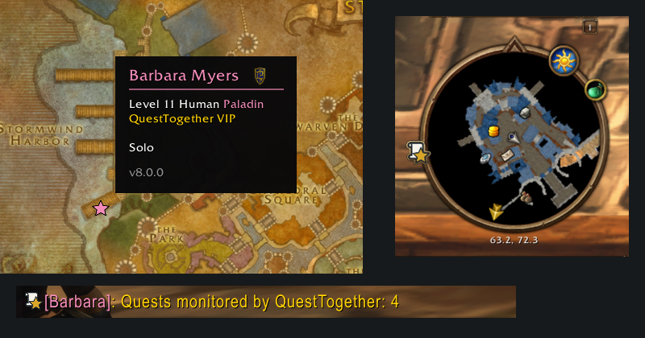
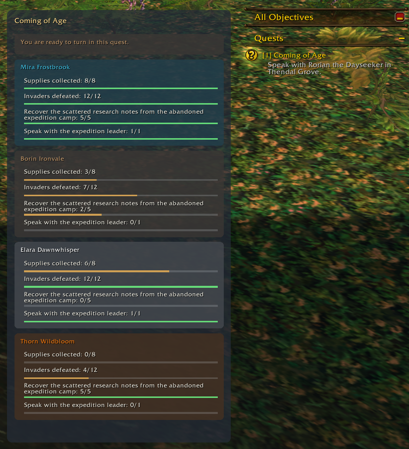
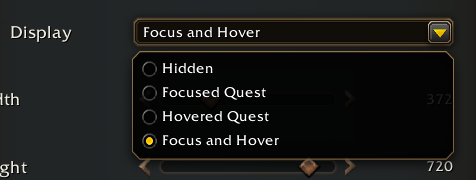
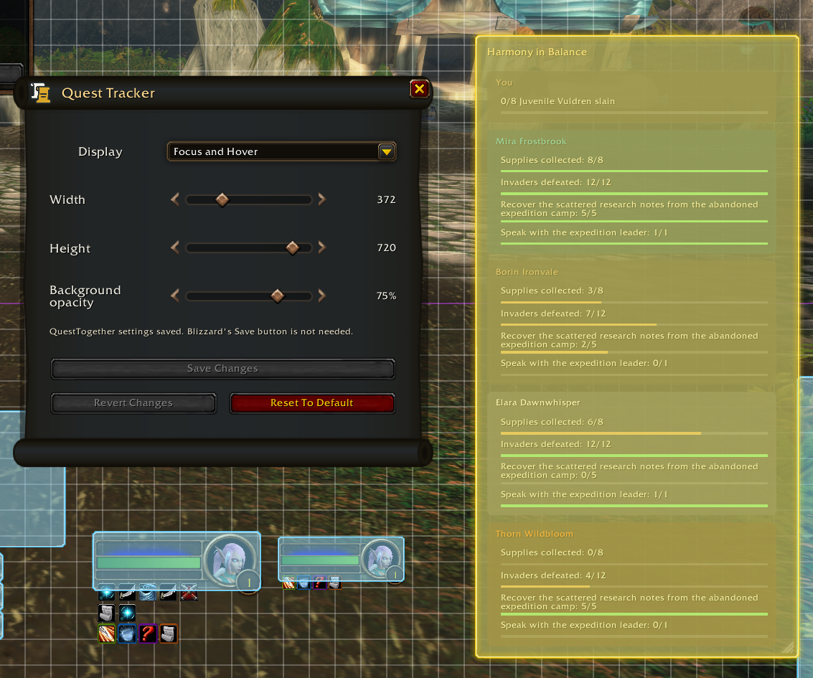
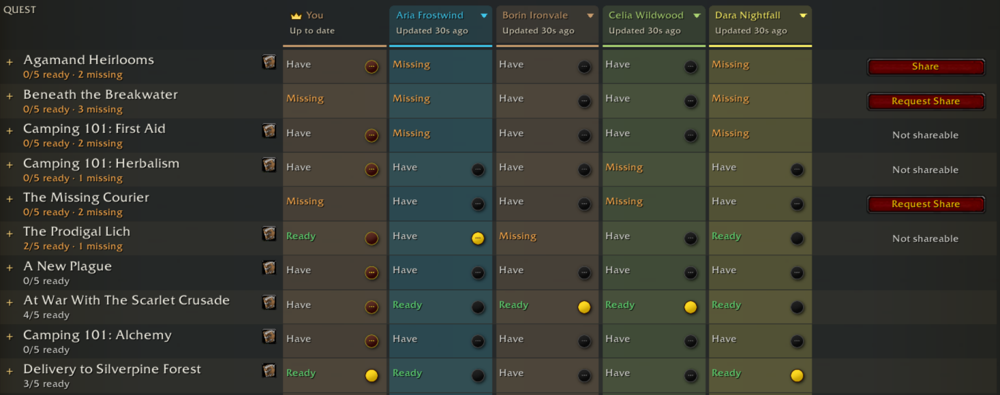
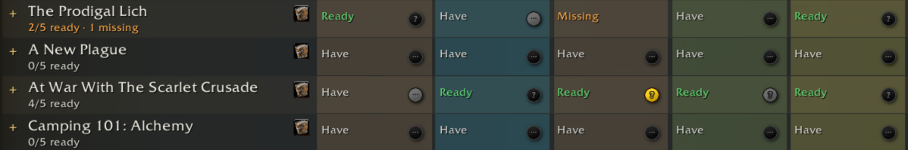
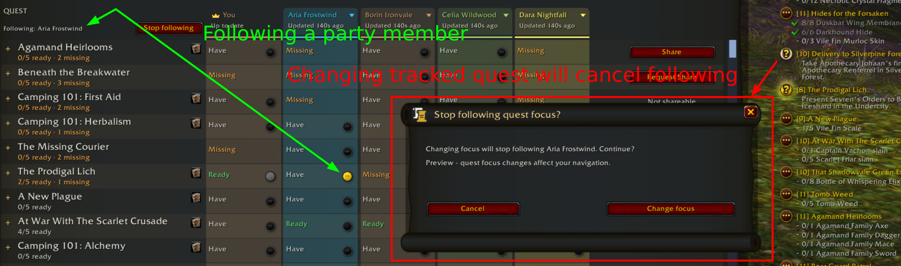
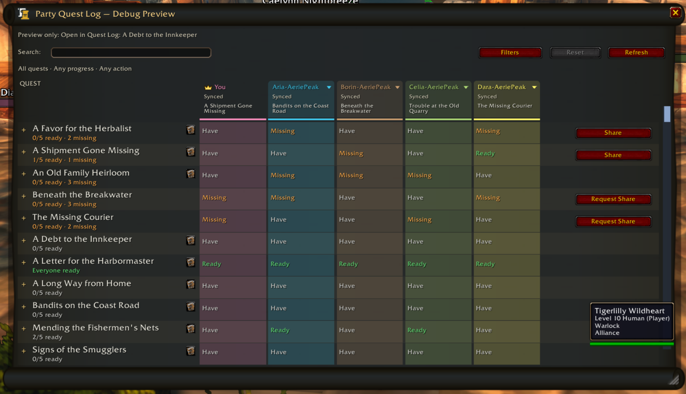
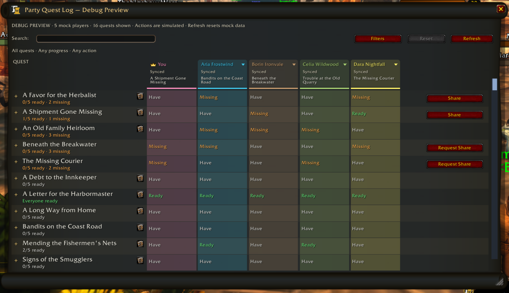
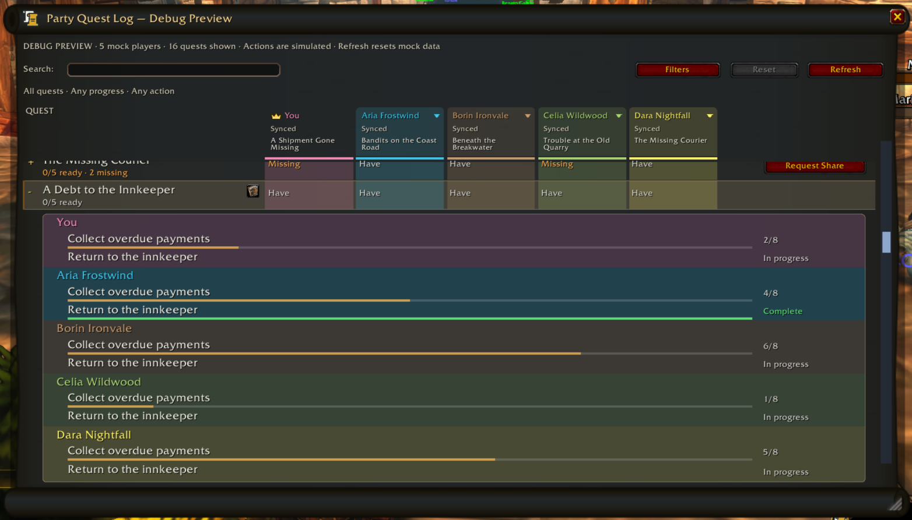

# QuestTogether — 更新日誌

<!-- Generated from canonical release notes; do not edit by hand. -->

## 10.2.0

隊伍任務日誌新增地區篩選與等級排序，更容易挑出接下來要一起完成的任務。QT 也能提醒你留意新拾取的任務起始物品。

### 找出現在需要的任務

- 開啟 /qt pql，在“篩選”選擇“任務區域”。指定目前地區或已知地區，再搭配“我沒有的任務”，即可找出隊友已有、自己還沒接到的任務。
- “任務等級”可“篩選”自身等級以下（含同級）、高於自身等級或等級未知的任務。“任務排序”提供等級由低至高、由高至低及標題排序；以等級排序時，未知等級一律排在最後。
- 選擇會依設定檔儲存。“重設”會恢復預設值，包括優先顯示有人缺少的任務。展開的任務鏈仍依任務關係排列步驟。
- 地區來自 Forever 上相容的 QuestieDB 任務地區資料，或 Blizzard 提供的下一個目的地，不代表所有目標所在的位置。資料不足時，地區仍會標示為未知。

### 留意能開啟任務的戰利品

- 新拾取的物品若被 Blizzard 辨識為可用任務的起始物品，QT 就能發出通報。它不會自動替你接受任務。
- “要公告的內容”中的“通報任務起始物品”預設開啟，並遵循現有通報偏好。搬動背包物品或登入時已持有該物品，都不會觸發通報。

### 修正與診斷改善

- 修正本機開發者小地圖圖示在載入畫面後，或身分資料較晚就緒時沒有正確更新的問題。
- 自動致謝診斷會提供更清楚的嘗試結果，且不記錄接收者姓名。這能協助調查未出現的致謝動作，但不保證動作一定顯示成功。

## 10.1.6

向隊友建議下一個任務，聽見熟悉的 WoW 點擊音效，並在交任務後順暢地繼續跟隨。

### 建議下一個任務

- 跟隨其他玩家的關注任務時，選取另一個任務並按下「建議關注任務」。跟隨不會中斷；若對方的任務日誌中有該任務，就能同意切換。雙方都需要安裝這次更新。
- 手動跟隨仍可選擇取消或變更關注任務。自動跟隨隊長時，可以取消或提出建議，但不能用個人選擇覆蓋隊長的關注任務。
- 「允許關注任務建議」位於隊伍與分享設定中。僅隊伍任務日誌 和 小小夥伴 預設會關閉建議接收。更新時也會尊重先前關閉 QT 任務分享請求的選擇，預設不接收建議。

### 熟悉的任務選取音效

- 自動變更關注任務的預設提示音改用 WoW 內建的任務選取點擊音效。音量由遊戲的音效設定控制；將任一 QT 音量滑桿設為零仍可靜音。已選擇的其他音效維持不變。

### 交任務後繼續跟隨

- 修正任務移出日誌後仍被分享為關注任務的問題，並清除交任務過程中已失效的停止跟隨確認。跟隨保持啟用，等待下一個雙方都有的任務。

## 10.1.5

改善隊伍任務同步的復原機制，減少變更設定時的重複更新。

### 隊伍任務同步

- 任務清單回覆遺失或傳輸中斷時，QT 現在能重新要求資料，修正隊員可能持續數分鐘顯示載入中的情況。家長接收孩子的任務，以及孩子接收家長的任務，都適用這項修正，也包含兒童模式。

### 設定與地圖

- 變更地圖要顯示哪些玩家時，不再無謂地重新建立向其他玩家提供位置的訂閱，也不會再次廣播你的位置與尋找夥伴狀態。
- 套用預設或切換設定檔時，避免重複更新地圖標記、地圖按鈕及 Data Broker 啟動器。

### 相容性與維護

- 原生介面整合會檢查遊戲實際提供的功能與安全支援，不再要求特定的用戶端版本。
- 整合內部狀態管理，移除重複及未使用的程式碼。既有設定維持不變。

## 10.1.4

戰鬥中的任務通知更即時，提示框的位置也更穩定了。

### 戰鬥中的任務通知

- 已追蹤任務的進度與可回報通知，現在可以在一般戰鬥中顯示，並繼續套用你原本的通知設定。
- 若任務資料無法讀取，或仍有其他限制生效，QT 會等到可以安全更新時再處理。戰鬥中已顯示的通知不會在脫離戰鬥後重複出現。

### 隊伍目標追蹤器的位置

- 當 QT 隱藏遊戲原生的任務提示框時，已吸附的隊伍目標追蹤器會維持在該提示框的位置，不再跳回暴雪目標追蹤器旁。滑鼠停留的任務列移動或縮放時，它也會跟著調整。

## 10.1.3

修正Forever中近期隊友清單的相容性問題。

### 近期隊友

- 即使Forever回傳的伺服器名稱為空，近期隊友清單也能正常讀取並記錄玩家。
- 原有記錄會保留，並合併供你在同一地區的角色使用；每位玩家保留最新的一筆記錄。歷史仍為私人資訊，上限維持100名玩家、保存90天。Retail和Classic仍依伺服器分別保存記錄。

## 10.1.2

繼續用控制器享受冒險！

### 控制器相容性修正

- WoW Forever 更新後，只要所需功能仍然相容，QT 就不會只因組建編號改變而停用控制器支援。必要的 API 與安全檢查仍會保留。
- 修正組建檢查導致新角色無法自動建立 PQL 控制器捷徑的問題。啟用自動安裝後，重新載入介面，QT 就能在動作列第 1 頁空白的 LT + RT + 方向鍵上欄位加入捷徑。現有巨集與自訂按鍵設定都會保留。
- 世界地圖上的 QT 隊友標記也不再要求組建編號完全相符，只要用戶端提供所需的相容功能即可繼續使用。

### 戰鬥開始，視野不受干擾

- 進入戰鬥時，QT 視窗及其選單現在會自動關閉，保持視野清晰，並讓控制器輸入重新用於遊戲操作。
- 偵錯紀錄和診斷報告視窗也會自動關閉，即使已在 QuestTogether 設定中停用插件也一樣。

## 10.1.1

在 Forever 使用任務鏈，現在更方便了！

### 輕鬆準備任務鏈資料

- 在 Forever，CurseForge 應用程式現在會隨 QuestTogether 一併安裝 QuestieDB。Retail 與 Classic 使用另一個下載檔案，不需要這項相依插件。
- Forever 若缺少 QuestieDB，隊伍任務日誌會在任務清單上方顯示清楚的安裝提示。
- 如果你是手動安裝插件，請安裝並啟用 Forever 版 QuestieDB，然後重新啟動 WoW。沒有 QuestieDB，仍然可以使用 QuestTogether 的其他功能。

## 10.1.0

讓 QuestTogether 陪你用喜歡的方式冒險！挑選合適預設、協助小夥伴跟上隊長，再透過更清楚的設定和新提示探索更多功能。

### 挑選你的冒險方式

- 全新安裝會顯示歡迎選擇畫面，取代首次更新說明，每個帳號一次，起初選取完整冒險。更新既有安裝不會自動套用預設或取代目前選擇。
- 遊戲內更新說明新增預設按鈕，方便直接開啟選擇畫面。也可隨時從 /qt 的預設或 WoW 選項重新開啟。單純開啟與瀏覽不會修改設定。
- 完整冒險保留一般地圖、名條、隊伍追蹤、聊天、泡泡、音效與表情功能，由你自行選擇任務焦點。
- 安靜解任務保留地圖、位置分享和隊伍工具，關閉自動聊天、泡泡、音效、表情以及登入或更新時的打擾。
- 僅隊伍任務日誌保留隨需使用的日誌與小地圖、控制器入口，隱藏地圖、名條和追蹤器擴充，並停用自動輸出與收到的 QT 任務分享請求提示。
- 小小夥伴讓家長負責規劃：不顯示自動 QT 視窗與啟動入口，僅向隊伍回報並跟隨隊長焦點。感謝與慶祝表情維持開啟，設定仍可透過 WoW 選項進入。
- 每個預設都說明適用情境，並能按查看設定展開完整清單。準備好再套用預設，之後仍可個別調整。版面、按鍵綁定與私人備註都會保留。
- 你也能將選擇用於未來角色，不更動現有或複製的設定檔。自訂只表示目前選項未完全符合任何預設。

### 一起跟隨隊長任務

- 自動跟隨隊長任務焦點是隊伍追蹤與焦點中的獨立選項，小小夥伴會啟用它。真正隊長須提供相容的 QT 焦點資訊，而且你擁有該任務；隊長更換也會調整。
- 焦點可用時，QT 會維持該任務，不顯示切換警告。要停止自動跟隨，請關閉設定。若隊長焦點不可用或你沒有該任務，可以自由選擇暫時焦點，條件恢復後自動繼續。

### 設定清楚，提示隨心

- 設定分類重新整理，工具提示更完整說明作用與限制。Data Broker 有獨立分類供相容工具列插件使用，核取方塊也會正確顯示已儲存值或預設值。
- 新設定預設開啟所有提示音，但已儲存的關閉選擇仍會保留。可在音效中逐項選擇提示、聲音、音量並試聽。
- 我的泡泡新增僅在隊伍中顯示，與僅單人顯示相對，也包含團隊。它只影響自己的泡泡，不改變送出的任務回報。

### 更多值得一試的功能

- 新增 58 則提示，總計 225 則，涵蓋任務鏈、分享、預設、隊長跟隨、控制器、音效、地圖及私人備註。所有支援語言皆提供適合用戶端的說明與相關設定連結。

>  提示： 隨時輸入 /qt tip 或 /qt hint 取得僅自己可見的提示，即使關閉啟動提示仍可使用。

## 10.0.2

隊伍任務日誌的任務鏈更清楚，接取條件也更容易掌握了。

### 更清楚的任務鏈顯示

- 展開任務鏈後，顯示在原任務上方的前置步驟會顯示已知名稱，包括尚未完成的低等級替代任務。尚未推進到的後續任務名稱預設仍會隱藏，並統一顯示為「任務名稱已隱藏」。
- 查詢任務之間的關聯時，任務鏈圖示的位置會顯示載入圓環。確認有關聯任務後，圓環會換成任務鏈圖示；若沒有關聯任務或無法取得資訊，圓環就會消失。
- 展開與收合任務鏈時會播放動畫，同時保留原任務列的位置。啟用「減少動態效果」後，展開與收合會立即完成，載入指示也會保持靜止。透過群組標題收合時，仍會立即完成。

### 更易讀的接取條件

- 條件提示以標題、顏色和間距區分未滿足、已滿足及未知的條件，減少重複的任務關聯說明，並彙整重複的已滿足條件。
- 當最新資訊確認角色等級已超過任務允許的最高等級時，會顯示「無法接取」，提示也會說明已因超過等級限制而無法再接取。其他尚未證實為永久限制的條件不會使用這個狀態。
- 已接取、可回報及已完成的任務不再顯示接取條件警告。資訊缺漏或過期時，條件仍會標為未知；畫面上的條件資訊並不保證一定能接取任務。

## 10.0.1

這次更新改善聊天頻道排序與任務跟隨，讓任務鏈在列表中更清楚易讀，並加入收到增益時自動致謝的功能。

### 聊天頻道順序修正

- 進入世界後，QT 會等候 10 秒再加入尚未加入的專用頻道，已加入的頻道則可繼續使用。一般頻道稍後加入時，也會重新檢查排列順序。
- 補強了頻道別名、過時的聊天輸入框資料、中繼資料及僅完成部分排序等情況的處理。在遊戲允許調整時，一般頻道會排在 QT 專用頻道之前，彼此的相對順序則會保留。

### 直接在列表展開任務鏈

- 在隊伍任務日誌展開任務鏈後，先前步驟會出現在原任務上方，後續步驟則在下方。原任務只會在任務鏈的對應位置出現一次，並保留原有操作。
- 連續外框、底色與更明顯的原任務標示，讓展開區域與其他任務行更容易區分。再按一次相同的鏈環按鈕即可收合。

### 接任務時繼續跟隨

- 修正跟隨其他玩家的任務焦點時，因接取新任務的事件順序而誤跳停止跟隨確認視窗的問題。現在會繼續跟隨對方；自行改選其他任務時，仍會要求確認。

### 自動感謝增益施法者

- 每個設定檔預設啟用。非戰鬥中收到附近其他玩家施放、持續至少 60 秒的新增益時，若能可靠辨識施法者，就可能隨機等候 2–4 秒後使用 /thank、/bow 或 /applaud 表情致謝，不會改變目前選取的目標。
- 接連收到的增益會合併處理，並限制重複致謝的頻率。自己施放、原本就有，或無法安全辨識效果與施法者的增益都會略過，因此不會對每個增益都致謝。
- 可在 /qt → 公告位置 → 自動感謝施加增益的玩家關閉。

## 10.0.0

和朋友解任務，各自跑到不同進度也能輕鬆會合！QuestTogether 這次大改版，讓你在隊伍任務日誌裡展開可查到的任務步驟，對照每位隊友的進度，找出要補哪一步。分享前也能先看看接取條件，大家更快出發。

### 在隊伍任務日誌裡查看任務鏈

- 輸入 /qt pql 開啟隊伍任務日誌。有任務鏈資料的任務，可以點日誌按鈕旁的鏈環，或從操作選單選擇「查看任務鏈」。任務步驟會直接在清單中展開。再點一次鏈環就能收合，點任務名稱則會照常展開任務目標。
- 在 Forever，請另行安裝適用於 Forever 的相容版本 QuestieDB。和 QuestTogether 一起啟用後重新載入介面，即可查看它提供的任務關聯、接取條件和已知的起始地點。平常使用隊伍任務日誌不需要 QuestieDB，隊友只要有相容版本的 QuestTogether 就可以回報自己的進度。
- 正式服會讀取遊戲提供的任務線名稱和所屬任務。資料有時只有一部分，也可能查不到。這些資料無法用來確認前置任務、能否接取或任務提供者的座標。其他用戶端仍可照常使用隊伍任務日誌。換了資料來源之後，可以更新日誌或關掉重開。

### 看看每位隊友走到哪一步

- 展開的任務步驟會對齊原本的隊友欄位。比對「進行中」、「就緒」、「已完成」和「不在任務日誌中」，就能看出大家的進度。「載入中」表示還在等資料，「未知」表示目前無法判斷。就算隊友去了不同分支，大家手上正在進行的任務還是看得到。
- 在「篩選」開啟「依任務鏈分組」，相關任務就會排在一起。這項功能預設關閉，選擇會記在設定檔裡。各組的範圍清楚可見，獨立任務仍會單獨列出。Forever 會以「相關任務」搭配已知的名稱，正式服則採用遊戲傳回的任務線名稱。
- 同一條路線的步驟會對齊，分支會縮排。一次可以展開一條任務鏈的詳細步驟。想多看幾步時，可點「顯示先前任務」或「顯示後續任務」。搜尋與篩選仍針對隊伍實際持有的任務，參考用的步驟不會算進任務總數。

### 帶隊友補進度，順手找到任務起點

- 把游標移到沒有這項任務的隊友欄位，就能看到已知的前置任務，或職業、種族、等級限制。已在進行、已就緒或已完成的隊友不會收到接取條件提醒。查不到條件時，仍由遊戲判定能否接取。
- 在 Forever，先用世界地圖上的 QT 按鈕開啟地圖標記。展開任務鏈，對其中有顯示名稱的步驟開啟操作選單。每個已知起點都有自己的選單項目。選「尋找任務提供者」可在地圖上查看地點，需要導航時，再選該地點的「設定路徑點」。隱藏的步驟沒有這些操作。從物品開始或查不到起點的任務會顯示說明。
- 查看任務鏈時，原本追蹤的任務、跟隨狀態和路徑點會保留。查看詳情、開日誌、設為追蹤任務、跟隨任務追蹤、分享和請求分享等操作，也會在適用時照常提供。

### 想保留驚喜，後續任務先不劇透

- 預設會淡化還沒走到的步驟，並隱藏任務名稱。隊伍目前的任務、你的遊戲已確認完成的任務，以及用來解釋已知限制的前置任務，則可顯示名稱。
- 想把已知的任務名稱全部展開？到「篩選」關閉「隱藏後續任務名稱」。這個選擇會記在設定檔裡。開啟隱藏時，提示、選單和搜尋也不會洩露名稱。

### 分享和請求分享前，看清接取條件

- 「分享」和「請求分享」下方會顯示簡短的接取提示。隊友已接取、已完成，或確定受職業、種族、等級及前置任務限制時，先看提示就能省下白跑一趟。執行操作和確認請求時，只要有最新資料，就會再次檢查。
- 剛開始查詢時，會看到「正在檢查接取條件」。若沒有資料、資料已過期或逾時，則會顯示「接取條件未知」，仍然可以試著分享。「暫無已知限制」表示目前掌握的資料沒有發現問題，最後由 WoW 判定能否接取。
- 把游標移到操作上可查看各位接收者的摘要。把游標移到沒有任務的隊友欄位，則能看到完整的已知條件。也可用控制器查看說明。分享請求仍會顯示等待狀態和最終結果。
- WoW 會將任務分享給整支隊伍。即使某位隊友可以接取，其他人仍可能看到遊戲的拒絕訊息。可重複任務或查不到歷史紀錄時，日誌不會因此判定前置任務尚未完成。

### 一眼看懂難度，操作起來更順手

- 日誌會顯示任務等級和遊戲原有的難度顏色。等級後的加號表示遊戲建議組隊。遇到同名任務，可以看提示中的任務 ID。等級查不到時也會明確標示。
- 滑鼠和鍵盤沿用熟悉的操作。若要在支援的 Forever 用戶端使用控制器，請開啟 WoW 的控制器介面，再到 QT 設定的「一般」開啟「啟用原生控制器導覽」。上下換列，左右切換控制項。選取任務名稱會展開目標，選取任務鏈裡的步驟會開啟操作選單。返回鍵會先關閉選單。選取位置若在展開的任務鏈內，就會收合任務鏈並回到原本的位置，否則會關閉日誌。提示會顯示在游標或選取的控制項附近。
- 跟隨任務追蹤的隊友會以職業顏色的雙箭頭標示，和展開任務鏈的鏈環按鈕很好區分。

>  提示： 輸入 /qt pqlpreview chains 便能在清楚標示的預覽畫面，用模擬隊友試看真實的任務鏈。預覽使用目前可取得的任務資料，不會送出分享請求，也不會更改實際追蹤的任務、跟隨狀態或路徑點。關閉預覽或輸入 /qt pql 即可返回。

### 專案授權更新

- 本版專案自有的程式碼、文件及原創素材採 GPL-3.0-only 授權，並隨版本提供相應原始碼、可編輯素材及建置所需檔案。舊版仍適用原有的 MIT 授權。隨附第三方授權及 Blizzard 美術素材的例外也繼續保留。

## 9.3.3

改善任務焦點跟隨，並讓名條預覽更貼近遊戲中的顯示方式。

### 接受任務時繼續跟隨

- 修正另一種事件延遲造成的問題：接受任務時可能出現停止跟隨隊友任務焦點的確認視窗。自動切換焦點會保留跟隨；主動選擇其他任務時仍會要求確認。

### 符合設定的名條預覽

- 友方玩家啟用僅顯示姓名時，QT圖示的所有位置皆以姓名文字為基準。「左側」和「前綴」在此模式下位置相同。
- Forever預覽會將姓名置於血條正上方中央，並在血條右側顯示等級標記。玩家預覽會遵循僅顯示姓名設定，並提供說明與前往暴雪對應設定的入口。
- Retail預覽現在會反映原生名條的樣式、尺寸、字型及生命值顯示設定。

## 9.3.2

修正接取新任務時的任務跟隨問題，以及友方名條只顯示名字時的 QT 圖示位置。

### 跟隨時接取新任務

- 跟隨隊友的任務選擇時，接取新任務造成的自動切換不再要求確認停止跟隨。跟隨狀態會保留，並在遊戲允許切換時回到目前共同追蹤的任務。
- 之後若自行選擇其他任務，仍會照常詢問是否結束跟隨。

### 只顯示名字的友方名條

- 將友方玩家名條設為只顯示名字時，QT 圖示現在會緊鄰名字文字的左側顯示。關閉此設定後，就會恢復原先儲存的圖示位置。

## 9.3.1

修正地圖標記分享與任務跟隨的同步問題，並調整跟隨者的顯示方式。

### 隊伍路徑點與任務追蹤

- 開啟「分享我的路徑點」後，使用 WoW 內建功能放置地圖標記，隊友就能再次收到路徑點，標記會以你的職業顏色顯示。
- 已有地圖標記不再妨礙任務選擇和跟隨狀態更新。跟隨隊友的任務選擇時，手動改選任務會再次詢問是否停止跟隨；選擇「取消」即可保持跟隨。

### 跟隨者標記

- 跟隨你任務選擇的隊友，現在會在目標追蹤器中顯示為一個職業顏色的鏈結圖示。原先的空心圓環和旁邊的獨立鏈結標記已合併為這個圖示。

## 9.3.0

原生控制器支援正式加入穩定版本，不必再下載 Beta。任務跟隨指令、新圓環標記與 VIP 修正也都保留。

### 開啟控制器導覽

- 支援 WoW Forever 1.60.1 的組建 70888 與 70938。請開啟 WoW 的 Gamepad UI，並在 QT「一般」設定中保持「啟用原生控制器導覽」勾選；這個選項預設開啟。其他用戶端仍維持原本的滑鼠與鍵盤操作。

### 開啟及操作 QuestTogether

- 使用預設控制器配置時，QT 會在一般動作列第 1 頁的 LT + RT + 方向鍵上方空格放入隊伍任務日誌巨集，並使用任務書圖示；已占用的欄位不會被取代。可用 WoW 動作列編輯器移動或移除按鈕，只要巨集還在，QT 就不會把按鈕放回去。若刪除巨集本身，預設位置空著時便可重新建立並放入。
- 在隊伍任務日誌中，用方向鍵切換任務與按鈕，按選取執行、返回關閉。清單會隨著選取位置捲動，讓目前任務保持可見。
- 到 WoW 按鍵設定為「開啟 QuestTogether 選單」指定按鍵，即可開啟相關操作與待處理請求；預設不會綁定。選單、下拉清單與確認視窗都能以控制器導覽。收到的請求只有在你主動開啟後才會取得操作焦點，確認視窗會先選取取消或拒絕。
- 更新後自動開啟的更新說明視窗會取得控制器焦點。右搖桿可一起捲動文字與捲軸，方向鍵選擇按鈕，返回關閉視窗。文字輸入及 HUD 位置調整仍使用原本的操作方式。

### 目標追蹤與世界地圖

- 用控制器瀏覽 WoW 目標追蹤清單時，隊伍目標追蹤器會像滑鼠停留時一樣回應，不會改變任務焦點或跟隨狀態。
- 世界地圖準星能醒目顯示 QT 玩家與群組標記。A/選取仍執行地圖原本的動作，不會自動開啟 QT 選單。已指定的 QT 選單按鍵可開啟相關操作，但某些組合可能被地圖操作優先使用。地圖平移、縮放及導航點功能維持不變。
- 世界地圖上的隊友標記會保留已驗證的 VIP 星號與開發者圖示。關閉 QT 地圖顯示後，會恢復 WoW 原生隊友標記。小地圖不受影響。

## 9.2.0

新增跟隨任務選擇的指令，讓隊友標記更清楚，並修正 VIP 星號異常變回圓點的問題。

### 用指令跟隨隊友的任務

- 將隊友選為目標後，輸入 /qt focus 就能跟隨對方的任務選擇。也可以使用 /qt focus <name> 指定隊友，或輸入 /qt unfollow 停止跟隨。
- 這些指令都能放進巨集。你也可以到 WoW 的按鍵設定，在 QuestTogether 分類中為「跟隨目標的任務追蹤」和「停止跟隨任務焦點」指定按鍵；預設不會自動綁定。這項功能只會跟隨任務選擇，不會讓角色自動跟著對方移動。
- 可使用 Forever 中包含姓氏的完整姓名，或 Retail 中包含伺服器名稱的角色名。若有多位隊友的簡稱相同，請改用完整名字。

### 職業色圓環標記

- 目標追蹤清單中的隊友任務標記改為空心圓環，以職業顏色呈現，並加粗邊緣以便辨識。跟隨該隊友的任務選擇後，圓環會填滿成同色實心圓，取代原本的綠色外框。隊友跟隨你時顯示的鏈條圖示則維持不變。

### 修正 VIP 星號顯示

- 修正兩種可能讓 VIP 星號變成一般圓點的情況：反覆更新狀態時，可能誤刪其他玩家仍有效的 VIP 狀態；附近玩家之間的連線變動後，有時無法傳遞目前有效的 VIP 確認資訊。原有的驗證規則與有效期限維持不變。

## 9.2.0-beta.1

這次控制器 Beta 版小更新改善了更新說明視窗的閱讀與操作。

### 更新說明視窗修正

- 更新後自動開啟的說明視窗現在會取得控制器焦點，可以直接按返回鍵關閉。
- 使用右類比搖桿捲動內文時，捲軸也會同步移動，儲存的閱讀位置會一併更新。
- 瀏覽歷史紀錄時，若選取的按鈕隱藏或停用，焦點會移至可用控制項；換頁後也會更新導覽項目。

## 9.1.0

你在 WoW Forever 使用控制器遊玩嗎？歡迎一起測試 QuestTogether 的控制器支援！

### 試用控制器 Beta 版

- Beta 版透過 WoW Forever 原生 Gamepad UI，讓你用控制器瀏覽隊伍任務日誌與 QT 選單，也能用世界地圖準星查看 QT 標記資訊。這次穩定版更新只發布測試邀請；控制器功能仍在 Beta 版中提供。
- 在 CurseForge 應用程式中，以滑鼠右鍵點選 QuestTogether，選擇 "Release Type"，再選 "Beta"。更新插件後，在 WoW 輸入 /reload。
- 是否參加測試由你決定。開啟 WoW Forever 的 Gamepad UI 後試玩看看，並告訴我們哪些操作順暢、哪些地方還需要調整，協助我們準備穩定版本。

## 9.1.0-beta.1

這次 Beta 將 WoW Forever 的原生控制器導覽整合進 QuestTogether。遊戲內測試仍在進行中。

### 原生控制器導覽

- 需要啟用 Forever 1.60.1 的控制器介面，支援已查核的組建 70888 與 70938。QT 一般設定中的「啟用原生控制器導覽」預設開啟。其他客戶端維持原有滑鼠與鍵盤操作。
- 隊伍任務日誌支援選取控制項、自動捲動、確認及返回。動作選單與下拉選項採用接近暴雪控制項的外觀。收到其他玩家的請求時，不會自動搶走控制器焦點。

### 開啟隊伍任務日誌

- 使用預設配置時，QT 只會在一般動作頁面 1 上對應 LT + RT + 方向鍵向上的欄位空白時，放入任務書圖示的巨集。既有動作不會被覆蓋；可透過動作列編輯器移動或移除巨集。
- 只移除按鈕時，QT 不會重新放回。若刪除巨集本身，預設欄位空白時可重新建立並放置。請在 WoW 按鍵設定中指定「開啟 QuestTogether 選單」，即可使用情境動作與「待處理請求」；此功能沒有預設按鍵。

### 任務瀏覽與地圖

- 以控制器在暴雪目標追蹤器中選取任務，也會觸發隊伍目標追蹤器的滑鼠懸停顯示。既有顯示與提示設定仍然適用，不會改變任務焦點或跟隨他人焦點的狀態。
- 世界地圖準星可顯示 QT 玩家與群集標記的提示；與任務提示重疊時，QT 提示會顯示在上層。按 A 自動開啟地圖選單仍在私人測試中，不包含在這次 Beta。A 保留原有地圖動作，地圖的原生按鍵也可能優先於自行設定的 QT 選單控制器組合。
- 在支援的組建中，世界地圖隊伍標記可採用 QT 樣式，包括 VIP 與開發者圖示。關閉 QT 地圖顯示後，會恢復暴雪的隊伍標記。小地圖行為不變。

### Beta 測試說明

- PQL 啟動按鈕、基本導覽、精簡選單與下拉選項，以及準星提示已在遊戲內確認可用。目標追蹤器、設定、視窗切換、控制器重新連線、戰鬥與擁擠地圖的完整測試尚未完成。回報問題時，請附上重現步驟、客戶端組建號與 /qt diagnostics 報告。

## 9.0.14

已修正 QT 頻道排在常用聊天頻道前面的問題。

### 聊天頻道

- 隱藏的 QT 頻道有時無法移到綜合等聊天頻道之後，現已修正。
- 用來尋找其他玩家的全域頻道現已改名為 QuestTogether。

## 9.0.13

QT 頻道會再次排在聊天頻道清單的最後。

### 聊天頻道順序

- QT 的隱藏頻道會移到一般聊天頻道後方，並保留各頻道的顏色、設定，以及每個聊天視窗原先選擇的發話頻道。
- 輸入訊息、調整頻道設定，或遊戲限制相關操作時，QT 會暫緩排序。若排序結果異常，便會停止後續排序，直到重新載入介面。

## 9.0.12

QuestTogether 不再自動調整頻道順序，避免影響日常聊天。

### 聊天頻道順序

- QT 不再將自身的隱藏頻道移到清單末尾，避免因此造成頻道編號變動、顏色錯置，或訊息傳到錯誤的頻道。尋找其他玩家的功能仍照常運作。
- 更新不會自動還原先前已變動的頻道顏色或發話頻道。如果你已遇到問題，請重新選擇想要發話的頻道，並在 WoW 聊天設定中調整頻道顏色。

## 9.0.11

這次更新修正隊伍任務比對與地圖操作問題，減少重複處理，並改為在需要時才載入遊戲內測試。

### 隊伍與地圖修正

- 使用「請求分享」時，會依選取的隊友判斷是否能請求任務；即使多人擁有同一任務，或比對清單套用了篩選條件，也能正確處理。
- 按下「重新整理」或隊伍成員變動後，仍在隊伍中的玩家會保留欄位的收合狀態。
- 隊伍任務日誌與隊伍目標追蹤器會清除其他玩家傳來的任務名稱及目標文字中的多餘格式，不更動收到的原始資料。
- 介面限制狀態改變時，會在遊戲允許的情況下移除地圖上過時的目標選取按鈕。戰鬥中隱藏受保護按鈕的限制仍會保留。

### 效能改善

- 減少小地圖的重複檢查與更新；附近玩家的位置沒有改變時，會沿用顯示資料與座標換算結果。
- 準備隊伍任務資料時，減少重複讀取任務日誌的工作。手動重新整理仍會讀取當前狀態，任務目標進度也會在每次請求時重新取得。

### 遊戲內測試

- 測試內容改為在執行 /qt test 時，透過隨附的選用插件 QuestTogether Tests 載入。要執行測試，請先啟用該插件並重新載入介面。平常遊玩時會減少記憶體用量，QuestTogether 的主要功能不需啟用此插件也能使用。

## 9.0.10

查看世界地圖上的玩家資訊更加流暢。

### 世界地圖效能

- 改善滑鼠停留在世界地圖玩家標記上時的掉幀問題，尤其是合併標記和顯示多名隊友的提示。提示開啟期間，玩家資訊仍會持續更新。

## 9.0.9

改善背景連線的穩定性，並減少對無法聯絡的玩家進行無效重試。

### 通訊修正

- 修正了其他可能讓 QuestTogether 背景密語的「找不到玩家」錯誤出現在聊天視窗的情況。你親自發送密語時的失敗提示仍會正常顯示。
- 切換區域或重新載入介面後，仍會保留聯絡失敗玩家的重試等待時間。過時的玩家資訊不再造成無止盡的重試；現有的正常連線也會保留到新的連線對象回應為止。
- 無法安全過濾聊天錯誤時，背景通訊會先暫停。診斷資訊也經過改善，方便追查仍可能發生的問題。

## 9.0.8

修正了載入隊伍資料時發生的錯誤。

### 問題修正

- 修正了與其他 QT 使用者組隊後可能出現錯誤，導致隊伍任務資料無法載入的問題。背景密語傳送失敗不再影響隊伍資料傳輸。

## 9.0.7

進一步修正背景通訊、相位提示、小地圖點擊與設定檔切換問題。

### 通訊改善

- 進一步修正 QT 背景插件密語造成的多餘「找不到玩家」提示，包括切換區域或停用後重新啟用插件時延遲出現的提示。你自行傳送的一般密語仍會顯示應有的錯誤回報。
- WoW 回報玩家離線時，QT 會取消等待傳送的訊息，並暫停一段時間後再嘗試。同一完整名稱的大小寫差異不再繞過重試等待時間。
- /qt diagnostics 提供更多協助排查這些提示的資訊。新增計數器不含玩家名稱或訊息內容。

### 地圖與設定檔

- 啟用「偵測不同分層」後，QT 會優先採用 WoW 的相位資訊，滑鼠提示會區分「不同相位」與估計結果「可能處於不同分層（實驗性）」。看不見或無法選取玩家為目標，本身並不能證明對方處於不同相位。
- 小地圖上的玩家選取區域現在會跟隨標記或選單的顯示層級，不再攔截對上方視窗的點擊。
- 切換設定檔時，會取消舊設定檔中尚未完成的任務比較與等待顯示的本地化公告，避免遲來的結果出現在新設定檔中或影響其內容。

## 9.0.6

地圖圖例現在也有 VIP 與開發者圖示的說明。

### 地圖圖例

- 將滑鼠移到世界地圖的 QT 按鈕上，即可在圖例中看到 VIP 星星與開發者齒輪圖示，旁邊也會顯示各自對應的 QT 標誌。

## 9.0.5

新增玩家提示的 QT 顯示選項，並修正部分不必要的密語錯誤通知。

### 玩家提示的顯示範圍

- 前往設定的「玩家名條」 > 「玩家提示」 > 「QuestTogether 提示」，即可選擇「對所有人顯示」、「對好友隱藏」（預設）、「對隊伍成員隱藏」、「對好友和隊伍成員隱藏」或「對所有人隱藏」。
- 選項會套用到原生玩家提示下方的整個 QT 區域，包含標誌與 QT 識別標記、「尋找任務夥伴」狀態及私人備註。自己的角色一律隱藏此區域。
- 已儲存的備註與分享設定維持不變。

### 密語錯誤通知

- 修正 QT 在背景傳送的插件密語仍會觸發「找不到玩家」通知的部分情況，涵蓋延遲出現，以及收到回覆後才出現的通知。若無法確認是否為一般密語的錯誤，仍會顯示通知。

## 9.0.4

這次更新加快了尋找玩家的速度，讓公開資訊傳遞更有效率，並修正地圖提示的版本顯示問題。

### 尋找玩家與資訊傳遞

- 連線的玩家較少且背景通訊仍有餘裕時，QT 會更快尋找其他玩家。也修正了啟動時雙方同時建立連線可能造成的問題。
- 支援此功能的版本會合併傳遞相同的公開資訊，減少重複傳送。新加入的玩家能收到已驗證且仍有效的資訊，資訊請求與轉送受阻後的重試也更可靠。
- 整體傳送上限維持不變，隊伍與私人資訊仍優先處理。公開分享設定、資訊來源驗證及停止分享後的保護措施持續生效，已撤回的資訊不會因此重新流傳。
- 仍與較早的 9.0.x 版本相容；越多玩家更新，合併傳遞的效益就越大。玩家資訊會逐步收集，無法保證顯示所有玩家。

### 地圖提示的版本資訊

- 公開位置更新會一併傳送插件版本，確認連線時也能得知對方版本。即使詳細資訊尚未送達，地圖提示也較不容易缺少版本資訊。
- 仍有效的版本資訊會隨快取的地圖位置保留，重新載入介面後仍可使用。原始時間與先後順序也會保留，避免延遲送達的資訊讓過期版本重新被當成最新資訊。

## 9.0.3

這次更新改善了玩家連線、隊伍聊天提醒的設定儲存，以及開啟地圖的方式。

### 尋找玩家與建立連線

- QT 現在也會從遊戲內在線的好友、Battle.net 好友在線且相容的 WoW 角色、遊戲聊天訊息的發送者，以及可見的友方玩家中尋找連線對象。現有的位置設定會繼續生效。
- 即使持續發現新玩家，先前的連線對象也能再次輪到重試機會。自己的連線名額不足時，不再比照對方無法連線的情況延後重試。
- 對方連線已滿時，請求可等候名額空出或連線輪替後重試。請雙方都更新插件；原有限制繼續適用，連線可能需要一些時間。
- 診斷資訊會區分對方連線已滿、本機名額不足、傳送失敗、玩家無法連線及等候逾時。

### 隊伍聊天提醒設定

- 勾選「不再提醒」並點選「保持開啟」後，即使 QT 在點選過程中辨識出隊友，也會儲存設定，避免其他隊友加入時再次彈出提醒。
- 同一提醒視窗更新成員清單時，會保留「不再提醒」的勾選狀態。

### 開啟地圖的相容性

- 調整了地圖與任務日誌的開啟方式，以減少之後在戰鬥中開啟地圖時可能出現的動作遭阻擋錯誤。

## 9.0.2

這次更新修正了 /qt ping 廣播請求的回覆問題，並繼續遵守你的診斷資訊分享設定。

### Ping 診斷

- 修正允許分享診斷資訊的玩家無法回覆 /qt ping 廣播請求的問題。
- 未開啟診斷資訊分享的玩家仍可轉送經過驗證的請求，但不會自行回覆。如果在驗證請求期間關閉分享，該次回覆便會取消，之後重新開啟也不會恢復。
- 回覆請求的玩家也需要更新至 9.0.2。只有執行指令的開發者更新插件，並無法修正舊版玩家的回覆問題。

## 9.0.1

這次更新減少了背景通訊造成的聊天錯誤訊息，並修正任務提示與任務分享回饋的處理。

### 背景通訊

- 若能確認「找不到玩家」訊息來自 QuestTogether 的背景密語，便會隱藏該訊息、取消傳給該玩家的待送訊息，並暫停後續嘗試。最後已知的任務資訊會保留，失敗情況仍會記錄在診斷中。
- 如果訊息也可能是由你手動傳送的密語引起，仍會正常顯示。

### 任務提示

- 建立新設定檔或重設追蹤器版面配置後，「隱藏暴雪任務提示」現在預設開啟。先前明確選擇的設定會保留。
- 只有隊伍目標追蹤器實際可見，且正在顯示滑鼠懸停的同一項任務時，才會隱藏暴雪任務提示。追蹤器隱藏時、編輯模式中，以及顯示其他提示框時，皆不會因此隱藏提示。

### 任務分享

- 修正 QuestTogether 無法正確接收暴雪任務分享回饋的問題。

## 9.0.0

QuestTogether 改用第三代通訊協定。要繼續互相接收 QT 資訊，一起使用的玩家都必須更新至本版本。

### 請一起更新

- 舊版通訊協定已停用。已儲存的設定、設定檔、VIP 憑證與任務追蹤跟隨設定都會保留。

### 尋找玩家與傳遞資訊

- 自訂聊天頻道現在只用來取得成員名單；插件資料改透過密語與遊戲原生的隊伍通訊管道傳送。
- 可公開分享的更新經過來源驗證後，可以透過其他 QT 用戶端轉送。系統會優先處理你所在的區域及目前查看的地圖區域，再逐步找到其他玩家。尚未連上這個網路的玩家可能無法被找到，因此無法保證涵蓋所有區域或送達每位玩家。

### 分享設定與通訊可靠性

- 隊伍任務日誌、目標詳細資訊、任務追蹤、路徑點、私人回覆與開發者診斷資料仍直接傳送，不經過轉送網路。現有的分享設定與開發者身分驗證要求維持不變。
- 通訊流量與記憶體用量都有上限，並為隊伍通訊預留容量。重試與復原次數受到限制，也加強了連線對象驗證、訂閱管理，以及過期和已取消資料的清理。

### 隊伍目標追蹤器的顯示層級

- 隊伍目標追蹤器現在使用一般 HUD 層級。角色視窗、背包視窗與物品提示框會正常顯示在它上方，同時保留貼齊任務提示框的配置方式。

## 8.4.0

這次更新讓你自訂個人聊天泡泡與 QT 音效，並調整隊伍目標追蹤器的提示框位置。另有任務追蹤跟隨標記、Data Broker 工具列入口，以及頻道拒絕傳送時的重試間隔調整。

### 個人聊天泡泡

- 「公告位置」中的「我的聊天泡泡」取代原本隱藏個人泡泡的選項，可選「一律顯示」、「僅單人時顯示」或「一律隱藏」。單人表示未加入小隊、團隊或副本隊伍。關閉「顯示聊天泡泡」後，此選項仍會顯示，但無法變更。
- 原有顯示或隱藏偏好會保留。選擇僅單人時顯示後，加入隊伍會立即隱藏目前的個人泡泡；離隊後可再次顯示新泡泡。這只影響自己的畫面，不影響其他玩家的泡泡、聊天記錄或送出的公告。

### QT 專屬音效

- 內附六種原創 QT 音效。請求與確認對話框，以及跟隨其他玩家時自動切換追蹤任務，預設會播放輕柔提示音；其他事件預設不播放音效。
- 「音效」可設定總開關與總音量、各事件的開關、音效、音量及試聽，另有戰鬥中靜音、最短播放間隔與重設。WoW 原有的音效設定仍然適用。
- 也可為隊伍路標、隊友任務可回報、隊友繳交任務、隊伍目標進度、收到 QT 聊天及任務分享結果開啟提示音。

### 隊伍目標追蹤器提示框

- 啟用貼齊暴雪目標追蹤器後，將滑鼠移到任務上並顯示對應的原生任務提示框時，隊伍目標追蹤器會貼齊該提示框。「隊伍與分享」及追蹤器編輯模式提供「頂端」（預設）、「下方」和「側邊」。
- 所選方向空間不足時，會改用其他方向；移開滑鼠後恢復平常的位置。「隱藏暴雪任務提示」預設關閉，啟用後也只會在隊伍目標追蹤器可見時隱藏目前滑鼠所指任務對應的提示框。

### 任務追蹤跟隨標記

- 亮綠色圓環標示你正在跟隨其任務選擇的隊友；鏈環徽記標示正在跟隨你選擇的隊友，滑鼠移上去可查看說明。
- 任務選擇圓點、圓環與徽記會被隊伍任務日誌及其他視窗遮住，不會穿透視窗顯示。

### Data Broker 工具列入口

- 其他插件提供 LibDataBroker 時，Bazooka 等相容工具列便可顯示 QT 啟動按鈕。QT 不內附此函式庫，也不新增必要相依套件。此按鈕與小地圖按鈕的顯示設定互相獨立。
- 在「一般」中設定 Data Broker 左右鍵動作，預設分別開啟隊伍任務日誌與 QT 選單。也可選擇切換尋找任務夥伴狀態、開啟「設定」或「無」。

### 通訊重試

- QT 頻道拒絕傳送時，該頻道的重試等待時間會從約 5 秒逐漸延長至最多 120 秒。隊伍、密語及正常頻道不受影響。舊訊息不會累積後重送；等待結束後會嘗試傳送目前的資料。
- 這可減少重複遭拒的傳送嘗試，但不會解除伺服器限制，也不保證送達。

## 8.3.1

隊伍任務清單的更新更加可靠，也改善了分享任務後的清單更新。

### 隊伍任務更新

- 按下重新整理後，會要求新的任務清單，不再卡在停滯的舊請求或等待背景資料查詢。
- 遊戲通知隊友已接受分享的任務，或已經在進行該任務時，插件會自動重新要求該隊友的任務清單。
- 收到新清單後，較晚抵達的回覆不會再將已持有的任務誤標為缺少。任務資訊沒有變動時，也會保留已收到的目標進度。

## 8.3.0

跟隨隊友的任務選擇更加順手，並修正任務視窗與名條圖示的顯示問題。

### 隊友任務跟隨操作

- 在最多五人的隊伍中，代表其他隊員的職業色圓點變大了，也能直接點選。圓點位於暴雪目標追蹤器原生任務焦點按鈕左側；移入滑鼠可查看是哪位隊友選了該任務，按左鍵即可要求跟隨。
- 多位隊友選擇同一任務時，圓點會並排顯示。目前跟隨的隊友會以白色外框標示，同時保留職業顏色。
- 點選圓點預設會先詢問是否跟隨。勾選「不再詢問」，即可在目前的 QT 設定檔中略過之後的圓點跟隨確認。
- 跟隨期間手動選擇其他任務時，詢問是否停止跟隨的視窗開啟期間，也會保留你選的任務。確認後會停止跟隨並保留該任務；取消、關閉視窗或按 Escape，則會恢復跟隨隊友目前選擇且你也擁有的任務。

### 任務視窗與名條位置

- 修正隊伍任務日誌在捲動時反覆調整任務列順序的問題。收到新的任務資訊時，順序仍可能改變。
- 隊伍目標追蹤器現在會顯示在暴雪任務的滑鼠提示上方。
- 名條右側的圖示不再與 Forever 的等級框重疊，上方圖示與名字之間也多留了一點空間。名字前的圖示會貼近實際顯示的文字，名字置中或靠右對齊時也能正確定位。任務圖示與 QT 玩家圖示皆適用。

## 8.2.1

隊伍任務資訊改為在背景持續更新，並加入聚焦與狀態標記，讓隊友的進度更容易掌握。

### 隊伍任務資訊

- 在最多五人的隊伍中，即使關閉隊伍任務日誌並隱藏隊伍目標追蹤器，QT 仍會更新任務清單與目標進度。資訊會隨著接收逐步補齊；遊戲內通訊延遲仍可能讓更新變慢。
- 不必一直把滑鼠停在任務上等待資料。移開滑鼠後，隊伍資料請求仍會繼續，已接收的進度也會保留供下次查看。

### 聚焦與狀態標記

- 暴雪預設目標追蹤器的任務標題旁會出現職業顏色圓點，表示哪些隊友正聚焦於該任務。不論是否跟隨別人的任務聚焦，都能看到這些標記。
- 隊伍目標追蹤器中，每位玩家的區塊新增進行中、可交付與已完成任務圖示，以及載入中和狀態未知標記。若已確認任務可交付，載入目標詳細資訊時也不會失去這項標示。
- 修正「聚焦與懸停」模式會因無法讀取無關的路徑點資訊，而讓聚焦任務消失的問題。

## 8.2.0

暫時沒有共同任務時，也能繼續跟隨隊友的任務追蹤。

### 保留跟隨，等候共同任務

- 即使沒有共同任務，也可以開始跟隨隊友的任務追蹤。
- 對方追蹤的任務不在你的日誌中時，跟隨仍會保持開啟。隊伍任務日誌會顯示等待共同任務，保留你目前的導航，也不再跳出缺少任務的提示視窗。
- 對方改為追蹤你日誌中已有的任務，或你接取了對方目前追蹤的任務時，就會自動恢復同步，不必再次選擇跟隨。
- 等待期間，接取或交回任務造成的 WoW 自動焦點切換不會結束跟隨。與之前相同，跟隨對象會依角色儲存；重新載入介面後，會等待最新隊伍資訊再恢復同步。

>  提示： 輸入 /qt pql，在隊伍任務日誌中開啟朋友的玩家選單，選擇跟隨任務追蹤。要結束時，選擇停止跟隨。

## 8.1.2

通訊失敗現在只記錄在 QuestTogether 內，不再觸發外部錯誤提示。

### 減少錯誤提示干擾

- 伺服器拒絕頻道操作或插件訊息傳送失敗時，QT 不再將這些錯誤回報給 BugSack 或 WoW 的全域錯誤處理機制。
- 仍可透過 QT 除錯紀錄與 /qt diagnostics 報告查看這些問題；原有的計數及重複紀錄頻率限制均予保留。

## 8.1.1

改善頻道通訊失敗時的錯誤紀錄，讓問題更容易查明。

### 通訊錯誤回報

- 即使送出時顯示成功，只要伺服器拒絕了 QuestTogether 頻道中的操作，現在也會記錄到 QT 除錯紀錄，並傳送給 BugSack 等錯誤收集插件。
- 重複錯誤的回報頻率受到限制，避免大量訊息干擾；偵測到的拒絕次數仍會全部計入 /qt diagnostics 報告。
- 這次修正改善的是錯誤回報，無法恢復遭伺服器阻擋的通訊。

## 8.1.0

本次更新改善隊伍資料通訊，並說明 WoW Forever 目前出現的訊息延遲與遺失問題。

### WoW Forever 訊息延遲與遺失提醒

- 我們已注意到，Forever 開服期間部分插件訊息會延遲送達，或未能送達。可能出現的情況包括地圖上缺少玩家、公告未顯示，以及隊伍資料一直停在「載入中」。
- 我們懷疑 Blizzard 伺服器負載過高可能加劇這些問題，但目前的診斷資料無法證明每次故障都是由伺服器負載造成的。
- 這次更新修正了已確認的 QuestTogether 問題，但無法保證訊息一定能透過 Blizzard 的訊息服務送達。

### 隊伍任務同步

- 隊伍任務日誌與隊伍目標追蹤器在和同組玩家交換請求及回覆時，現在使用遊戲原生的隊伍、團隊或副本隊伍頻道。與組外玩家比較任務時，仍使用密語。
- 參與通訊的隊友都需要更新，才能雙向使用隊伍頻道。舊版仍然相容，但可能透過密語回覆。
- 請求傳送遭明確拒絕時，會立即結束等待，不再讓畫面持續顯示「載入中」，直到較長的等待期限結束。
- 滑鼠移開任務或改為指向其他任務時，會清理尚未完成的回覆傳輸。先前保留的資料快照不再占滿回覆傳輸名額，阻擋後續請求。

### 通訊診斷

- 遊戲原生傳送功能明確回報失敗時，QT 會將錯誤交給 WoW 的 Lua 錯誤處理器，讓錯誤收集插件能夠擷取，並記錄在 QT 診斷與除錯紀錄中。同類錯誤的重複回報會受到限制；正常的傳送速率限制與結果不確定的傳送不會列入這類錯誤回報。
- 若資料仍然卡住，/qt diagnostics 現在能提供更詳細的頻道、傳送結果與待處理請求資訊，協助開發者排查。

## 8.0.6

隊伍目標追蹤器的預設模式改為「懸停任務」。

### 隊伍目標追蹤器

- 尚未儲存顯示模式時，只會顯示滑鼠在暴雪目標追蹤器中指向的任務。單人遊戲時隱藏的設定仍然有效。
- 將追蹤器恢復為預設設定時，也會選用「懸停任務」。
- 已儲存的顯示模式不會變更，四種顯示模式仍可選用。

## 8.0.5

玩家標記移動更平順，提示資訊也更好讀了。

### 地圖標記與玩家提示

- 當你移動或轉向時，小地圖上的玩家圓點會更平順地跟著變化，減少其他玩家站著不動時圓點來回抖動的情況。
- 在世界地圖和小地圖上，只要滑鼠不動，玩家標記移動時提示框也會留在最初出現的位置。合併標記的提示仍會顯示最初指向的那批玩家。移開滑鼠、關閉地圖、切換地圖、失去有效位置資料或關閉位置顯示時，提示框就會關閉。
- 個別玩家的提示框現在也會用白色外框、隊伍圖示和總人數呈現隊伍資訊，與合併標記的提示一致。未組隊的玩家不再顯示隊伍資訊框或額外標註未組隊。
- 隊伍超過5人時，個別玩家的提示框會先列出隊長，再列出滑鼠指向的玩家；如果指向的就是隊長，就只顯示一次。總人數仍按整個隊伍計算。

## 8.0.4

世界地圖上的標記現在能更流暢地跟隨地圖移動。

### 世界地圖標記

- 使用滑鼠滾輪縮放或拖曳地圖時，玩家位置圓點和隊伍分享的路徑點標記會隨地圖流暢移動。
- 切換地圖層級時，標記會立即更新，按右鍵返回上一層地圖時也一樣。上一個區域的圓點不會殘留在地圖上。

## 8.0.3

這次更新潤飾了多語言更新說明，讓內容更自然易讀，也補回了發布歷史中缺漏的紀錄。

### 更新說明與發布歷史

- 已潤飾全部十種支援的非英語語言更新說明，涵蓋本次與過往的更新內容，讓文字更通順、意思更清楚。各次更新的原意維持不變。
- 已補回缺漏的 7.4.4 更新紀錄，現在可在發布歷史與變更紀錄中查閱。

## 8.0.2

地圖標記與 VIP 辨識更加穩定。

### 穩定性修正

- 經過讀取畫面後，VIP 星形標記仍能保留；同時到達的 VIP 更新也不再互相阻擋。
- 修正位置更新暫時缺少座標時，地圖標記可能消失的情況。
- 改善頻道流量受限期間共享更新的可靠度。

## 8.0.1

鍵盤操作不再需要另外按鈕。

### 隊伍任務日誌

- 開啟隊伍任務日誌或點選任務時，清單會自動取得焦點，原本的鍵盤按鈕已移除。用方向鍵移動，按 Enter 展開或收合目標。
- Tab 在清單與搜尋欄間切換。清單取得焦點時按 Escape 可關閉視窗；點選外部則放開鍵盤焦點。任務更新不會再搶回焦點。

## 8.0.0

QuestTogether VIP 登場。

### VIP 外觀

- VIP 可使用職業色星形地圖標記、金色星星 QT 聊天前綴與小地圖按鈕，個別玩家提示也會標示 QuestTogether VIP。獎勵僅改變外觀，不會提供開發者權限。

**Forever**

### 如何成為 VIP

- 將 QuestTogether 下載連結分享給朋友、公會、相關 Discord 或社群平台。請截下已送出的訊息或公開貼文，畫面須包含 QT 連結及分享的地方。
- 把截圖透過 Discord 私訊交給 @chevcast 審核。請先加入 QT Discord 伺服器，或向 @chevcast 提出好友邀請，才能順利傳送私訊。VIP 視窗備有可複製的連結，以及通過審核後的啟用步驟。

### 啟用你的獎勵

- 從小地圖選單、設定或 /qt vip 開啟 VIP 視窗。請先等 @chevcast 確認已授予你的 Discord 帳號 VIP 資格；Discord 的 /qt claim 指令在取得資格後才有效。
- 接著用 Ctrl+C 複製領取碼，傳給 @chevcast，或在 QT Discord 伺服器使用 /qt claim。將收到的私人啟用碼貼到 VIP 視窗，選擇啟用 VIP。想在 Retail 或 Forever 使用同一份獎勵，請在對應客戶端重複領取。

### 永久保留，自由選擇外觀

- 獎勵綁定 Discord 帳號，並由各套安裝中的角色共用；Retail 與 Forever 需各自領取。關閉顯示我的 VIP 外觀只會隱藏外觀，獎勵仍會保留。
- 一般、VIP 與開發者小地圖按鈕都改用沿著圖示輪廓的金邊。開發者外觀優先於 VIP。

## 7.4.4

功能更新與後續修補，現在可在同一頁閱讀。

### 整合更新紀錄

- 更新說明會將每個次要版本和其後的修補版本合併成一頁，先列出次要版本，再依序附上有日期與版本標題的修補內容。歷史導覽也改為切換這些整合頁面。
- 已整理舊修補說明，只留下各次修正，不重複先前的功能介紹、提示或圖片。只更新修補版本仍不會自動開窗，隨時可用 /qt notes 查看。

## 7.4.3

統一隊伍任務功能的名稱與控制選項。

### 隊伍任務

- 任務追蹤器更名為隊伍目標追蹤器（POT），保留既有的顯示設定與視窗位置。
- 輸入 /qt pql 可開啟隊伍任務日誌；/qt compare 仍可作為別名使用，說明與提示改用 /qt pql。
- 不在隊伍中時隱藏可在 HUD 編輯模式，以及設定 > 隊伍與分享 > 隊伍目標追蹤器中調整。兩個核取方塊控制同一項設定；新設定檔或重設預設值時會開啟，既有選擇則保留。

## 7.4.2

修正更新說明的字元顯示。

### 更新說明文字修正

- 將不支援的分隔字元改成一般文字，避免顯示為空方框。

## 7.4.1

修正隊伍目標追蹤器，並新增配置選項。

### 隊伍目標追蹤器

- 修復 Forever 中尚未完成的單一步驟目標卻顯示 1/1 的情況，包含 Use Walk on Air。隊伍目標追蹤器與隊伍任務日誌皆已修正。

### 選擇顯示時機

- 在 HUD 編輯模式開啟不在隊伍中時隱藏，即可在單人遊玩時隱藏追蹤器。預設關閉；編輯模式仍保留位置預覽。

### 視窗配置

- 預設啟用貼齊 Blizzard 目標追蹤器，讓 QT 緊貼其外框。拖離後會停用貼齊並開啟角落縮放；重新啟用貼齊會重設位置。寬度與最大高度滑桿在兩種模式都能使用。
- 追蹤器會依內容縮小，超過設定的最大高度才捲動。預設最大高度增加為 600，已儲存的大小不變。
- 玩家區塊的職業色填滿固定為 25% 不透明度，不受視窗背景滑桿影響。

## 7.4.0

透過新的隊伍目標追蹤器，隨時掌握全隊任務進度。

### 隊伍目標追蹤器

- 精簡的職業色視窗會顯示隊員的目標數量與進度條；隊員也需要使用 QuestTogether 才能分享進度。
- 收到隊伍通知就會更新，不受聊天紀錄與泡泡顯示設定影響。沒有目標計數的任務，則顯示可回報等任務狀態。

**Forever**

### 選擇追蹤內容

- 可選擇「隱藏」「聚焦任務」「懸停任務」或「聚焦與懸停」。預設採用「聚焦與懸停」：滑鼠指向暴雪目標追蹤器中的任務時暫時預覽，移開後回到聚焦任務。
- 沒有符合條件的任務時，視窗會隱藏。可在 HUD 編輯模式，或設定 > 隊伍與分享 > 隊伍目標追蹤器中調整。

**Forever**

### 配合你的介面配置

- 在 HUD 編輯模式選取隊伍目標追蹤器，即可移動、調整大小和背景不透明度。儲存、還原及重設預設值都包含顯示模式與版面配置。
- 玩家區塊會填滿視窗寬度，需要時可捲動。支援明亮與深色主題；即使背景不透明度為零，文字仍清楚，並保留淡淡的玩家背景。

**Forever**

## 7.3.5

地圖標記更清楚，尋找玩家更方便，隊伍資訊也更即時。

### 地圖與玩家資訊

- 將滑鼠移到 QT 地圖按鈕上，可查看各種圖示與狀態的圖例。
- 左鍵點選世界地圖的玩家圓點會標示該玩家，並開啟該位置最詳細的地圖；到達最底層地圖後則開啟玩家選單。右鍵一律開啟選單。
- 在地圖上尋找也會前往最詳細的地圖。綠色光暈會隨地圖切換保留，直到一分鐘後、關閉地圖或選擇另一位玩家才清除。
- 指向玩家、群集或共享導航點時，地圖和無關標記會變暗，目標標記仍保持明亮。QT 地圖按鈕不再觸發地圖變暗效果。
- 統一玩家光暈效果；隊伍提示與群集共用更新的成員資料，並改善請求延遲後的恢復。
- 改善開發者診斷，同時保留診斷分享選擇與公開位置的隱私保護。

## 7.3.4

玩家提示更清楚，QuestTogether 標記也更一致。

### 玩家提示與聊天

- 只要有有效的玩家位置資料，隊伍名單便會立即顯示 QT 圖示，重新載入後也適用。
- 隊伍與群集成員清單維持精簡的狀態圖示。只有直接指向該玩家時才顯示開發者或隱藏位置的說明；隱藏位置標記仍僅供開發者查看。
- 已驗證開發者的通知使用卷軸搭配齒輪圖示，尋找任務夥伴時會加上金色光暈。

## 7.3.3

群集提示更精簡了。

### 玩家地圖

- 群集提示改以職業色齒輪辨識 QuestTogether 開發者，不再多列文字說明。開發者說明仍保留在個別玩家提示中。

## 7.3.2

隊伍資訊更一致，地圖導覽也更精準。

### 玩家地圖

- 玩家提示、群集提示與隊伍醒目標示共用已知的隊伍資訊，減少重複載入和分組不一致。群集提示的白色隊伍圖示旁會顯示隊伍總人數。
- 在完整世界地圖上點選群集，會前往涵蓋所有成員的最詳細地圖，必要時再展開群集。

## 7.3.1

隊伍資訊與地圖開關更清楚了。

### 玩家地圖

- 群集提示會將已知同隊的玩家放在白色圓角框內，並顯示隊伍圖示。即使隊友不在這個群集中，也仍會顯示組隊標記。
- 隱藏 QT 標記時，世界地圖的 QT 按鈕仍保持清楚，並加上紅色 X。此時將滑鼠移到按鈕上不再使地圖變暗。

## 7.3.0

更容易在擁擠地圖找到玩家、聯繫最近的夥伴，並減少重複的任務進度通知。

### 玩家地圖

- 世界地圖上重疊的玩家圓點會組成群集。此功能預設開啟，可在玩家位置設定中停用。
- 點選群集會前往涵蓋所有成員的最詳細地圖。若仍有群集，會展開為能正常查看提示與選單的個別圓點；人數較多時，可在群集上捲動瀏覽。
- 世界地圖右上角的 QT 按鈕可顯示或隱藏 QT 玩家與共享導航點。指向按鈕會使標記後的地圖變暗，不影響小地圖標記及位置分享。
- 在地圖上尋找會開啟玩家最近分享的位置，並醒目標示該圓點。

### 最近的夥伴

- 使用 /qt companions 或小地圖選單查看曾經組隊的玩家私人紀錄。玩家選單可密語、邀請組隊或編寫私人備註。
- 紀錄由相同客戶端與伺服器上的角色共用，最多保留 100 位夥伴、保存 90 天。隨時可刪除單筆或清空清單。

### 任務更新與玩家資訊

- 同一目標的快速連續更新會合併成一則最新進度通知，目標完成仍會立即公告。
- 通過簽章驗證的 QuestTogether 開發者會使用職業色齒輪標記，並在提示中顯示開發者說明。群集清單也會像隊伍名單一樣顯示職業顏色、QT 圖示及尋找任務夥伴狀態。

## 7.2.1

修正私人備註與收合後的隊伍任務日誌欄位。

### 修正與調整

- 修復私人玩家備註中看不到文字游標的問題，讓焦點框線更柔和，並改善編輯長篇備註時的捲動。
- 收合的隊伍任務日誌欄位改用可靠的圖示表示可回報與已完成任務，避免字元顯示成空方框。

## 7.2.0

新增私人玩家備註，讓隊伍任務日誌更好用。

### 私人玩家備註

- 從玩家的 QuestTogether 選單新增、編輯或刪除私人備註，指向該玩家時就能閱讀。
- 備註由你的角色共用，只保存在電腦上，不會傳給其他玩家，也不會納入診斷資料。

### 隊伍任務日誌改進

- 可以各別收合玩家欄位騰出空間，需要細節時再展開。
- 按下鍵盤按鈕後，用方向鍵選擇任務、Enter 展開目標、Space 開啟任務操作；Escape 回到一般操作。
- 若對方更新後的插件能確認任務紀錄，會區分已完成與尚未接取的任務。無法確認歷史時，仍標示為不在任務日誌中。
- 任務分享無法繼續時會有更明確的原因說明，玩家提示也會顯示 WoW 回報的近期分享結果。

### 提示與玩家資訊

- 許多聊天提示加入可點選的捷徑，直接前往相關視窗或設定。
- 持續指向遠處玩家時，會要求更新資料與完整小隊名單，並在必要時重試。

>  小提示： 輸入 /qt tip 或 /qt hint 查看提示，再使用其中可點選的捷徑探索 QuestTogether。

## 7.1.3

更穩定地顯示符合客戶端語言的任務文字。

### 任務文字修正

- 任務通知、隊伍任務日誌與任務跟隨提示，能更可靠地取得遊戲提供的本地化任務名稱。
- 等待名稱載入時，任務更新仍會維持順序；提示文字較晚到達時，任務詳情也能正確恢復。
- 改善從其他玩家接收任務名稱的處理方式。

## 7.1.2

新增啟動提示開關，並簡化設定頁面。

### QuestTogether 使用提示

- 可在 QuestTogether 設定首頁的「一般」關閉自動提示。/qt tip 和 /qt hint 仍可使用。
- 設定首頁更精簡，明亮／深色主題改由下拉選單選擇。

## 7.1.1

提示圖示與文字配色更清楚了。

### QuestTogether 使用提示

- 提示改用 QT 燈泡圖示，取代無法顯示的表情符號；標籤採金色，內文採奶油色。

## 7.1.0

透過使用提示，探索 QuestTogether 的更多功能。

### QuestTogether 使用提示

- 登入或重新載入介面時會顯示一則提示。提示清單會打亂順序，同一輪全部看完前不會重複。

> 💡 小提示： 隨時輸入 /qt tip 或 /qt hint，就能再看一則 QuestTogether 使用提示。

## 7.0.2

這次改善了任務資訊與可選的診斷功能。

### 功能改善

- 新增任務詳情視窗，可閱讀遊戲提供的任務文字。
- 改善可選的開發者診斷與通訊可靠度，並遵守你的診斷分享設定。

## 7.0.1

QuestTogether 的操作元件換上更接近 Blizzard 現行介面的樣式。

### Blizzard 風格元件

- 設定滑桿新增微調箭頭，並在軌道旁顯示數值。核取方塊、色票、捲軸與一般按鈕也改用 Blizzard 目前的外觀。
- 隊伍任務日誌與除錯視窗的搜尋欄加入搜尋圖示和清除按鈕。

### 捲動調整

- 改善設定、隊伍任務日誌、更新說明與除錯視窗的捲動，包含調整大小和任務列對齊。
- 關閉視窗時，原生捲軸的箭頭操作與拖曳會確實停止。

## 7.0.0

QuestTogether 為 WoW Forever 上線重建了通訊系統。這次更換通訊協定，請所有一起遊玩的玩家一同更新。

### 無法與舊版交換資料

- QuestTogether 7.x 採用新的通訊協定，無法和 6.x 或更舊版本交換玩家位置、任務進度、隊伍任務日誌及其他插件訊息。請提醒任務夥伴也更新。

### 迎接 WoW Forever 上線

- 我們選擇在 WoW Forever 正式推出前進行這些較大的相容性變動，建立更穩固的通訊基礎。
- 正式推出後，我們會更審慎地維持版本間的相容性，避免頻繁要求大家同步更新。若日後確實需要再次中斷協定相容性，會清楚公告。

### 先更新眼前與正在查看的區域

- 玩家資訊會優先更新目前所在區域，以及持續開啟查看的地圖區域；遠處位置則在背景較慢地更新。
- 附近移動使用精簡的專用更新，並合併、錯開探索請求，降低人潮密集處的通訊負擔。

### 讓大型資料也能順暢傳送

- 任務通知、隊伍任務日誌、玩家詳細資料與診斷資料統一控制傳送速度，傳送大型回覆時也會保留其他活動所需的空間。
- 大型回覆可以補齊遺失片段，不必整份重傳。延遲送達的位置會保留原本的採樣時間，不會蓋過較新的位置或撤回紀錄。
- 變更位置分享會取消尚未送出的公開座標。登出或進入讀取畫面時，QT 會嘗試送出離開通知；若未送達，仍會在資料到期後清除。

## 6.5.11

新增快捷鍵，方便開啟 QT 工具與切換任務夥伴狀態。

### 按鍵綁定

- QuestTogether 現在正確顯示在設定 > 按鍵設定中，不再出現錯誤的 HEADER_QUESTTOGETHER。
- 可為開啟 QT 選單、切換隊伍任務日誌、切換尋找夥伴狀態、停止任務跟隨、開啟 QT 聊天和設定指定按鍵。
- 既有隊伍任務日誌按鍵會保留，新操作預設未指定按鍵。隱藏小地圖圖示後，選單快捷鍵仍可使用。

## 6.5.10

改善隊伍任務日誌、請求與地圖更新，並修正設定檔和進度泡泡。

### 隊伍任務日誌

- 啟用自動更新時，未改變的任務清單使用更少流量；手動重新整理仍要求完整更新。
- 目標改變或忽略後再解除忽略玩家時，清單會正確恢復，不再留下舊進度或卡在載入中。

### 視窗與設定檔

- 切換、複製或重設設定檔會恢復已儲存配置或預設值。顯示尺寸改變時維持視窗在螢幕內，也保留偏好的大小與位置。
- 關閉加入隊伍或分享任務確認視窗後，會正確顯示下一個等待要求。
- 在 Blizzard 編輯模式開啟設定，不再妨礙還原個人進度泡泡配置。QT 停用時，已開啟的支援視窗仍會適應主題與顯示變化。

### 追蹤與通訊

- 到期或已不需要的加入及分享要求，會在傳送前取消。
- 額外目標與世界任務即使先從日誌消失、之後才收到完成事件，仍會保留正確的通知類型。
- 手動位置更新會利用舊版 QT 的公開回覆更新一般圓點，同時保留較新的位置和分享選擇。

## 6.5.9

改善隊伍更新與玩家地圖，並修復 Alt+Z 隱藏介面的問題。

### 隊伍任務日誌與視窗

- Alt+Z 隱藏再恢復介面後，待處理的任務關注確認與姓名後方職業色背景會保留。
- 日誌請求在重新載入、讀取畫面或訊息片段遺失後更能恢復，減少一直停在載入中的情況。
- 視窗與個人進度泡泡更適合小螢幕，重設配置也會保留等待確認的選擇。

### 地圖與隊伍

- 位置、隊伍與關注更新會拒絕過時訊息，避免延遲回覆讓離開的玩家重現或蓋掉新資料。
- 離開世界時傳送離開通知，若送達便能更早清除標記；漏收仍由正常到期處理。讀取後加入隊伍的可用狀態也會恢復。
- 隊友採用 Blizzard 地圖與小地圖標記，不再重複 QT 圓點。地圖篩選提供全部 QT 玩家、尋找夥伴者或無，自己的位置分享仍獨立。

### 追蹤與通訊

- 登入時任務日誌不完整也能恢復；密集任務事件不再持續延後待處理更新。
- 傳送共用限速佇列，開發者要求驗證拆成小步驟以減少畫面停頓；關閉診斷分享會取消排隊中的診斷。
- 大型診斷回覆有更多完成時間。舊請求端無法容納的報告會收到明確的大小限制回覆，不再無聲地逾時。

## 6.5.8

新增原生 WoW 下拉元件、更清楚的地圖設定與開發者診斷。

### 設定與玩家地圖

- 九個設定下拉欄改用原生元件，具備金色選取文字、黑色選單及前後切換按鈕。
- 地圖顯示玩家選項取代獨立顯示與隊伍覆蓋開關，可選全部 QT 玩家、尋找夥伴者並包含或不包含隊友、僅隊友或無。既有偏好保留，自己的位置分享仍獨立。
- 新增開發者分類，集中放置除錯視窗、重新掃描任務日誌與診斷分享選項。

### 診斷回覆

- 與開發者分享診斷資料預設開啟，允許已驗證開發者要求 QT 診斷、插件設定，以及遊戲內角色、隊伍與位置資料，公開位置分享關閉時也適用。可在開發者設定中停用。
- 回覆使用私人插件密語，分段控制傳送速度，較大資料也會保留所有欄位。遠端診斷要求雙方使用 6.5.8 以上版本，已發布的 6.5.7 無法回覆。

## 6.5.7

新增小地圖選取目標，並改善隊伍圖示。

### 玩家圓點與隊伍圖示

- 非戰鬥中左鍵點選小地圖玩家圓點，若遊戲允許便可將該玩家設為目標。右鍵仍開啟選單，選取目標列為第一項；世界地圖選單維持既有行為。
- 尋找夥伴圖示的金色外框更醒目，提示中的隊伍名單也會為正在找夥伴的成員顯示發光 QT 圖示。
- 隊伍任務日誌的關注任務符號改在獨立前景層繪製，避免被按鈕背景遮住。

## 6.5.6

在紀錄中辨認誰正在尋找任務夥伴。

### 尋找任務夥伴

- LFQP 圖示加亮金色外框並強化光暈，縮小顯示時也更清楚。
- 尋找夥伴的玩家，其紀錄列 QT 前綴圖示會發光；任務專屬圖示與聊天泡泡圖示維持原樣。

## 6.5.5

修復隊伍任務日誌中消失的任務圖示。

### 任務圖示

- 修正捲動或更新清單後，任務關注按鈕偶爾只剩空圓圈的情況。重複使用的按鈕會正確重設圖像，無法套用指定圖像時改用備用圖示。

## 6.5.3

新增三個附圖的隊伍任務日誌指南段落。遊戲行為不變，截圖採用模擬 Forever 隊友。

### 隊伍一目了然

- 指南新增隊伍任務日誌總覽截圖。

**Forever**

### 選擇任務或跟隨隊友

- 新增任務跟隨控制的截圖。

**Forever**

### 安心變更關注

- 新增變更關注確認視窗的截圖。

**Forever**

## 6.5.2

修正任務跟隨預覽。

### 用自己的任務測試

- 關閉隊伍任務日誌預覽後，會恢復原本對實際隊友的任務跟隨。

## 6.5.1

任務關注更清楚，切換跟隨更穩妥，圖示也與原生追蹤器一致。

### 清楚的關注狀態

- 跟隨時只有對方目前任務按鈕保留顏色；未跟隨時，自己的按鈕與隊友目前任務保留顏色。其餘改為灰色而非淡化，隊友目前任務仍可點選以開始或切換跟隨。

### 切換前確認

- 選擇自己的任務或改跟隨另一位隊友時，會先詢問是否結束目前跟隨。從 Blizzard 追蹤器變更或清除關注也會詢問，等待決定時 QT 恢復原本跟隨的任務。取消會繼續跟隨，變更關注會套用選擇；可用 /qt preview unfollow 預覽。

### 一致的任務圖示

- 任務就緒判斷採用與 Blizzard 追蹤器相同的完成查詢，修正交付任務顯示進行中圖示而非問號的問題。正確的就緒狀態也會包含在共享快照。

### 用自己的任務測試

- 比較預覽採用真實任務日誌，加入四位模擬隊友與額外缺少任務。關注操作會改變真正的 Blizzard 導航，分享仍為模擬；可從隊友姓名選單推進其關注任務。無法分享的任務改為置中顯示不可分享或分享狀態未知，不再留下空白操作欄。

## 6.5.0

直接在隊伍任務日誌控制關注任務，重新載入後仍可繼續跟隨隊友。

### 任務關注按鈕

- 各玩家任務欄新增 Blizzard 風格按鈕，取代標頭中的任務名稱。點選自己欄位的按鈕可切換導航任務；隊友選中的按鈕顯示目前關注，點選即可跟隨。

### 持續的跟隨選擇

- 跟隨選擇依角色儲存，可跨重新載入並等待暫時的資料空缺。收到新隊伍資料且你持有該任務時，會同步關注。自行選擇導航、對方離隊、隊伍解散或轉為團隊都會停止跟隨。

### 沒有該任務時

- 對方關注你沒有的任務時，會停止跟隨但保留原導航。主題對話框會解釋原因，並可開啟隊伍任務日誌，要求分享後再跟隨。用 /qt preview focus 預覽對話框，/qt preview compare 測試按鈕與模擬關注變化。

## 6.4.3

修正關注任務與隊伍提示，並簡化地圖顯示設定。

### 自己的關注任務

- 隊伍任務日誌中自己的欄位標頭會直接讀取目前關注任務，單人或關閉任務關注分享時也適用。更換導航任務後不必重新整理便會更新。

### 隊伍提示名單

- 小隊完整名單載入期間，會先顯示滑鼠指向的玩家與隊長。只有仍缺其他成員時才顯示載入訊息；超過五人的團體仍只列隊長。

### 簡化地圖設定

- 「在地圖與小地圖顯示其他玩家」一個核取方塊同時控制兩處顯示，自己的位置分享仍獨立。沿用舊設定時，只要其中一處原本開啟就保持顯示，兩處都關閉才停用。

## 6.4.2

感謝使用 QuestTogether。本次提供更多任務快照、位置顯示與視窗輔助控制，設定更容易調整；意見與支援仍歡迎到 Discord。

### 隊伍任務日誌

- 玩家標頭顯示任務快照的新舊程度，選單可只重新整理該成員。篩選新增可選的自動更新，啟用後實際日誌視窗開啟期間約每 30 秒更新。
- 接收新資料時，會盡量保留搜尋、已展開任務、水平位置及目前可見任務的位置。
- 任務關注標籤區分等待、到期與不支援；無法分辨時顯示未分享或無法取得。選單也會警告循環跟隨。

### 輔助功能與配置

- 輔助功能新增 80%–150% 視窗縮放，以及讓捲動和目標展開立即完成的減少動態效果。文字與元件一起縮放，必要時限制比例以維持整個視窗可見。
- 隊伍任務日誌和歡迎視窗依設定檔保存大小與相對螢幕位置；顯示尺寸或 UI 比例改變時，QT 視窗會重新適配。
- 使用輔助功能的重設視窗配置，或 /qt resetlayout，可清除儲存配置並將視窗置中。

### 位置顯示控制

- 世界地圖與小地圖可各自切換顯示，獨立於位置分享；隱藏本機標記不影響對外分享。
- 位置篩選可選全部 QT 玩家、尋找夥伴者或僅隊友。永遠顯示我的隊伍預設開啟，使用夥伴篩選時也會顯示位置權限允許的隊員。

### 修正與調整

- 實驗分層偵測維持原設定與介面，改善本地證據改變或附近候選仍在冷卻時的請求處理。
- QT 對話框按 Escape 會走正常關閉流程；隊伍任務日誌可在遊戲按鍵設定中綁定，預設不佔用任何按鍵。
- 指向任務或目標列可讀完整文字；視窗縮放與附近範圍滑桿改用更亮軌道和深色外框。

## 6.4.1

以實驗方式判斷附近 QT 玩家是否處於不同分層。

### 實驗性分層偵測

- 預設在設定 > QuestTogether > 實驗功能啟用。關閉偵測不同分層會停止比較並隱藏推測的鏡像標記。
- 在 Forever 開放世界，附近相容客戶端會比較 NPC 觀察與可見玩家。推測不同分層時顯示鏡像圖示，指向可讀詳情；需要分享位置。
- 推測可能有誤。單純看不見玩家不足以判定；彼此可見或看見共同玩家時，會優先於 NPC 推測。過期證據自動清除，舊版 QT 無法參與。

### 更新截圖

- 更新說明的截圖現在直接上傳 Discord，讓更新頻道貼文中的圖片能持續顯示。

## 6.4.0

調整 QT 視窗，讓隊伍任務更容易開啟。

### 隊伍任務日誌

- 進一步認識 6.3 推出的隊伍任務日誌：以職業色欄位比較最多五人，查看任務持有、缺少任務及全隊可回報狀態。可搜尋並組合持有、進度與操作篩選，符合條件時能分享或要求分享。
- 標頭顯示各人的關注任務。點選隊友姓名可主動選擇跟隨；自己沒有該任務時不改變導航。重新整理可取得最新遠端進度，截圖使用虛構預覽資料。
- 自己持有的任務新增小書本按鈕，可在 Blizzard 任務日誌開啟詳情；點選任務列仍展開目標。皇冠隨隊長變更更新，自己的欄位保持第一。

**Retail**

**Forever**

### 展開全隊目標

- 點選任務可查看各成員目標數量、進度條與完成步驟，也能同時展開多個任務。本次讓區塊更緊湊，標題與內文採一致職業色；一般五人、每人兩個目標的任務可放入預設視窗，更長內容仍可能需要捲動。

**Forever**

### 視窗與小地圖

- 左鍵小地圖圖示開關隊伍任務日誌，右鍵開啟選單。設定重新加入選單，提示也會說明操作方式。
- 隊伍通知提醒、分享與加入要求、泡泡設定及 Discord 連結視窗，改用 QT 卷軸外框與明暗主題，並增加留白及滑桿數值空間。
- 拖曳視窗會保留游標偏移，比較預覽也適用。選單與提示統一將 Blizzard 視窗稱為任務日誌。

### 預覽指令

- /qt preview 可列出視窗與通知預覽。舊指令仍可用，模擬操作不會邀請玩家、分享任務或傳送訊息。
- 比較預覽改為完整五人隊伍，包含獵人、盜賊、多樣目標、關注任務與隊長皇冠。

## 6.3.1

調整隊伍任務日誌的留白。

### 目標區塊間距

- 展開的目標區塊增加底部留白，避免進度條貼住邊框；捲動與展開動畫也會納入新增空間。
- 「沒有目標詳細資料」等訊息改在玩家姓名旁垂直置中，不再擠在上緣。

## 6.3.0

新的隊伍任務日誌、共享目的地與可選的任務跟隨，讓一起解任務更方便。

### 隊伍任務日誌

- 隊伍任務比較更名為隊伍任務日誌。可同時展開多個任務，查看各成員目標與進度，以及全隊就緒摘要。
- 可搜尋任務並組合持有、進度與分享篩選。重新整理會更新遠端快照；舊版仍能比較任務清單，但無法提供目標詳情。
- 羊皮紙視窗可調整大小並平順捲動，搭配職業色欄位、可點選且留白充足的標頭，以及圓角目標區塊。

### 任務關注與共享導航點

- 各隊員姓名下會顯示目前任務。從標頭或 QT 選單選擇跟隨任務關注，只跟隨你已接取的任務。缺少或清除任務不會改變導航；手動導航、離隊或重新載入會結束跟隨。
- 隊友的 Blizzard 導航點會以職業色圖釘顯示在世界地圖與附近小地圖。重疊時列出所有擁有者；導航至此使用 TomTom 或原生導航。收到圖釘不會自動轉向，也不代表位於相同鏡像。
- 隊伍與分享中的分享關注任務、分享導航點、顯示隊伍導航點預設開啟，與公開位置分享和尋找夥伴狀態獨立。跟隨需主動選擇；這些功能要求更新後的隊友，適用最多五人隊伍與地城，不含團隊。

### 視窗與選單

- 更新說明改用深色羊皮紙，也可選明亮主題。視窗可移動縮放，歷史列更整齊，箭頭可逐版瀏覽或直達兩端；底部提供 Discord 與設定入口。
- 玩家提示更貼合內容。小地圖選單將任務工具與更新說明、紀錄位置、圖示顯示分組；移除設定及傳送 QT 聊天項目，設定仍可透過 /qt options 開啟。

## 6.2.3

減少重複的可回報任務通知。

### 任務就緒狀態修正

- 開始追蹤時已可回報或已完成的任務會靜默記錄。狀態資料暫缺或稍後更新時，不再重播已確認過的可回報通知。
- 新的完成仍會公告，重新接受任務會重設通知紀錄。修正需由傳送者更新才生效，舊版仍可能連續送出通知。

## 6.2.2

保留各語言任務進度的具體內容。

### 保留目標詳情

- 任務、世界任務與額外目標的進度，在聊天和泡泡中保留傳送者原文及數量，不再換成「目標 1：5/5」之類的通用文字。
- 接受與完成任務的通知仍使用在地化標籤，以及遊戲提供的本地任務名稱。

## 6.2.1

更清楚地控制何時傳送隊伍聊天通知。

### 確認隊伍通知的傳送時機

- 通知位置設定現在明確說明：隊伍中有人尚未被辨識為 QT 使用者時，也會向隊伍聊天傳送通知。此設定仍預設開啟。
- 短暫等待探索其他使用者後，會出現附 QT 圖示的對話框。開始轉送前可選擇保持啟用或關閉通知；不再提醒會將確認狀態存入目前設定檔。
- 在地化提醒會列出相關隊員，新加入未辨識成員時可能再次出現；確認他們使用 QT 後就會消失。等待期間暫停的事件不會事後補送。

## 6.2.0

附近圓點移動更順暢，玩家詳情更快，通訊也更穩定。

### 更順暢的小地圖移動

- 附近玩家可透過限速插件密語交換位置，優先服務最近、符合條件的最多四人，並遵守分享選擇、篩選、忽略名單與流量限制。
- 附近位置串流與直接指向回覆需雙方更新。舊版仍使用一般廣播，伺服器延遲和遊戲限制仍可能影響傳遞。

### 更快取得玩家與隊伍資料

- 指向姓名或圓點可直接要求更新資料，並限制請求頻率；沒有變動的隊伍名單不再兩分鐘後便到期。
- 最近位置、夥伴狀態與已知隊伍資訊可跨 /reload 保留，但從原始採樣起最多三分鐘。進入區域時也會要求分散傳送的探索更新。
- 等待精確人數時先使用已知的單人或組隊狀態。名單列加上小型 QT 圖示，姓名仍保持對齊。

### 在地化與顯示

- 種族、探測詳情、任務資料與更多介面文字在可用時採用本地翻譯；無法翻譯時保留可讀原文，進度不會套用不相關的本地目標說明。
- 一般通知改用 QT 圖示，尋找任務夥伴移到小地圖選單第一項。

### 通訊與可靠度

- 比較、隊伍名單、加入與分享要求、探測回覆優先直接密語相容玩家。合併定期訊息並減少相同位置的重送，降低重複公開流量。
- 修正反覆掃描任務、名條重試過多、限制期間無法關閉視窗，以及 /qt set 接受非開關設定的問題。關閉位置分享不再丟棄無關的排隊要求。

## 6.1.2

附近玩家圓點更即時，翻譯通知也更清楚。

### 小地圖玩家圓點

- 修正小地圖未提供地圖 ID 時 QT 圓點消失的問題，必要時改用目前區域地圖。

### 加快附近位置更新

- 同區已知 QT 使用者少於 10 人時目標為每秒一次；10–19 人為 5–10 秒，100 人為 15–20 秒，其間逐步拉長。500 人以上的間隔不變。
- 快速更新僅傳送新採樣的精簡位置，其他資訊維持較慢的定期訊息。既有流量限制仍適用，壅塞可能造成延遲；對方也需更新才會傳送較快的位置。

### 通知在地化

- 即使缺少本地任務名稱或可選的翻譯資料，接受任務等事件標籤仍會使用你的語言。
- 遊戲無法提供本地任務名稱時，保留傳送者可讀的名稱；無法安全重建的進度文字也維持原文。

## 6.1.1

精簡玩家與任務的快捷選單。

### 選單整理

- 玩家姓名與任務名稱選單不再包含紀錄視窗捷徑。請從小地圖選單或設定，將 QT 紀錄切換至主要聊天視窗或獨立視窗。

## 6.1.0

在地圖上看出誰正一起解任務，並能透過任何隊員要求加入。玩家提示也將隊伍資訊放在更顯眼的位置。

### 看見組隊關係

- 組隊玩家的地圖與小地圖圓點新增雙人徽章。指向隊員時，同伴加上白色外框，隊長顯示皇冠，無關圓點變暗；金色尋找夥伴光暈仍保留。
- 提示以職業色圓點和姓名列出隊員，帶皇冠的隊長排最前。五人以內列出全員，更大團體只列隊長；QT 紀錄的玩家姓名提示也能查看。
- 自己的隊伍採用遊戲名單；遠端詳情按需向已更新的 QT 玩家要求，快取結果並控制頻率。舊版仍有一般圓點與基本人數，完整遠端名單則需對方更新。

### 將加入要求轉給隊長

- 即使選中的隊員沒有邀請權限，仍可提出加入要求。若其隊長使用 QT 且能邀請，會轉交隊長，沿用確認與自動核准設定。
- 若不確定隊長使用 QT，開啟隊伍聊天通知時，該隊員可傳送「[QT] PlayerName 要求加入隊伍。」之後須由有邀請權限的人手動處理。
- 提出要求與轉送的隊員都需更新。滿員、遊戲限制、忽略名單、到期與要求頻率檢查仍然適用。

### 整理玩家提示

- 隊伍資訊緊接在等級、種族與職業下方，成員列更精簡，各區也留出間距。聯盟與部落徽章放大一倍。
- 插件版本移到最後，採用較短的 vX.Y.Z 格式；顯示位置時間時，最後更新會放在版本正上方。
- 移除玩家及小地圖按鈕提示中的追蹤任務數量，尋找夥伴玩家的目前任務名稱仍保留。

## 6.0.2

以自己的語言瀏覽歷史更新，完成任務的通知也更容易找回正確名稱。

### 瀏覽歷史說明

- 歡迎視窗新增較舊、較新與最新捷徑，以及列出版本日期的歷史選單。開啟說明時先顯示最新版本。
- 歷史收錄所有已發布版本，包含早期測試版，並提供全部支援語言，同時納入儲存庫對應的更新紀錄。
- 沒有可移動項目時會停用按鈕。閱讀舊版不影響已確認的更新；自動彈窗仍只用於主要與次要版本升級。隨時可用 /qt notes 開啟。

### 任務完成名稱

- 任務在 QT 取得可用名稱前離開日誌時，會先查詢遊戲提供的任務名稱，再改用任務 ID。找回的名稱不受回報與移除事件順序影響。
- 本機無法解析本地名稱時，仍保留傳送者文字；雙方都沒有名稱才使用任務 ID。傳送端的名稱恢復需由傳送者更新。

## 6.0.1

慶祝動作現在只回應附近真正看得見的玩家。

### 附近慶祝修正

- 回應他人完成任務或升級時，必須找到身分相符且實際可見的玩家單位。只有地圖座標或名字不會觸發表情，開啟 devlogall 也一樣。
- 收到的表情必須在 QT 的慶祝清單內。mountspecial、陣營歡呼等未列出的動作會直接忽略，不會另選替代動作。
- 自己的任務完成與升級慶祝保留原本行為及設定。

## 6.0.0

QuestTogether 6.0 為 Forever 上線準備新的通訊方式，降低社群成長後的背景流量。

### 區域活動與全球探索

- 任務通知及頻繁的玩家更新改走區域頻道，隊伍通知仍能跨越區域。
- 世界各地的玩家圓點仍然可見，背景更新則較慢。在世界地圖開啟其他區域，會暫時訂閱該區的更新。
- QT 文字聊天仍留在全域 QuestTogether 頻道，顯示哪些訊息仍由全域或僅限區域的聊天設定決定。

### 減少背景流量

- 在線狀態、版本、任務數量、夥伴狀態與位置合併成精簡更新，人潮密集處會降低更新頻率。
- 通知會控制傳送速度並優先於背景更新；探測回覆也會錯開時間。WoW 仍可能延遲頻道傳遞，並不保證訊息立即到達。
- 玩家提示會顯示較舊位置的經過時間；診斷新增訊息數量、流量限制及傳送端回報的通知延遲。

### 在測試階段完成重大調整

- 我們選擇在 Forever 上線前處理這項較大的通訊變更，趁更多玩家尚未依賴舊行為的測試期間，先確立基礎。
- 6.0 會離開 QuestTogetherAnnounce1，不再透過該舊頻道收發。全域聊天與探索使用 QuestTogether，本地活動使用區域頻道。
- QT 頻道會排在其他聊天頻道後，主要頻道則在區域頻道前。位置分享、忽略名單及通知偏好都會保留。

### 舊版相容範圍

- 請和夥伴一起更新。舊版無法讀取合併更新或接收新區域頻道，混用版本可能漏掉玩家圓點、夥伴狀態及附近通知。
- 只使用舊頻道的玩家，無法再由 6.0 經該頻道找到。較新的 5.x 可能仍能透過共用全域頻道或隊伍交換部分訊息，但不是完整相容。
- 手動 /qt ping 仍使用全域頻道，可收到相容舊版的回覆；它只是盡力探索的工具，不是所有 QT 使用者的完整人數統計。

## 5.17.2

QT 聊天與任務通知更容易分辨了。

### 白色聊天文字

- QT 聊天訊息在聊天紀錄與頭頂泡泡中改用白色。玩家姓名保留職業顏色，任務通知仍使用黃色。

## 5.17.1

了解更多隊友資訊，並從聊天提示直接查看自己的任務狀態。

### 玩家提示

- 姓名與地圖圓點提示新增 QT 監控任務數，以及單人或隊伍人數；自己的提示採用目前本地狀態。
- 小地圖提示也改為計算 QT 監控任務，與啟動通知一致，不再只計 WoW 追蹤器中的關注任務。
- 遠端數量與隊伍人數需要對方更新，利用既有定期訊息約每 80 秒更新，不增加訊息；缺少或過舊資料顯示未知。舊版仍能收到相容的版本通知。

### 指向查看任務狀態

- 指向 QT 紀錄中的任務名稱，可在游標旁查看自己的任務狀態、可分享性、任務 ID 與本地目標進度。
- 移除狀態選單項目；點選仍可分享、在任務日誌開啟、比較隊伍任務或切換紀錄視窗位置。
- 新提示標籤支援所有語言，詳情反映自己的進度，而非傳送者的任務階段。

## 5.17.0

在 QT 聊天打招呼，尋找同區夥伴，並查看更清楚的玩家資訊與設定。

### 與 QT 玩家聊天

- 輸入 /qt <text>，或從小地圖選單選擇傳送 QT 聊天訊息。對話以泡泡圖示顯示於 QT 紀錄及附近頭頂泡泡，既有斜線指令仍可使用。
- 可選全域聊天（預設）、僅限區域，或隱藏 QT 聊天。僅限區域需要傳送者最近分享的位置，全域則不需要。
- 過渡期間，新的 QuestTogether 頻道與 QuestTogetherAnnounce1 並行。支援時會排在其他頻道之後，QuestTogether 在前；手動輸入的聊天只走新頻道。

### 尋找任務夥伴

- 啟用尋找夥伴時，會用金光 QT 圖示和笑臉向所在區域通知；區域傳遞需要位置分享並遵守通知偏好，關閉狀態則不公告。
- 可在通知內容控制這些訊息。重複通知有 30 秒冷卻，但狀態與光暈立即更新；加入隊伍後自動停止尋找為可選設定，預設關閉。
- Shift 點選小地圖按鈕可切換尋找狀態，明亮的金色呼吸環不會裁切圖示。

### 範圍與玩家詳情

- 附近範圍從 5% 到整個區域，預設 25%，距離依目前區域大小計算；隊友與直接可見玩家保留原有行為。
- 指向 QT 紀錄姓名，可在游標旁看到與地圖圓點相同的詳情：職業色姓名、等級、種族、職業、陣營徽章、夥伴狀態、可用的追蹤任務及版本。
- 自己尋找夥伴時，姓名提示也會顯示目前超級追蹤任務。新版透過既有定期訊息約每 40 秒公布版本，舊版維持原頻率。

### 清楚的控制與通知

- 小地圖提示顯示 QT 版本、夥伴狀態、聊天範圍、關注任務數、附近範圍與位置分享狀態。
- 下拉選單、滑桿、設定檔操作與色彩控制皆有在地化的滑鼠提示。
- 無法解析本地任務名稱時，紀錄與泡泡保留傳送者原文，不改用通用任務編號；名稱可用後，後續通知會恢復在地化顯示。

## 5.16.7

遊戲內、Discord 與各語言的更新紀錄檔，現在可閱讀相同的 QuestTogether 更新說明。

### 一致的多語更新紀錄

- 英文紀錄與歡迎視窗、Discord 公告共用相同的摘要和項目。
- 所有支援語言皆有紀錄檔，收錄既有的翻譯歷史，並保留舊版手寫英文紀錄的副本。
- 發布檢查會確認紀錄檔與基準說明及各語言內容保持同步。

## 5.16.6

一眼看出自己是否正在尋找任務夥伴。

### 小地圖的發光提醒

- 開啟尋找任務夥伴時，你的 QuestTogether 小地圖按鈕會帶有和名條相同的金色呼吸光暈。
- 效果隨自己的狀態變化，停用 QT 或隱藏按鈕時會停止，按鈕和圖示維持原有大小。

## 5.16.5

隊伍通知改用更精簡的前綴。

### 精簡隊伍通知

- 傳給未使用 QuestTogether 隊友的任務進度，前綴由 [QuestTogether] 縮短為 [QT]。
- 通知仍遵守聊天字數限制，並保留各種語言的完整字元。

## 5.16.4

離開編輯模式後保留泡泡設定，並在擁擠地圖優先顯示附近夥伴。

### 泡泡設定會保留

- 關閉 HUD 編輯模式不再還原 QT 泡泡字體大小、顯示時間與位置。
- 泡泡面板新增儲存變更按鈕和儲存狀態。設定立即套用，儲存決定還原的基準；儲存後繼續調整，再按還原會回到最後儲存值。

### 附近玩家優先

- 地圖或小地圖有超過 128 個符合條件的圓點時，依與角色的距離優先顯示最近玩家。
- 512 筆位置快取滿後，會優先保留近處玩家而非遠處新紀錄；平移和縮放地圖不影響距離優先順序。
- 維持既有圓點與快取上限，不增加通訊訊息。

## 5.16.3

更容易找到設定，也能一眼查看 QT 偏好。

### 依用途整理設定

- 隊伍與分享取代其他，集中夥伴狀態、加入要求與任務分享核准。
- 慶祝表情移到通知位置，小地圖顯示放在首頁一般，除錯工具和重新掃描任務歸入疑難排解。
- 比較隊伍任務與尋找夥伴成為前兩個快速操作，既有偏好會保留。

### 更實用的快速狀態

- 透過可點選區塊查看夥伴狀態、位置分享與顯示、要求核准、通知輸出，以及任務和玩家名條設定。
- 也會顯示目前設定檔、安裝版本及偵測到的新版本；QT 停用時會清楚註明這些是已儲存偏好。
- 點選區塊標題可前往設定。摘要隨內容增高，頁面開啟期間會持續更新。

## 5.16.2

透過玩家提示辨識 QT 使用者，更容易看見尋找夥伴狀態。

### QT 玩家提示

- 指向 QT 玩家的角色、名條或單位框架，會顯示「此玩家正在使用 QuestTogether」。尋找夥伴者也會顯示狀態與發光 QT 圖示。
- QT 區塊配合提示的寬度及比例，避開血條；下方空間不足時會移到提示上方。

### 更明顯的光暈

- 名條金色光暈向外延伸的範圍加倍，圖示本身維持原大小。
- 圖示與光暈反映真正的 QT 使用者，以及目前尋找夥伴的狀態。

## 5.16.1

更容易找到任務夥伴，也能知道對方目前關注哪個任務。

### 更明亮的夥伴光暈

- 尋找夥伴者的 QT 名條標誌增加明亮且柔和起伏的金色光暈，圖示本身保持穩定。

### 查看目前任務

- 指向正在找夥伴的玩家地圖或小地圖圓點，可查看其用於導航的單一超級追蹤任務。雙方都需更新。
- 任務資訊約每 20 秒更新，只有尋找夥伴與位置分享皆啟用才會分享。
- 優先使用你的客戶端任務名稱，否則顯示傳送者名稱或任務 ID。舊版 QT 仍保留原本圓點與夥伴標記。

## 5.16.0

QuestTogether 已支援所有 WoW 語言，也能以你的客戶端語言顯示其他玩家的任務更新。

### 完整語言支援

- 選單、設定與更新說明支援英文、德文、法文、歐洲西班牙文、拉丁美洲西班牙文、巴西葡萄牙文、俄文、義大利文、韓文、簡體中文與繁體中文。
- 拉丁美洲西班牙文改用獨立文字，不再共用歐洲西班牙文。

### 任務進度在地化

- 已更新 QT 玩家的支援事件，可在 QT 紀錄與泡泡中以你的語言呈現，盡可能採用本地任務名稱與傳送者的實際進度數字。
- 無法安全選出翻譯後的目標描述時，會以本地化目標編號搭配數量、百分比、完成或進度狀態。
- 舊版 QT 與公開隊伍聊天保留傳送者原文。遊戲無本地任務名稱時，使用原名或任務 ID；同語言事件仍保留詳細原文。

### 任務名稱

- 任務比較會優先採用本地名稱，含非 ASCII 標點的本地化名稱也更能維持可點選狀態。

## 5.15.0

直接從 QT 玩家選單要求加入任務隊伍。

### 要求加入隊伍

- 有近期組隊資料的玩家，選單會以要求加入取代邀請。雙方都需更新，提出要求者必須未組隊。
- 接收方可送出一般 WoW 邀請或拒絕，需有邀請權限且一般小隊仍有空位；申請者也必須正常接受邀請。

### 可選的自動邀請

- 新增兩項自動核准選項：角色好友的要求，以及自己尋找任務夥伴期間其他玩家的要求。兩項預設皆關閉，可在提示視窗及其他設定調整；不包含 Battle.net 帳號好友。
- 要求會到期，並遵守忽略名單、隊伍變化與遊戲限制。QT 不會自動離開目前隊伍，也不會代你接受邀請。

## 5.14.1

隊伍通知現在會顯示 QuestTogether 全名。

### 隊伍聊天

- 隊伍聊天的前綴由 [QT] 改為 [QuestTogether]，讓其他玩家更容易找到插件。

## 5.14.0

QuestTogether 新增五種語言，也能讓未裝 QT 的隊友掌握進度。

### 更多介面語言

- 新增德文、法文、西班牙文、巴西葡萄牙文與俄文。會跟隨遊戲語言，必要時使用英文。
- 設定、選單、提示、任務比較與更新說明已在地化；其他玩家傳來的任務名稱和進度文字仍保留原文。
- Discord 的五個語言更新頻道提供對應語言的發布公告。

### 讓整隊知道進度

- 通知位置新增選項：隊伍有人尚未被辨識為 QT 使用者時，也把自己已啟用的事件通知傳到隊伍聊天。預設開啟，可從設定停用。
- 也適用配對的副本隊伍，單人與團隊除外，且絕不轉送其他玩家的通知。

## 5.13.1

維護更新改善任務名條恢復、清理舊泡泡和標誌，並統一設定與除錯視窗行為。

### 名條與玩家標記

- 受限制畫面關閉後，任務圖示與血條染色會恢復；延遲掃描保留穩定等待時間，暫缺提示資料也保留重試額度。
- 戰鬥中名條消失或被重複使用時會清除泡泡；受保護或禁止存取的框架等待安全時再處理。
- 停用 QT、換區再啟用後位置與在線資訊會恢復；延遲的位置或夥伴狀態撤回不再讓離開玩家的標誌重現。

### 設定與視窗

- 尋找夥伴核取方塊會同步指令、選單及設定檔中的狀態變動。
- 除錯視窗即使已隱藏，限制解除後仍能安全結束中斷的拖曳與縮放。

### 可靠度

- 加強測試，即使內部捕捉錯誤，也能偵測禁止存取框架的行為。
- 發布檢查會拒絕包含尚未提交實作變更的發布，確保修正實際進入下載檔。

## 5.13.0

透過發光圓點與名條標誌尋找夥伴，位置設定更簡單，也會提醒其他玩家回報的新穩定版本。

### 看見任務夥伴

- 尋找夥伴者的職業色地圖圓點、小地圖圓點與 QT 名條標誌會帶柔和金光；狀態關閉或到期後消失。
- 玩家位置新增僅顯示尋找任務夥伴者，預設關閉，啟用後會篩選兩張地圖。
- 遊戲內新內容視窗會並列展示一般與發光標誌和圓點；金光代表尋找夥伴。

### 簡化位置設定

- 分享我的位置與顯示其他玩家，各自同時控制世界地圖和小地圖。新設定檔預設皆開啟，升級會保留原本拒絕分享位置的選擇。

### 新版本提醒

- 收到其他玩家回報較新的穩定版本時，會在選定的 QT 聊天視窗提醒更新。
- 提醒跨角色保存，每次重新載入顯示一次，直到安裝該版本或更新版本。Alpha 與 Beta 不會觸發提醒。
- 版本通知精簡且不頻繁，也會辨識既有探測回覆中的版本資訊。

## 5.12.0

透過新的尋找任務夥伴狀態找人同行，並改善小地圖提示，區分 Retail 與 Forever 的戰爭模式及伺服器行為。

### 尋找任務夥伴

- 狀態會出現在玩家選單與地圖圓點提示，讓其他 QT 玩家知道你想找同伴；不會自動分享位置或發送邀請。
- 從小地圖、設定 > 其他或 /qt lfg 切換。用 /qt lfg on、off 或 status 設定或查詢。預設關閉，依設定檔儲存。
- 更新停止後狀態會到期，忽略玩家會排除，停用 QT 會暫停發布狀態。

### Retail 與 Forever

- Forever 的玩家圓點、任務位置及探測資訊不再顯示戰爭模式；探測也省略伺服器標籤，但保留完整姓名。
- Forever 附近任務更新不再需要 Retail 戰爭模式資訊，地圖圓點可跨鏡像顯示，方便找人組隊。
- Retail 優先使用實際戰爭模式狀態；未知或不支援時不再誤報為關閉。

### 更穩定的玩家圓點

- 暫時沒有座標不再立即移除圓點，最後位置最多保留兩分鐘，較舊資料會標示經過時間；通訊可用時停止分享仍會立即撤回。
- 移動廣播限制為每十秒一次，靜止定期訊息維持每二十秒一次以相容舊版。
- 位置快取最多 512 人，每張地圖最多繪製 128 個點；顯示範圍外的玩家不再佔用繪製名額。

### 可靠的玩家標誌

- 讀取目前友方名條設定，修正 Forever 與 Retail 缺少標誌的問題。左側標誌會移開以避讓可見增益，增益消失後復位。
- 所有支援的 QT 訊息皆可識別傳送者。有限的工作階段快取會記住玩家，漏收定期訊息不再移除標誌；明確離開與忽略仍會清除，也不增加訊息。

### 小地圖提示

- QT 小地圖提示改用獨立圖層，可顯示在快捷列介面上方；按鈕不可用或進入限制時會隱藏。

## 5.11.0

新增玩家位置、名條標誌、單人任務比較與 Discord 支援入口。與 QT 玩家分享進度時，也能分別控制分享和查看的內容。

### 尋找附近玩家

- 開啟友方名條時，可在友方 QT 玩家旁顯示卷軸標誌。玩家名條功能預設啟用，位置為留有間距的左側；可選左、右、上或前綴，不改變血條顏色。
- 分享位置的玩家可在世界地圖與小地圖顯示職業色圓點；指向可讀姓名、陣營、種族、職業、等級，點選開啟 QT 玩家選單。
- 兩張地圖各有分享與查看開關，四項預設皆開。即使關閉兩項位置分享，仍可保留名條標誌所需的在線資訊。
- 位置定期更新並在到期後消失，雙方須更新；看見圓點不代表位於相同鏡像或分層。

### 比較單人或全隊

- 玩家選單的比較任務改為只比較你與選定玩家，也支援可聯繫的非隊友 QT 玩家。全隊比較仍可從小地圖、任務選單與 /qt compare 開啟。
- 分享任務及要求分享仍限隊友；單人比較會說明何時需組隊，或何時對方需要 QT。
- 若已有分享要求正在等待其他玩家，切換比較目標後仍會顯示正在等誰。

### 意見與支援

- 歡迎視窗及設定首頁新增 Discord 意見與支援，可開啟可複製的邀請；連結視窗不可用時改在聊天輸出邀請。

### 修正與調整

- 更完整地過濾忽略玩家：阻止新紀錄、泡泡、圓點、比較及分享操作，忽略名單變動時也清除既有泡泡與位置。
- 修正提示邊界無法讀取時，誤配其他任務目標而出現錯誤名條的問題。
- 關閉位置分享遇到暫時通訊失敗會重試；兩項分享都關時，其他插件更新也不再附帶位置。
- 玩家離開前在線資訊恰好到期時，標誌仍會清除。地圖密語會開啟聊天輸入；受限制時無法從設定變更紀錄目的視窗。

## 5.10.0

QuestTogether 與隊友和附近玩家分享任務進度。小地圖按鈕可開啟設定、隊伍任務比較、任務日誌與最新說明。

### 比較與分享隊伍任務

- 從小地圖、任務或玩家選單，或 /qt compare 開啟比較，查看誰持有任務及各自進度。預設列出全隊任務，勾選隱藏我沒有的任務可只看自己的日誌。
- 可向使用新版插件的隊友要求分享可分享任務。預設先徵求同意，自動分享為可選設定。
- 地圖或戰鬥限制解除後比較會恢復；重新整理會取代舊回覆，冷卻與失敗提示會說明何時可重試。

### 捷徑與任務選單

- 拖曳卷軸形小地圖按鈕可調整位置。選單提供設定、比較、任務日誌、更新說明與紀錄視窗位置；從選單隱藏後，可在其他設定恢復按鈕。
- 任務選單提供狀態、分享、在任務日誌開啟與比較隊伍任務。分享或開啟日誌時會重新確認目前任務和限制。
- 任務離開日誌後，狀態連結仍保留名稱；自動分享核取方塊會反映已儲存設定及設定檔切換。

### 說明與最新消息

- 歡迎與更新說明改用獨立視窗，不再重複出現在聊天中。可從小地圖或設定首頁的更新說明，或 /qt notes、/qt changelog、/qt patchnotes 開啟。
- 主要及次要版本升級會自動開窗，修補更新僅更新內容。一般指令用 /qt help，預覽、診斷與開發者指令用 /qt help debug。

## 5.9.2

左鍵或右鍵點選 QT 紀錄的任務名稱可開啟選單，狀態在前、分享其次。分享使用目前日誌項目，不改變 Blizzard 選取任務；單人、受限制或任務無法分享時停用。分隔線後最後一項可將 QT 紀錄移至主視窗或獨立視窗，與玩家姓名選單一致。

### 本次變更

- 狀態訊息中的任務名稱可點選，包含其他玩家紀錄提供的備用名稱。格式化已完成任務比較時會保留原連結，避免狀態詳情變成第二個損壞連結。
- 521 項在 Lua 5.1、5.2 正反順序通過；六種客戶端 API、Lua 與 shell 語法、libchev 一致性及差異檢查通過。實機選單、任務分享傳遞與引擎污染驗證仍須另外進行。

## 5.9.1

修正全面檢視發現的任務追蹤、名條、任務區域通知、通訊可靠度與使用者操作問題。

### 本次變更

- 避免無關提示任務區塊借用相同目標文字，保留有效隊伍進度，並在地圖、副本、名單及任務變動後恢復名條。
- 新接受任務及初始掃描會等待可讀資料，保留目標里程碑、任務分類和未知位置狀態，避免誤報離開或重複進入。
- 改善在地化通知與任務比較的訊息大小、節奏、重試、取消及可分享性說明。原生導航點失敗時不再追蹤舊圖釘；停用期間拒絕受限制點選，而非遺失排隊工作。
- 泡泡測試改為本地預覽，接受完整 Forever 姓名或引號姓名並保留精確身分。修正啟停、設定檔處理、HUD 編輯模式開啟、允許的慶祝表情及診斷。
- 強化實機安全測試隔離和回歸，修正錯誤假設，並讓 CI 正確回報 Lua 語法失敗。516 項在 Lua 5.1、5.2 正反順序通過，六類客戶端 API、語法、libchev 一致性及差異檢查通過；實機顯示、雙客戶端傳遞與引擎污染驗證仍分開進行。

## 5.9.0

同步表情可慶祝自己與附近 QT 玩家的升級。其他設定在任務完成表情旁新增獨立升級表情開關，預設啟用；附近回應仍遵守玩家範圍與距離規則。

### 本次變更

- 確認的目標完成狀態會按生物類型與個別生成單位記錄。戰鬥中新出現的怪物若無可讀提示，即使舊單位曾快取為需要，也不標記。新未完成目標可恢復醒目效果，任務狀態改變會清除完成記憶；不完整或無法讀取的提示不能視為全隊完成證據。
- 怪物拾取歸屬不允許時，立即清除任務名條圖示與血條染色，戰鬥中也適用；監控歸屬變動，並在生命值和威脅更新時重查。
- 一般野外戰鬥可使用可讀單位提示發現新任務怪。怪物重回鏡頭、成為目標或被指向時更新；延遲框架、GUID 與任務提示行依單位限制重試，移除單位便取消舊工作，圖示與染色一起恢復。保留地圖、副本、不可讀資料及保護框架防護，不在戰鬥探索中呼叫 Questie 或隱藏提示介面。
- 374 項離線測試在 Lua 5.1、5.2 正反順序通過，六種客戶端 API、Lua 語法、程式庫一致性及差異檢查也通過。完成快取回歸能重現修復前問題；實際遊戲與引擎污染驗證仍另外進行。

## 5.8.6

加強角色名、職業名、任務名與自訂職業色對無法存取或異常 API 值的處理。可選 TomTom、Questie 資料先驗證再使用，Questie 提示遇到無法讀取的行便停止；泡泡顯示與編輯模式狀態先正規化為布林值再交給控制項。

### 本次變更

- 合併讀取畫面事件處理，移除未使用的內部參數及限制列舉分支，釐清回呼與回傳值。保留新舊客戶端備援及精確的專用程式庫版本。
- 336 項在 Lua 5.1、5.2 正反順序通過，並擴充六種客戶端適配檢查；新增回歸能在舊實作上失敗。Lua 解析、程式庫一致性與差異檢查皆通過。
- 檢視剩餘 Ketho WoW API/LuaLS 診斷，另做未載入離線客戶端模擬的檢查。保留項目均有具體相容、防護、回呼、程式庫或測試資料理由；Retail 與 Forever 實際遊戲驗證仍另行進行。

## 5.8.5

現代客戶端改讀 C_TaskQuest.GetQuestsOnMap 的 questID，修復任務／世界任務地圖探索；仍保留舊 API 與 questId 欄位。優先使用 C_ChatInfo.PerformEmote，讓過時全域函式停用時仍能播放完成表情，並安全處理 API 缺少或失敗。

### 本次變更

- 移除未使用的隊伍名單指紋計算及區域變數。離線檢查擴充到新舊任務／表情 API、優先順序、無法存取的任務資料，以及缺少或失敗的 API。
- 334 項在 Lua 5.1、5.2 正反順序通過，六種客戶端的擴充 API 檢查、Lua 解析與程式庫一致性皆通過。Retail、Forever 實際遊戲驗證仍與離線檢查分開。

## 5.8.4

整理儲存庫：本地開發筆記不納入版本控管原始碼或發布套件，遊戲行為不變。

### 本次變更

- 本地開發筆記保留在受追蹤原始碼與發布套件之外，不改變遊戲功能。

## 5.8.3

每次登入或重新載入僅提示一次安裝版本、支援客戶端與設定指令，並提供此插件的 CurseForge 和 GitHub 意見連結。點選會開啟原生風格複製視窗，由專用 libchev 1.2.0 共用訊息與安全複製介面；連結註冊或視窗不可用時直接顯示完整 URL。歡迎輔助功能無法使用也不會中斷正常啟動。

### 本次變更

- 334 項在 Lua 5.1、5.2 正反順序通過，客戶端 API、Lua 解析及程式庫副本一致性皆驗證通過。NoPoizen 模擬在七種客戶端／規則設定測試兩個意見連結；實機顯示仍需另外確認。

## 5.8.2

將測試資料的 GUID 查詢與附近玩家隔離。實際單位佔用提示與快取圖示測試的名條代碼時，/qt test 會出現兩項誤判失敗，現已修正；實際遊戲名條行為不變。

### 本次變更

- 離線環境加入相同代碼衝突，可在未修復時重現兩項失敗。修正後全部 333 項在 Lua 5.1、5.2 正反順序通過，六種客戶端 API 設定也通過；遊戲內確認仍須另外進行。

## 5.8.1

插件清單中的 QuestTogether 改用 Blizzard 任務標記，不再顯示預設問號。

### 本次變更

- 插件清單中的 QuestTogether 旁改顯示 Blizzard 任務標記，取代預設問號。

## 5.8.0

支援目前 Classic 客戶端：修正接受任務資料、加入受保護的目標 API 備援、如實呈現未知分享狀態，並完善客戶端類型資料及六種 API 回歸檢查。Retail/Forever 行為與共用除錯工具維持不變。

### 本次變更

- 333 項在 Lua 5.1、5.2 正反順序通過，另驗證六種客戶端設定、Lua 解析與專用程式庫副本一致性。NoPoizen 客戶端基本模擬與套件驗證也通過，新適配層仍待實機驗證。
- 原始碼依據、支援範圍與驗證限制請見 CLIENT_COMPATIBILITY.md。

## 5.7.7

專用 libchev 1.1.3 讓重疊除錯視窗與控制項維持在同一原生堆疊群組，分類選單也會跟隨所屬主控台。

### 本次變更

- 任務目標圖示預設改放名條左側，已儲存位置保持不變。
- 自己的姓名顯示遵守 Forever 的我的姓氏設定，其他玩家姓氏仍顯示，符合原生設定範圍。通訊、組隊識別、名條比對與社交操作一致使用全名，保留原設定檔及個人泡泡位置鍵。
- 修正以另一種全名格式收到自己的頻道訊息，造成重複本地通知的問題。回歸涵蓋本地通知後的頻道與隊伍回聲，也包含名字相同的不同角色。
- 331 項在 Lua 5.1/5.2 正反順序通過；新預設圖示位置與多視窗互動仍需獨立實機確認。

## 5.7.6

三個插件統一使用專用 libchev 1.1.2 除錯主控台，包含分類搜尋、複製、測試結果、診斷、可用時的時間戳及單次最終摘要。透過明確材質邊界修復原生窗框拉伸。

### 本次變更

- QT 提供自己的任務診斷和隔離測試，共用程式庫負責主控台與一般除錯。可執行 /qt test、/qt debug 或 /qt diagnostics。
- 324 項在 Lua 5.1/5.2 正反順序通過，使用者已在遊戲中確認修正後的窗框；其他實機限制與遊戲行為仍需另外驗證。

## 5.7.6-beta.3

QuestTogether 5.7.6-beta.3 將內建共用除錯主控台更新為 libchev 1.1.1。

### 本次變更

- 恢復各插件共用主控台的原生 WoW 視窗外觀，移除重複測試摘要，並在有限歷史中保留最後摘要。
- 共用搜尋、分類、複製、捲動、測試、診斷與既有限制防護維持不變。
- 使用者已在 Forever 1.60.1 build 70009 的 beta.2 確認 324 項通過；另檢查七個實機載入測試檔，未發現產生 NaN 或除以零的測試資料。舊結果不代表新外觀變更已驗證。
- /reload 後開啟 /qtd，執行 /qt test，確認外觀與單次摘要。本修訂的實機繪製、限制及污染行為仍須驗證。
- 實際 Lua 5.1.5 和 5.2.4 正反順序皆通過 324 項，每次 CLI 僅輸出一次摘要；解壓的 26 檔案安裝 ZIP 也在兩版本通過。23 個 Lua 檔、22 項 TOC、供應程式庫清單、格式與差異檢查皆通過。固定版本：2feea04bab60ba1c1b91bd01ab8a58ce02e091a9。QT 尚未設定 GitHub CI，上游程式庫 CI 已通過。

## 5.7.6-beta.2

QuestTogether 5.7.6-beta.2 將獨立除錯視窗改為各插件共用的 libchev v1.1 主控台。程式庫已內建，不需另行安裝。

### 本次變更

- 統一分類篩選、模糊與引號搜尋、複製選取、清除、重新載入、測試、診斷及捲動跟隨。
- /qt test 開啟目前結果；重複執行會取代舊 TEST 紀錄並清除殘留搜尋條件。/qt diagnostics [questID] 與 /qt diag [questID] 在同一主控台重建目前快取報告，於共用匯出額度內保留近期事件。
- 共用限制檢查與自有框架防護取代 QT 舊主控台回呼及下拉實作。任務狀態、通知、名條、通訊與 QT 專屬測試隔離仍由 QT 管理。
- 此測試版的 Retail/Forever 實機顯示與污染仍待驗證。/reload 後執行 /qt test 和 /qt diagnostics，檢查分類搜尋、複製、清除、縮放、捲動、重複測試及報告／紀錄切換，並包含戰鬥限制變化和常用插件組合。
- Lua 5.1.5、5.2.4 正反順序皆通過 324/324 項；23 個 Lua 檔解析、22 項 TOC 與固定程式庫清單皆通過。安裝 ZIP 解壓後經獨立離線環境也通過全部 324 項。程式庫固定版本：1f2cd0eaabb692fd0befd51dbdadeb7e07beb3c6。

## 5.7.6-beta.1

QuestTogether 5.7.6-beta.1 內建專用 libchev v1.0.0，與其他 Together 插件共用紀錄、診斷、回呼防護、延後工作與測試執行。程式庫已包含，不需另外安裝插件。

### 本次變更

- 診斷報告加入通用客戶端、插件與程式庫資訊；複製視窗額滿時保留最新事件。
- 任務、隊伍、名條與限制行為仍由 QT 負責，各插件執行狀態彼此獨立。
- QT 停用時，只要限制允許，座標連結仍可使用；排隊背景工作保持暫停，過時計時器會丟棄。
- /qt test 共 315 項：原有 300 項，加十項共用程式庫檢查與五項整合回歸。
- 全部 315 項在 Lua 5.1.5 與 5.2.4 以正反順序通過，Lua 語法、TOC 載入順序及內建版本／雜湊清單皆通過。libchev 原始碼：09ac76eb6fe8e9589b809188652950c3cd9e444c。
- 此為測試版，拆分後的 Retail/Forever 實機顯示與污染（taint）仍待驗證。重新載入後執行 /qt test 和 /qt diagnostics，搭配平常的插件，在戰鬥、換區、停用再啟用及重新載入時測試任務、進度泡泡、名條與座標連結。先前 Retail 的 300 項實測屬於 v5.7.5。
